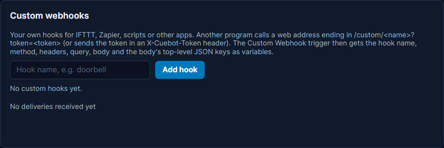

# Custom webhooks

A custom webhook is a web address you make in Cuebot. When another program visits it, an action runs. That program
can be IFTTT, Zapier, a script on another computer, a phone shortcut, or anything that can call a web address.
Example: you make a hook called `doorbell`; your smart doorbell's app calls its address, and Cuebot plays a sound and
switches OBS to your "Be right back" scene.

Like the other webhooks, the call reaches Cuebot through a **relay**: a helper on the internet, because your computer
has no public web address. If you have not set one up yet, read [Webhooks](webhooks.md) first; the shared relay takes
one tick.

## What you need

- A relay in Cuebot: the shared relay, or your own (see [Webhooks](webhooks.md)).
- A program that can call a web address (a "web request" or "HTTP request").

## Make a hook

1. In Cuebot, open **Apps > Webhooks**, tab **Services**, and scroll to **Custom webhooks**.
2. Type a short name into **Hook name, e.g. doorbell**. Use letters, digits and dashes; other characters become
   dashes.
3. Click **Add hook**. The hook appears in the list with a **token**: a secret code made just for this hook, shown
   as dots. Tick **Show** to see it (not while you are live).
4. Open the **Relay** tab. Under **Webhook URLs**, click **Copy** next to **Custom webhook**. The address ends in
   `/custom`.
5. Build your hook's full address: add `/` and the hook name, then `?token=` and the token:

    ```text
    https://hooks.techdaddydigital.com/.../custom/doorbell?token=YOUR-TOKEN
    ```

    The first part (up to `/custom`) is what you copied; it is different for everyone. Instead of `?token=`, a program
    can also send the token in a header called `X-Cuebot-Token`.

6. Give that address to the other program.



Each hook in the list has:

- **On / Off**: when off, calls to it are ignored.
- **Test**: pretends the hook was called, so you can try your actions. Nothing leaves your computer.
- **New token**: makes a new token. The old one stops working at once, so update every program that calls the hook.
- **Remove**: deletes the hook. Programs that call it stop working.

!!! warning "Treat the address like a password"
    Anyone with the full address (with the token) can start your action. Do not show it on stream. If it leaks, click
    **New token**.

## The Custom Webhook trigger

1. Make an action and add the trigger **Custom Webhooks > Custom Webhook**.
2. Type your hook's name into **Hook name**. Leave it empty to run for every hook you made.

The trigger gives you these variables:

| Variable | What it holds |
| --- | --- |
| `%hookName%` | The hook's name, like `doorbell` |
| `%method%` | How it was called: `GET`, `POST` or `PUT` |
| `%query%` | Everything after the `?` in the address (without the token) |
| `%query.NAME%` | One item from after the `?`. For `?room=kitchen`, `%query.room%` is `kitchen`. |
| `%body%` | The text that was sent along, as it came |
| `%contentType%` | What kind of text was sent, like `application/json` |
| `%headers%` | All the headers, as JSON text (without the token) |
| `%path%` | The part of the address after `/custom/`, starting with the hook name |
| `%isTest%` | True for the **Test** button |

**JSON and forms become variables by themselves.** When the body is a JSON object (text like
`{"who":"Alice","score":10}`), each top-level name becomes a variable: `%who%` is `Alice` and `%score%` is `10`. The
same works for a form (`who=Alice&score=10` with the type `application/x-www-form-urlencoded`). A value that is itself
an object or a list arrives as JSON text; use [JSON get value](../../reference/sub-actions/json.md#json-get-value) with
**Read from variable** set to that name to dig deeper. Names that Cuebot uses itself (like `body` or `method`) are never
overwritten.

The **Test** button sends `{"value1":"Hello from a custom webhook","value2":42,"value3":true,"user":{"name":"Alice"}}`,
so `%value1%` is "Hello from a custom webhook".

Full details: [Custom Webhooks triggers](../../reference/triggers/custom-webhooks.md).

## Call it from other programs

### curl (a command-line tool)

```bash
curl -X POST "https://hooks.techdaddydigital.com/.../custom/doorbell?token=YOUR-TOKEN" \
  -H "Content-Type: application/json" \
  -d '{"who":"Alice","room":"kitchen"}'
```

Your action then has `%who%` = Alice and `%room%` = kitchen. A plain visit works too:
`curl "https://.../custom/doorbell?token=YOUR-TOKEN&room=kitchen"` gives `%query.room%` = kitchen.

### IFTTT

1. In an IFTTT applet, pick any trigger ("If This").
2. For "Then That", pick **Webhooks > Make a web request**.
3. **URL**: your hook's full address with the token. **Method**: `POST`. **Content Type**: `application/json`.
4. **Body**: JSON with IFTTT's ingredients, like `{"value1":"{{TextField}}"}`. In Cuebot that is `%value1%`.

IFTTT may need a paid plan for its Webhooks service. To go the other way (Cuebot telling IFTTT something), see
[IFTTT](ifttt.md).

### Zapier

1. In a Zap, add the action **Webhooks by Zapier > POST**.
2. **URL**: your hook's full address with the token. **Payload Type**: `json`.
3. Under **Data**, add names and values. Each name becomes a variable in Cuebot.

## Examples

**Doorbell: be right back**

1. Add a hook called `doorbell`.
2. Make an action called "Doorbell"; add the trigger **Custom Webhook** with **Hook name** `doorbell`.
3. Add a sound, and the OBS sub-action that switches to your "Be right back" scene.
4. Click **Test** next to the hook to try it.

**Post what a script sends**

1. Add a hook called `announce`.
2. Make an action with the trigger **Custom Webhook**, **Hook name** `announce`, and the sub-action **Send chat message
   (any platform)** with `%text%`.
3. From your script, `POST` `{"text":"Giveaway starts in 5 minutes!"}` to the hook's address.

## Troubleshooting

The relay always answers "OK" to the caller, even when Cuebot later refuses the call. So look in Cuebot: the **Custom
webhooks** card shows the last delivery, and the **Relay** tab lists **Recent deliveries**.

| You see | What to do |
| --- | --- |
| "Enter a name (letters, digits, dashes)" | Type a hook name before **Add hook**. |
| "A hook named '...' already exists" | Pick another name, or use the existing hook. |
| **Rejected**: "The custom hook token did not match; the delivery was dropped." | The token in the address is wrong or old (after **New token**). Copy it again. |
| **NotConfigured**: "Enter the custom hook token in Cuebot to accept Custom webhook webhooks." | The name in the address does not match any hook. Check the spelling after `/custom/`. |
| **Ignored**: "Nothing to do for this event type." | The hook is switched **Off**. Switch it **On**. |
| Nothing arrives | Check that a relay is on (**Relay** tab) and that Cuebot is running: the shared relay drops calls while Cuebot is closed. The relay also refuses calls other than `GET`, `POST` and `PUT`, and bodies over 1 MB. |
| The action runs twice | The caller called twice. Each call is its own event; Cuebot only drops a delivery the relay sent twice. |

!!! warning "Partly checked"
    The relay was tried for real: a message sent to it reached Cuebot. Custom hooks are checked by Cuebot's own tests.
    See [What's experimental](../help/experimental.md).

## How it works (for the curious)

The relay passes each call to Cuebot unchanged. Cuebot reads the hook name (the first part after `/custom/`, capitals
do not matter), compares the token in a way that does not leak timing, and publishes the event. Hooks and their tokens
are stored in `webhooks.json` in your [profile folder](../help/your-data.md), with the tokens locked.
