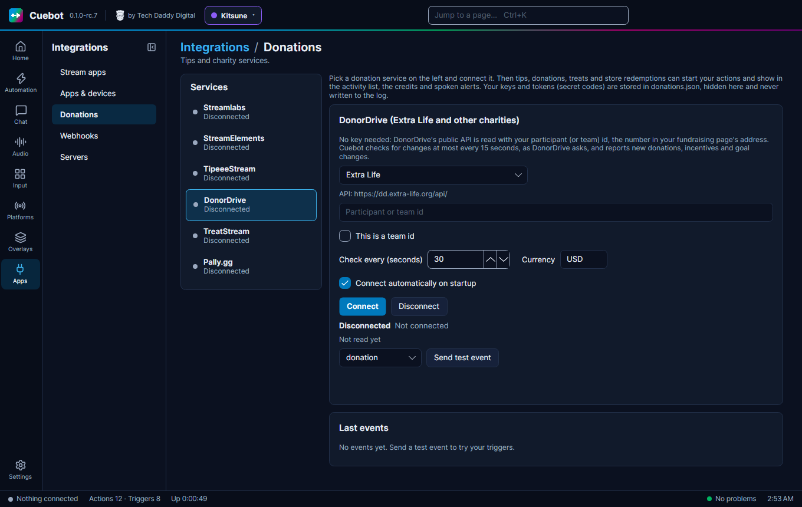

# DonorDrive (Extra Life and other charities)

DonorDrive runs the fundraising pages of many charity events, like **Extra Life**. Cuebot watches your fundraising
page, and each new donation becomes a trigger. Example: someone gives $25 to your Extra Life page, and Cuebot thanks
them in chat, plays a charity alert and updates the total on screen.

## What you need

- A fundraising page on a DonorDrive charity site (Extra Life, or another charity that uses DonorDrive).
- Your **participant id** (or **team id**): the number in your fundraising page's address. It is not a password, and
  no key or sign-in is needed.

To find the id, open your fundraising page. The address ends in something like `participantID=123456` or
`/participants/123456`: the number is your id. A team page has a team id the same way.

## Set it up

1. In Cuebot, go to **Apps > Donations** and pick **DonorDrive** on the left.
2. Pick your charity in the list: **Extra Life**, **DonorDrive test site**, or **Other DonorDrive charity (custom
   site)**. For a custom site, type the charity's web address (like `https://www.example-charity.org`) into the box
   that appears. The line below shows the address Cuebot will read, like **API: https://dd.extra-life.org/api/**.
3. Type your number into **Participant or team id**. Tick **This is a team id** if it is a team's number.
4. **Check every (seconds)**: how often Cuebot looks for new donations. 30 is the default; 15 is the fastest DonorDrive
   allows.
5. **Currency**: DonorDrive does not say which currency its amounts are in, so type it here, like `USD`.
6. Tick **Connect automatically on startup** if Cuebot should start watching by itself.
7. Click **Connect**. The status says "Watching *your page name* on dd.extra-life.org". The line below it shows your
   page, like "Kris (Extra Life 2026): 250 of 1000 USD raised, 12 donations".
8. Pick **donation** in the list and click **Send test event** to try your actions.

The first check only learns what is already there. Old donations are not replayed, so you do not get a flood of alerts
when you connect.

## What Cuebot can do

| Trigger | When it runs | Useful variables |
| --- | --- | --- |
| **Donation** | Someone donates on your page. | `%user%` ("Anonymous" if hidden), `%amount%`, `%formattedAmount%`, `%message%`, `%formattedRaised%`, `%formattedGoal%`, `%numDonations%` |
| **Incentive** | A donation picks an incentive (a reward donors can choose on your page). | the donation's variables, plus `%incentive.description%` and `%incentive.amount%` |
| **Profile updated** | Your page's numbers change, like the total raised or the goal. | `%raised%`, `%previousRaised%`, `%goal%`, `%formattedRaised%`, `%numDonations%` |
| **Connected** / **Disconnected** | Cuebot starts or stops watching. | `%service%`, `%reason%` |

The **Donation** and **Incentive** triggers have **Minimum amount**, **Maximum amount** and **Currencies**. The
**Incentive** trigger also has **Incentive description**, to run for one incentive only (typed as written on your page).

A donation also shows a **Charity donation** alert in your [alert box](../overlays/alerts.md), and goes into the
activity feed, the credits and spoken events. Full details:
[DonorDrive triggers](../../reference/triggers/donordrive.md) and the script functions
[donordrive.*](../../reference/script-functions/donordrive.md) (`donordrive.getProfile` reads the page's numbers).

## Examples

**Thank donors in chat with the new total**

1. Make an action called "Extra Life thanks".
2. Add the trigger **DonorDrive > Donation**.
3. Add the sub-action **Send chat message (any platform)** with
   `Thank you %user% for %formattedAmount%! We are at %formattedRaised% of %formattedGoal%.`
4. Click **Send test event** on the DonorDrive card to try it.

**Do the incentive**

1. On your fundraising page, make an incentive, like "Sing a song" for $20.
2. In Cuebot, make an action called "Sing incentive".
3. Add the trigger **DonorDrive > Incentive** and type `Sing a song` into **Incentive description**.
4. Add a sub-action that reminds you, like a chat message `%user% wants a song!` or a sound.

**Keep a total on screen**

1. Make an action called "Charity total".
2. Add the trigger **DonorDrive > Profile updated**.
3. Add the sub-action **OBS > Set text** for your text source, with `%formattedRaised% raised of %formattedGoal%`.

## Troubleshooting

| You see | What to do |
| --- | --- |
| "Enter your DonorDrive participant or team id first." | Type the number into **Participant or team id**. |
| "DonorDrive has no such participant or team (check the id and the charity program)" | The number is wrong, it is a team id without **This is a team id** ticked (or the other way round), or the wrong charity is picked. |
| "Enter the DonorDrive site of your charity program first" or "'...' is not a web address" | With **Other DonorDrive charity**, type the charity's web address. |
| "DonorDrive returned something other than JSON" | The custom site address is not a DonorDrive site. Check it with the charity. |
| **Reconnecting (rate limited)** | DonorDrive asked Cuebot to slow down. Cuebot waits longer between checks by itself (up to 5 minutes). Raise **Check every (seconds)** if it happens often. |
| A donation shows up late | Cuebot checks every 30 seconds by default, and DonorDrive sometimes updates its list a little later than the total. That is normal. |

!!! warning "Partly checked"
    Cuebot read a real Extra Life team through DonorDrive. But no real donation has come in through Cuebot yet. Use
    **Send test event** to check your actions, and please tell us if a real donation does not show up. See
    [What's experimental](../help/experimental.md).

## How it works (for the curious)

DonorDrive has no live feed, so Cuebot asks DonorDrive's public web API for your page every few seconds. It sends a
small "has anything changed?" tag with each request, so a check where nothing changed costs almost nothing. Only when
something changed does it read the donation list (and the incentives). Settings are saved in `donations.json` in your
[profile folder](../help/your-data.md).
