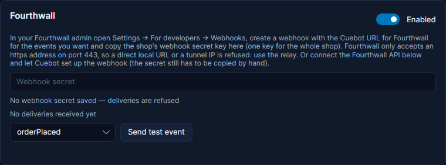
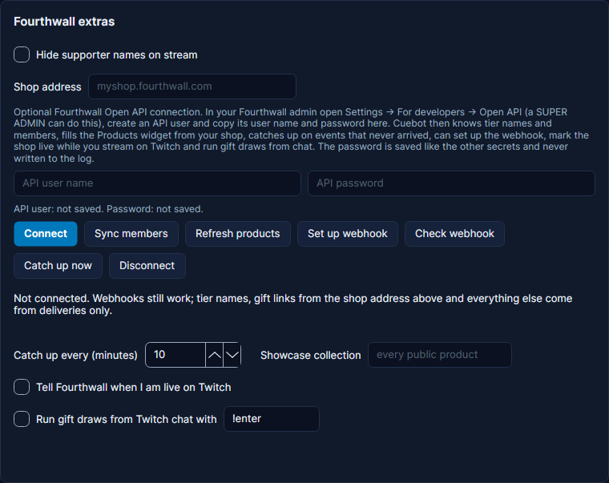

# Fourthwall

Fourthwall tells Cuebot about shop orders, donations, memberships, stream gifts, thank-yous, products, discount codes
and collections. Each one becomes a trigger, and purchases, donations and new members show up in the activity feed,
spoken events, alerts, credits, top spenders and subathon timers.

Fourthwall reaches Cuebot through a relay. Set one up first: see [Webhooks](webhooks.md).

!!! note "The relay is required"
    Fourthwall only accepts an `https` web address with a name, on the normal port (443). A local address, a port
    number or a tunnel's IP address is refused. Use the shared relay or your own.

## Set it up

1. In Cuebot, open **Apps > Webhooks**. On the **Relay** tab, click **Copy** next to **Fourthwall**.
2. In your Fourthwall admin, open **Settings > For developers > Webhooks**. Create a webhook with that address and
   tick the events you want.
3. Copy the shop's **webhook secret key**. It is one key for the whole shop.
4. Back in Cuebot, on the **Services** tab, paste it into the **Fourthwall** card and tick **Enabled**.
5. In Fourthwall, click **Send test notification**. The card shows the last delivery, and the event is marked as a
   test.

**Send test event** on the Fourthwall card makes a pretend event inside Cuebot only. There is one for every
Fourthwall trigger, including an anonymous donation.

!!! tip "Or let Cuebot set up the webhook"
    With the Fourthwall API connected (below), click **Set up webhook** under **Fourthwall extras**. Cuebot creates the
    webhook for the address on the Relay tab with every event it understands, or adds the ones missing. Fourthwall
    never gives the secret key through the API, so step 3 is still needed.

## What counts as money

Only money that really arrived counts:

- **Donations:** Fourthwall also reports donations that were started but never paid (open, abandoned, cancelled or
  failed). Those have amount 0, never show in the feed or alerts, and the **Donation** trigger skips them. Change
  **Donation status** on the trigger to run for them anyway, for example to log them.
- **Orders:** your own samples orders, and viewers claiming a stream gift or a giveaway link, are orders too. They
  have amount 0 and the **Order Placed** trigger skips them. A claimed gift shows in the feed as "redeemed a gift"
  (the gift itself already counted when it was bought). Pick another **Order kind** on the trigger to run for them.
- **Cancelled orders** stay counted in top spenders: Cuebot does not take money back out. **Order Updated** with
  **Order status** `CANCELLED` lets you react to them.

## Supporter names

A supporter may leave their name blank. Cuebot then says "Anonymous", and `%isAnonymous%` is true.

Tick **Hide supporter names on stream** under **Fourthwall extras** to show "A supporter" instead of anyone's name in
the feed, speech, alerts and `%user%`. `%fw.username%` still has the name they typed, for private use.

Emails (`%fw.email%`) are private: never put them in chat or on screen.

## Memberships

Fourthwall sends **Subscription Changed** when a member picks another tier, and also when they cancel. Use **Change**
on the trigger to run for cancellations only, everything else, upgrades or downgrades. The membership stays active to
the end of the paid period; **Subscription Expired** runs when it ends.

Fourthwall's messages name a tier only by its id. With the API connected, `%tier%` is the tier's name and the tier
filters take names. Cuebot remembers each member's last tier, so `%direction%` says upgrade or downgrade and
`%fw.previousTier%` names the old one.

`%fourthwallMemberCount%` (a global variable) counts active members. The **Goal** widget can count them too: pick
**Fourthwall members (now)**.

## Stream gifts

Fourthwall's stream gifting lets viewers buy merch for other viewers while you are live.

- **Gift Purchase** runs when someone buys gifts. It shows as a merch alert, marked as a gift. `%fw.giftUrls%` holds
  the links where winners claim them: type your shop's address into **Shop address** under **Fourthwall extras**
  (Cuebot fills it in when the API is connected).
- **Gift Draw Started** and **Gift Draw Ended** run around a draw. `%fw.winners%` lists the winners for a chat
  message.

With the API connected, Cuebot can run the draws for you instead of another bot:

1. In Fourthwall's gifting settings, pick **Open API** as the platform that runs draws. The card warns you when it is
   still set to something else.
2. Tick **Run gift draws from Twitch chat with** and choose the command (`!enter` by default).
3. Tick **Tell Fourthwall when I am live on Twitch**, so viewers can buy gifts while you stream. Cuebot sets this when
   your Twitch stream goes live and clears it when it ends.

When a draw starts, post the command in chat from the **Gift Draw Started** trigger (`%fw.entryCommand%`). Viewers
type it in Twitch chat until the draw's time is up. Cuebot then hands Fourthwall everyone who entered, and Fourthwall
picks the winners. **Gift Draw Ended** follows with the winners.

## Connect the Fourthwall API (optional)

Webhooks alone work. Connecting the API adds tier names and the member list, your shop's products in the Products
widget, catch-up of missed events, the webhook setup, the streaming status, gift draws, and these steps:
**Create Fourthwall promo code**, **End Fourthwall promo code**, **Show or hide Fourthwall product or collection**,
**Set Fourthwall streaming status**, **Get Fourthwall members**, **Get Fourthwall sales totals**,
**Create Fourthwall members post**, **Get Fourthwall thank-yous waiting**, **Send Fourthwall thank-you video**,
**Create Fourthwall giveaway links**, **Refresh Fourthwall showcase products** and **Catch up on missed Fourthwall
events**.

1. In your Fourthwall admin, open **Settings > For developers > Open API**. Only a SUPER ADMIN can do this. Create an
   API user.
2. Copy its user name and password into **Fourthwall extras** on the **Services** tab. They are hidden as dots, stored
   locked on your computer and never written to the log.
3. Click **Connect**. Cuebot shows your shop, tiers, member count and products.

Fourthwall allows 100 requests every 10 seconds. Cuebot stays far below that, and waits and tries again if Fourthwall
says it is busy. If Fourthwall refuses the user name or password, Cuebot stops asking and the card says so.

### Catch-up

A message can get lost: the relay was down, or the secret was wrong for a while. Every few minutes (**Catch up every**,
10 by default) Cuebot asks Fourthwall which events it sent, and runs the ones that never reached it. They are marked
`%isReplay%`. Tick **Skip caught-up events** on a trigger to keep, for example, a late alert off the screen; the money
still counts, and the alert box does not pop them up (see [Missed alerts](../overlays/alerts.md#missed-alerts-catch-up)). Catch-up only looks at events after you first connected, and at most 24 hours back.

### Products widget

Set the **Products** widget's **Products** option to **My Fourthwall shop**. It then shows your public products with
their pictures and prices, and "Sold out" where they are. To show only some, put a collection's short name (the end
of its web address) in **Showcase collection**. Cuebot reads the products again after every product change and every
30 minutes, or click **Refresh products**.

### Ideas

- **First 10 chatters get 20% off:** **Create Fourthwall promo code** with Max uses 10, then send `%fw.code%` in
  chat. **Promotion Status Changed** with **New status** `AllUsed` can announce that it is gone.
- **Flash drop:** **Show or hide Fourthwall product or collection** when a channel point reward is redeemed, and again
  (unticked) a few minutes later.
- **"I'm live" for members:** **Create Fourthwall members post** on Twitch **Stream online**.
- **Merch goal that survives a restart:** **Get Fourthwall sales totals** for today, then set your goal from
  `%fourthwallTotal%`.
- **Thank-you clips:** **Get Fourthwall thank-yous waiting**, save an OBS replay, then **Send Fourthwall thank-you
  video** with the file.

## Not checked with a real shop yet

Everything here was tested against Fourthwall's published examples, not a real shop. These details can only be
confirmed live: whether Fourthwall really sends unpaid donations, the exact shape of **Product Updated**, whether a
blank name arrives empty, the order kinds of samples and claimed gifts, and the gift draw flow with the Open API
platform. See [What's experimental](../help/experimental.md).
