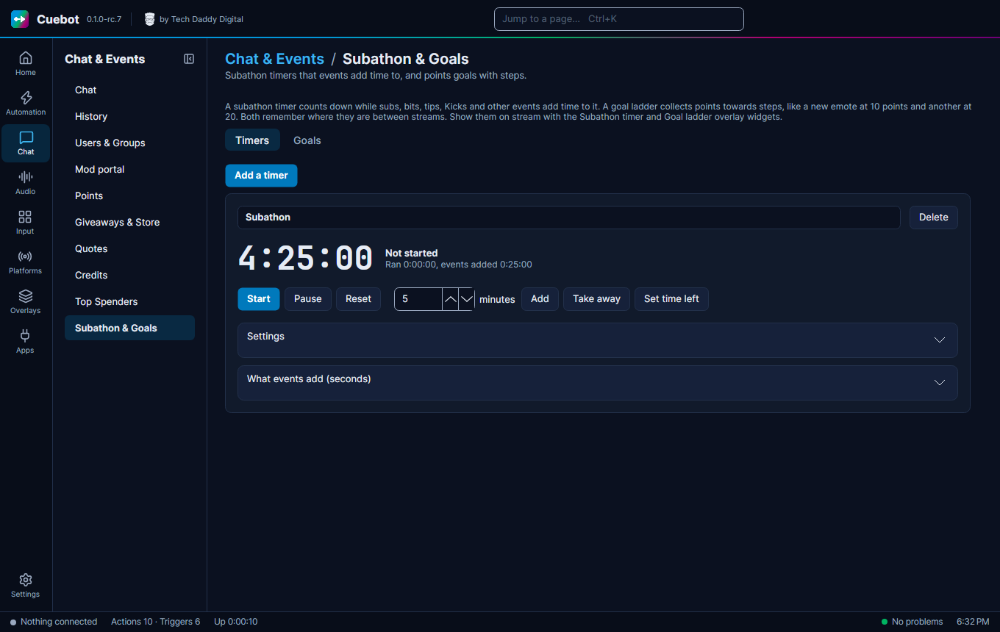

# Goals

A **goal ladder** collects points towards steps. For example: a new emote at 10 points, another at 20, a cosplay
stream at 50. Subs, bits, tips and other events add the points. It is on **Chat > Subathon & Goals**, on the **Goals**
tab.

It works on every platform you connected, and it remembers where it is between streams. You can have as many goals as
you like, each with its own name.

## Make a goal

1. Click the **Goals** tab, then **Add a goal**. Give it a name, like `Emote ladder`.
2. Under **Steps**, write each step's points and what viewers get, like `10` and `New emote`. Click **Add a step** for
   more. Cuebot keeps the steps in order by points, so you can add them in any order.
3. Open **What events add** and set what each event is worth. A new goal counts 1 point per sub.

When the points reach a step, the **Goal step reached** trigger runs once for that step. If points go down and up
again, it does not run twice. After the last step, **Goal completed** runs. **Reset to 0** (click twice) makes every
step reachable again. Tick **Start from 0 each new stream** under **Settings** to reset it by itself. A new stream is
when you go live 15 minutes or more after you went offline, so a short disconnect does not count.

## What events are worth

**What events add** works like a subathon timer's list, but in points instead of seconds: each sub, each 100 bits,
each 1 of money, each follow, each raid and each channel point reward can add points. 0 means the event does not
count. A service's own test button (like **Send test event**) never adds points. The sample events the AI assistant
sends with **emulate event** ("everything") do, so you can try a goal before the stream. The full list, and how money
is counted, is under [What events are worth](subathon-timers.md#what-events-are-worth).

Each goal also has a **Multiplier** that everything events add is multiplied by: `2` for double points, `0.5` for half.
See [the multiplier](subathon-timers.md#too-much-or-too-little-the-multiplier).

## Show it on stream

Add the **Goal ladder** widget to an overlay (see [Overlays](../overlays/overlays.md)). In its settings, type the goal's
name, or leave it empty for the first one.

The **Goal ladder** shows a bar to the next step, and a list of steps with a tick next to the ones reached.

## Commands and alerts

| You want | Use |
| --- | --- |
| `!goal` in chat | **Get a goal**, then a chat message with `%goalPoints% points. Next: %goalNextStep% at %goalNextStepPoints%` |
| An alert for each step | The **Goal step reached** trigger. `%step%` is the step's name |

Scripts can do the same with `goals.*` (see [Script functions](../../reference/script-functions/index.md)).

The [phone app](../mods/phone-app.md) shows your goals on its **Dashboard**, where you can add points or **Set points…**
by hand.
