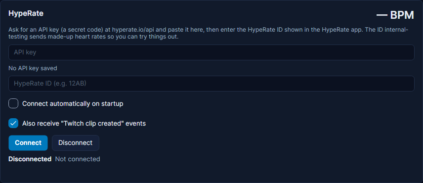

# HypeRate (heart rate)

HypeRate shows your heart rate on stream, read from a smartwatch or a chest strap through the HypeRate phone app.
Cuebot can read it live, and your heart rate becomes a value and a set of triggers. Example: when your heart rate drops
below 60 during a chill stream, Cuebot jokes "Are you still alive?" in chat.

For Pulsoid, a similar service, see [Pulsoid](pulsoid.md). Both feed the same heart-rate steps, so you can switch later
without rebuilding your actions.

## What you need

- The HypeRate app with a working sensor. The app shows your **HypeRate ID**, a short code like `12AB`.
- A HypeRate **API key**: a secret code for programs like Cuebot. You ask HypeRate for one at
  [hyperate.io/api](https://www.hyperate.io/api).

## Set it up

1. Ask for an API key at [hyperate.io/api](https://www.hyperate.io/api) and wait for HypeRate to send it.
2. In Cuebot, go to **Apps > Apps & devices**, tab **Apps & services**, and find the **HypeRate** card.
3. Paste the key into **API key**.
4. Type your **HypeRate ID (e.g. 12AB)** from the HypeRate app. Just trying things out? Type `internal-testing`:
   HypeRate then sends made-up heart rates.
5. Tick **Connect automatically on startup** if Cuebot should connect by itself every time it starts.
6. Optional: tick **Also receive "Twitch clip created" events** to hear about Twitch clips made through HypeRate.
7. Click **Connect**. The status says "Connected to HypeRate session 12AB; waiting for heart rate data", and then
   shows your heart rate. The big number at the top right of the card shows it too, like **85 BPM**.

## What Cuebot can do

| Trigger (under **HypeRate**) | When it runs | Settings |
| --- | --- | --- |
| **Every heart rate reading** | Every new reading, about once a second. Keep the action short. | none |
| **Heart rate changed** | Your heart rate moved enough. Good for a number on screen. | **Minimum seconds between runs** (5), **Minimum change (BPM)** (1) |
| **Heart rate above threshold** | Once, when you reach a number or go higher. | **Threshold (BPM)** (120), **Reset distance (BPM)** (5) |
| **Heart rate below threshold** | Once, when you drop to a number or lower. | **Threshold (BPM)** (60), **Reset distance (BPM)** (5) |
| **Twitch clip created** | A Twitch clip was made through HypeRate (needs the clip box ticked). | none |
| **Connected** / **Disconnected** | Cuebot connects, or the connection ends. | none |

The heart-rate triggers give you `%heartRate%` (beats per minute now), `%previousHeartRate%` and `%source%`
(HypeRate). **Heart rate changed** adds `%heartRateChange%`; the threshold triggers add `%heartRateThreshold%`.
**Twitch clip created** gives `%clipUrl%` and `%twitchSlug%`. **Connected** gives `%sessionId%`, the ID you watch.

**Reset distance** stops a threshold trigger firing over and over while you hover near the number: with threshold 60
and reset distance 5, it runs at 60, and can only run again after you went above 65.

| Sub-action | What it does |
| --- | --- |
| **Heart Rate > Get heart rate** | Reads your latest heart rate into `%heartRate%`, with `%heartRateAvailable%`, `%heartRateSource%` and `%heartRateAgeSeconds%`. **Source**: Latest, Pulsoid or HypeRate. |

Your heart rate is also in the global variables `%heartRate%` and `%hyperateHeartRate%` while Cuebot runs. Full
details: [HypeRate triggers](../../reference/triggers/hyperate.md),
[Heart Rate sub-actions](../../reference/sub-actions/heart-rate.md) and the script functions
[heartrate.get](../../reference/script-functions/heartrate.md) and
[hyperate.isConnected](../../reference/script-functions/hyperate.md).

## Examples

**Are you still alive?**

1. Make an action called "Still alive".
2. Add the trigger **HypeRate > Heart rate below threshold** with **Threshold (BPM)** `60`.
3. Add **Send chat message (any platform)** with `Only %heartRate% BPM... are you still alive?`

**Share HypeRate clips**

1. Tick **Also receive "Twitch clip created" events** on the HypeRate card and click **Connect** again.
2. Make an action called "Share clip" with the trigger **HypeRate > Twitch clip created**.
3. Add **Send chat message (any platform)** with `New clip: %clipUrl%`.

**A !heart chat command** works the same as on the [Pulsoid page](pulsoid.md#examples): **Get heart rate**, then a chat
message with `%heartRate%`.

## Troubleshooting

| You see | What to do |
| --- | --- |
| "Enter your HypeRate API key first." | Paste the key, then click **Connect**. |
| "Enter your HypeRate ID (shown in the HypeRate app) first." | Type the ID from the HypeRate app. |
| "HypeRate rejected the API key. Check it and click Connect." | The key is wrong or no longer valid. Copy it again from HypeRate's email. |
| "HypeRate refused to join session '...' (...). Check the ID." | The ID is wrong. Copy it again from the HypeRate app. |
| Connected, but the number stays at **— BPM** | HypeRate gets no readings: check your watch or strap and the HypeRate app. Try the ID `internal-testing` to see if Cuebot's side works. |
| **Reconnecting in ...** | The connection dropped. Cuebot tries again by itself. |

!!! warning "Not checked yet"
    HypeRate is checked by Cuebot's own tests only, built from HypeRate's documentation. It has not been tried with a
    real heart-rate sensor yet. See [What's experimental](../help/experimental.md).

## How it works (for the curious)

Cuebot opens a websocket (an always-open line) to HypeRate and joins your ID's channel. It sends a small "still here"
message every 10 seconds, as HypeRate asks, and reconnects when HypeRate stops answering. HypeRate wants the key in the
web address, so Cuebot hides it from every log line. Settings are stored in `integrations.json` in your
[profile folder](../help/your-data.md), with the key locked.
