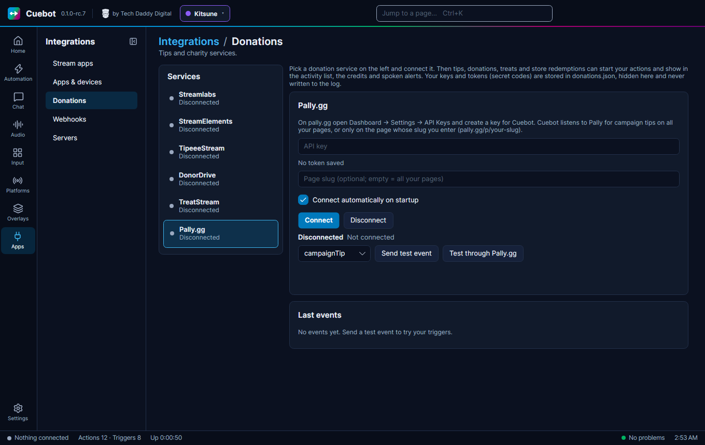

# Pally.gg

Pally.gg lets viewers tip you on a campaign page (an address like `pally.gg/p/your-page`). Cuebot listens to Pally.gg,
and each tip becomes a trigger. Example: someone tips $5 on your page, and Cuebot thanks them in chat and plays a tip
alert on your overlay.

## What you need

- A Pally.gg account with at least one page.
- A Pally.gg **API key**: a secret code that lets Cuebot hear your tips. Make one just for Cuebot.

## Set it up

1. On pally.gg, open **Dashboard > Settings > API Keys** and create a key for Cuebot. Copy it.
2. In Cuebot, go to **Apps > Donations** and pick **Pally.gg** on the left.
3. Paste the key into **API key**. Under the box it now says **Saved token:** with dots and the last few letters.
4. Optional: type a **Page slug** to hear only one page. The slug is the last part of the page address: for
   `pally.gg/p/my-charity` it is `my-charity`. Leave it empty to hear tips from all your pages.
5. Tick **Connect automatically on startup** if Cuebot should connect by itself every time it starts.
6. Click **Connect**. The status says "Connected to Pally.gg (all your pages)" or "Connected to Pally.gg (page
   my-charity)".
7. Click **Test through Pally.gg**. Cuebot asks Pally.gg's own server to send a sample tip back. In a moment it shows
   under **Last events**. This proves the real connection works. It is marked as a test (`%isTest%` = True).

**Send test event** (with **campaignTip** in the list) makes a pretend tip inside Cuebot only, without asking Pally.gg.
Use it to try your actions while you are not connected.

## What Cuebot can do

| Trigger | When it runs | Useful variables |
| --- | --- | --- |
| **Campaign tip** | Someone tips on one of your Pally.gg pages, or you press **Replay Alert** in Pally.gg. | `%user%`, `%amount%`, `%formattedAmount%`, `%message%`, `%campaignTitle%`, `%campaignUrl%`, `%tipNetAmount%`, `%isReplay%` |
| **Connected** / **Disconnected** | Cuebot connects, or the connection ends. | `%service%`, `%reason%` |

The **Campaign tip** trigger has these settings:

- **Pally page name**: only tips for one page (its slug). Empty means all pages.
- **Include replayed alerts**: see below.
- **Minimum amount**, **Maximum amount** and **Currencies**: only tips in a range.

Pally.gg sends amounts in US cents; Cuebot turns them into dollars, so `%amount%` is `5` for a $5 tip.
`%tipNetAmount%` is what you get after Pally.gg's fee.

Each tip also shows a **Tip / donation** alert in your [alert box](../overlays/alerts.md), and goes into the activity
feed, the credits and spoken events. Full details: [Pally.gg triggers](../../reference/triggers/pally-gg.md) and the
script functions [pally.*](../../reference/script-functions/pally.md).

## Replay Alert

Pally.gg's activity feed has a **Replay Alert** button. It sends an old tip again, on purpose. Cuebot then:

- runs the **Campaign tip** trigger again, with `%isReplay%` = True;
- plays the alert in the alert box again, since that is what you asked for (other services' late alerts are skipped,
  but this one is not; see [Missed alerts](../overlays/alerts.md#missed-alerts-catch-up)).

Want an alert again but not the chat thank-you? Untick **Include replayed alerts** on the **Campaign tip** trigger of
that action. Or add an [**If**](../../reference/sub-actions/logic.md#if) step that checks `%isReplay%`.

## Examples

**Thank every tipper in chat (but not on replays)**

1. Make an action called "Pally thanks".
2. Add the trigger **Pally.gg > Campaign tip** and untick **Include replayed alerts**.
3. Add the sub-action **Send chat message (any platform)** with
   `Thank you %user% for %formattedAmount% to %campaignTitle%! %message%`.
4. Click **Send test event** on the Pally.gg card to try it.

**One page, one sound**

1. Make an action called "Charity page tip".
2. Add the trigger **Pally.gg > Campaign tip** and type your page's slug into **Pally page name**.
3. Add a sound sub-action, or an OBS scene change, for tips to that page only.

## Troubleshooting

| You see | What to do |
| --- | --- |
| "Enter your Pally.gg API key first." | Paste the key into **API key**, then click **Connect**. |
| "Pally.gg rejected the API key" | The key is wrong or was deleted on Pally.gg. Make a new one and paste it. Cuebot only retries this slowly. |
| "Connect to Pally.gg first." (after **Test through Pally.gg**) | Click **Connect** first; the echo test needs a live connection. |
| **Reconnecting** ("no pong from Pally.gg", "connect timed out") | The connection dropped. Cuebot tries again by itself. |
| A tip made while Cuebot was closed never showed up | Pally.gg sends each tip only once, to whoever is connected at that moment. It has no way to send missed tips later. Use **Replay Alert** in Pally.gg if you want to show it. |

!!! warning "Not checked yet"
    Connecting to Pally.gg has not been confirmed with a real account, and no real tip has come in through Cuebot.
    Cuebot was built from Pally.gg's own documentation (its event feed is still marked Beta). Please tell us if it
    does not work. See [What's experimental](../help/experimental.md).

## How it works (for the curious)

Cuebot opens a websocket (an always-open line) to `events.pally.gg` with your key: the "firehose" channel for all your
pages, or the page's activity feed when you typed a slug. It sends `ping` after 30 seconds of silence and expects
`pong`. Pally.gg has no currency field, so Cuebot assumes US dollars. The key is stored locked in `donations.json` in
your [profile folder](../help/your-data.md) and is never written to the log.
