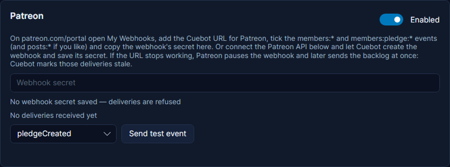
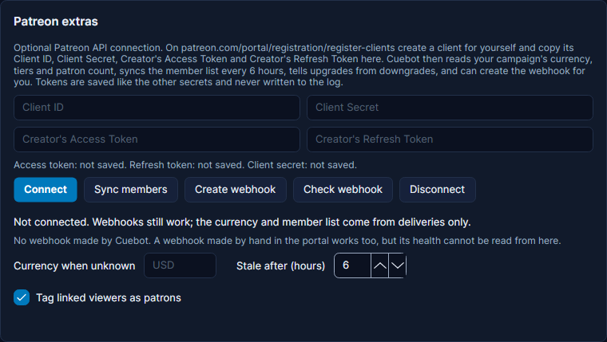

# Patreon

Patreon tells Cuebot when someone joins, pledges, changes or stops their pledge, and when you publish a post. Each one
becomes a trigger, and new patrons show up in the activity feed, spoken events, credits, top spenders and subathon
timers.

Patreon reaches Cuebot through a relay. Set one up first: see [Webhooks](webhooks.md).

## Set it up

1. In Cuebot, open **Apps > Webhooks**. On the **Relay** tab, click **Copy** next to **Patreon**.
2. Open [patreon.com/portal](https://www.patreon.com/portal) and go to **My Webhooks**. Paste the address, and tick
   the `members:*` and `members:pledge:*` events (and `posts:*` if you want post triggers).
3. Copy the webhook's **secret**.
4. Back in Cuebot, on the **Services** tab, paste it into the **Patreon** card and tick **Enabled**.
5. In the portal, click **Send Test** next to an event. The card shows the last delivery.

**Send test event** on the Patreon card makes a pretend event inside Cuebot only, so you can try actions without
Patreon.

!!! tip "Or let Cuebot set it up"
    With the Patreon API connected (below), click **Create webhook** under **Patreon extras**. Cuebot creates the
    webhook for the address on the Relay tab, with every event, and saves the secret for you.

## Connect the Patreon API (optional)

Webhooks alone work. Connecting the API adds your campaign's currency, your tier list, the patron count, the whole
member list (so patron perks survive messages that were missed), upgrade/downgrade detection and the webhook's health.

1. Open [patreon.com/portal/registration/register-clients](https://www.patreon.com/portal/registration/register-clients)
   and create a client for yourself. Any name works.
2. Copy its **Client ID**, **Client Secret**, **Creator's Access Token** and **Creator's Refresh Token** into
   **Patreon extras** on the **Services** tab. They are hidden as dots, stored locked on your computer and never
   written to the log.
3. Click **Connect**. Cuebot shows your campaign, tiers, patron count and currency.

Cuebot reads the member list again every 6 hours (or click **Sync members**). When the access token runs out, Cuebot
gets a new one with the refresh token. If Patreon refuses both, Cuebot stops asking and the card says so: paste new
tokens and click **Connect**.

## Money and currency

- `%amount%` is the pledge **per month**. A yearly pledge of $60 is `%amount%` 5. The real charge is in
  `%chargeAmount%` and `%formattedCharge%`, and `%pledgeCadence%` is 12 for yearly. The **Minimum amount** filter, the
  feed, top spenders and subathon timers all use the monthly value.
- `%currency%` is your campaign's currency. Cuebot reads it from the message, or from the API when connected. Until it
  knows, type it into **Currency when unknown**. While it is unknown, the **Currencies** filter lets every pledge
  through.

## Free members, gifts and trials

Patreon replaced "following" with free membership. The **Follow Created** trigger (Streamer.bot's name) runs when
someone joins as a free member, and for a gifted membership or a free trial (`%isGifted%`, `%isFreeTrial%`). The feed
says "joined your Patreon as a free member". **Follow Deleted** runs when someone leaves completely, free or paying.

Patreon may send "member created" twice for the same person. Cuebot runs the trigger once.

## Upgrades and downgrades

**Pledge Updated** has a **Change** setting: **Any change**, **Upgrades only** or **Downgrades only**. `%direction%`
is `upgrade`, `downgrade` or `same`, with `%previousAmount%` and `%previousTier%`. With the API connected, Cuebot reads
them from the patron's pledge history; otherwise it compares with the member list it keeps (empty if it has never seen
the patron before).

## Tiers

The **Tier** box on **Pledge Created** and **Pledge Updated** suggests your tiers once the API is connected, like
`Gold #1234567`. A picked tier is matched by its number, so renaming it on Patreon keeps your trigger working. You can
also type names with commas, like `Gold, Silver`. A tier title that itself has a comma works when it is the only one.

## Patrons who hide their identity

A patron can hide their identity on Patreon. Then `%user%` is "An anonymous patron", `%isAnonymous%` is true and
`%avatarUrl%` is empty. Their name is only in `%privateName%`: never put that on stream. Give overlays a fallback
picture for an empty `%avatarUrl%`.

## Overlay alerts

Patreon reaches the overlay [alert box](../overlays/alerts.md) without an action:

- A new paying patron (**Pledge Created**) is a **Subscriber** alert. `{name}` is the patron, the tier name and the
  monthly price come along (`tierName`, `price`, `currency`). Patreon sends both `members:create` and
  `members:pledge:create` for a new patron; only the pledge is an alert, so a join pops up once.
- An **upgrade** to a higher pledge is a **Subscriber** alert too, with `upgrade: true`, `previousTier` and
  `previousAmount` for a variation of its own. Patreon sends no message for monthly renewals, so there is no "resub";
  a downgrade is no alert.
- A free member joining (and a gifted membership or free trial, which get no pledge message) is a **Follow** alert.
- A patron who hides their identity shows as "An anonymous patron" with no picture; their real name is never sent.

Try them with **Emulate > Patreon** in the alert box's editor.

## Patron perks in chat

When a patron linked Twitch or YouTube on Patreon, Cuebot tags that viewer with user variables: `isPatron`,
`patreonTier`, `patreonStatus`, `patreonAmount` and `patreonSince`. Use them in conditions, like "if the user variable
isPatron is True". Or add **Get Patreon patron** to a chat command: it fills `%isPatron%`, `%patreonTier%` and more
for the chatter. Untick **Tag linked viewers as patrons** to turn the user variables off.

The member list (and so the tagging) is complete only with the API connected. Without it, Cuebot knows only the
patrons it got a message about.

## Totals and goals

`%patreonPatronCount%`, `%patreonPaidCount%` (patrons paying now) and `%patreonMonthly%` (their pledges per month
added up) are global variables, updated with every message and sync. **Get Patreon campaign totals** puts them in an
action. The **Goal** widget can count **Patreon paying patrons** or **Patreon monthly pledges**, with the target set
in the widget (Patreon's own goals no longer work for apps).

## Posts

**Post Published**, **Post Updated** and **Post Deleted** give `%title%`, `%url%`, `%isPaid%` and `%isPublic%`. With
the API connected, `%tierNames%` says which tiers can see it, so chat can say "new patron-only post for Gold".

## When the relay stops working

If the address Patreon sends to stops working (the relay is down, or you deleted the route), Patreon retries for up
to a week, then **pauses** the webhook. When you resume it in the portal, Patreon sends everything it held back at
once. So that this does not set off a pile of old alerts mid-stream:

- A new pledge that started and was charged longer ago than **Stale after (hours)** (6) is marked `%isStale%`. Every
  Patreon trigger has **Skip stale deliveries**, ticked by default. Stale pledges still count in the member list and
  totals, and the alert box does not pop them up (see [Missed alerts](../overlays/alerts.md#missed-alerts-catch-up)).
- With the API connected and a webhook Cuebot created, the card shows whether Patreon paused it, and **Resume
  webhook** un-pauses it. A webhook made by hand in the portal cannot be checked from Cuebot (Patreon does not allow
  it); resume it in the portal under **My Webhooks**.

## What is not checked yet

No real Patreon message has reached Cuebot yet; everything was built from Patreon's documentation and example
messages. These need a real campaign to confirm:

- whether webhook messages name the campaign's currency;
- whether a free trial also sends a "pledge created";
- the amounts Patreon sends for a yearly pledge and for a cancelled one;
- which fields are empty when a patron hides their identity;
- how far apart a repeated "member created" arrives;
- how long a creator's access token lasts.

All triggers, variables and steps: [Patreon triggers](../../reference/triggers/patreon.md) and
[Patreon sub-actions](../../reference/sub-actions/patreon.md).
