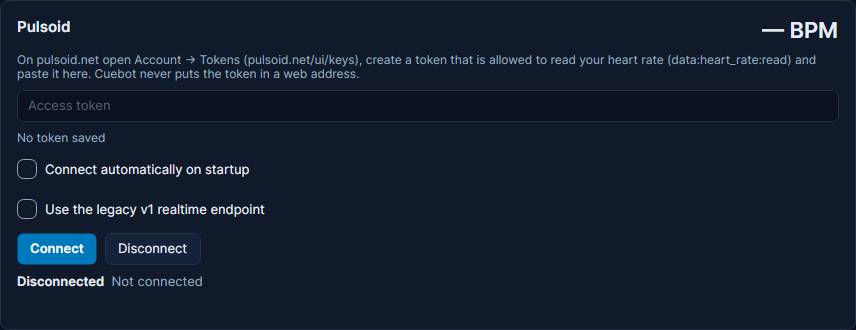

# Pulsoid (heart rate)

Pulsoid reads your heart rate from a chest strap, a smartwatch or an armband and sends it over the internet. Cuebot can
read it live, and your heart rate becomes a value and a set of triggers. Example: when your heart rate goes over 130
during a horror game, Cuebot posts "Calm down!" in chat and shows a shaking heart on screen.

For HypeRate, a similar service, see [HypeRate](hyperate.md). Both feed the same heart-rate steps, so you can switch
later without rebuilding your actions.

## What you need

- A heart-rate sensor that works with Pulsoid, set up in the Pulsoid app.
- A Pulsoid **access token**: a secret code that lets Cuebot read your heart rate. Pulsoid may ask for its paid plan
  (or its trial) to make one.

## Set it up

1. On pulsoid.net, open **Account > Tokens** ([pulsoid.net/ui/keys](https://pulsoid.net/ui/keys)) and create a new
   token. It must be allowed to read your heart rate (`data:heart_rate:read`). Copy it.
2. In Cuebot, go to **Apps > Apps & devices**, tab **Apps & services**, and find the **Pulsoid** card.
3. Paste the token into **Access token**. Under it, the card shows that a token is saved.
4. Tick **Connect automatically on startup** if Cuebot should connect by itself every time it starts.
5. Click **Connect**. The status says "Connected to Pulsoid; waiting for heart rate data".
6. Put your sensor on. The big number at the top right of the card shows your heart rate, like **85 BPM** (beats per
   minute), and the status says "Connected to Pulsoid: 85 BPM".

**Use the legacy v1 realtime endpoint**: only tick this if the normal connection does not work. It uses Pulsoid's older
way of sending your heart rate.

## What Cuebot can do

| Trigger (under **Pulsoid**) | When it runs | Settings |
| --- | --- | --- |
| **Every heart rate reading** | Every new reading, about once a second. Keep the action short. | none |
| **Heart rate changed** | Your heart rate moved enough. Good for a number on screen. | **Minimum seconds between runs** (5), **Minimum change (BPM)** (1) |
| **Heart rate above threshold** | Once, when you reach a number or go higher. | **Threshold (BPM)** (120), **Reset distance (BPM)** (5) |
| **Heart rate below threshold** | Once, when you drop to a number or lower. | **Threshold (BPM)** (60), **Reset distance (BPM)** (5) |
| **Connected** / **Disconnected** | Cuebot connects, or the connection ends. | none |

The heart-rate triggers give you `%heartRate%` (beats per minute now), `%previousHeartRate%` and `%source%` (Pulsoid).
**Heart rate changed** adds `%heartRateChange%`; the threshold triggers add `%heartRateThreshold%`.

**Reset distance** stops a threshold trigger firing over and over while you hover near the number: with threshold 120
and reset distance 5, it runs at 120, and can only run again after you dropped below 115.

| Sub-action | What it does |
| --- | --- |
| **Heart Rate > Get heart rate** | Reads your latest heart rate into `%heartRate%`, with `%heartRateAvailable%`, `%heartRateSource%` and `%heartRateAgeSeconds%`. **Source**: Latest, Pulsoid or HypeRate. |

Your heart rate is also in the global variables `%heartRate%` and `%pulsoidHeartRate%` while Cuebot runs. Full details:
[Pulsoid triggers](../../reference/triggers/pulsoid.md), [Heart Rate sub-actions](../../reference/sub-actions/heart-rate.md)
and the script functions [heartrate.get](../../reference/script-functions/heartrate.md) and
[pulsoid.isConnected](../../reference/script-functions/pulsoid.md).

## Examples

**A !heart chat command**

1. Make an action called "Heart command" with a [chat command](../chat/commands.md) `!heart`.
2. Add the sub-action **Get heart rate** (Source **Latest**).
3. Add **Send chat message (any platform)** with `My heart is at %heartRate% BPM.`

**Calm down!**

1. Make an action called "Calm down".
2. Add the trigger **Pulsoid > Heart rate above threshold** with **Threshold (BPM)** `130`.
3. Add a chat message `Whoa, %heartRate% BPM! Breathe...` and a sound.

**Heart rate on screen**

1. Make an action called "Heart rate text".
2. Add the trigger **Pulsoid > Heart rate changed** (leave 5 seconds and 1 BPM).
3. Add **OBS > Set text** for a text source, with `%heartRate% BPM`.

You can also move your VTube Studio model with it: see [VTube Studio](../apps/vtuber/vtube-studio.md).

## Troubleshooting

| You see | What to do |
| --- | --- |
| "Enter your Pulsoid access token first (pulsoid.net → Account → Tokens)." | Paste the token, then click **Connect**. |
| "Pulsoid rejected the access token (expired or revoked?). Paste a new one and click Connect." | Make a new token on pulsoid.net and paste it. |
| "Pulsoid refused the connection: the token needs the data:heart_rate:read scope." | Make a new token and tick the heart-rate read permission. |
| Connected, but the number stays at **— BPM** | Pulsoid gets no readings: check your sensor and the Pulsoid app. Readings of 0 (no skin contact) are ignored. |
| **Reconnecting in ...** | The connection dropped. Cuebot tries again by itself. |

!!! warning "Not checked yet"
    Pulsoid is checked by Cuebot's own tests only, built from Pulsoid's documentation. It has not been tried with a
    real heart-rate sensor yet. See [What's experimental](../help/experimental.md).

## How it works (for the curious)

Cuebot opens a websocket (an always-open line) to Pulsoid and sends the token in a header, so it never appears in a web
address or a log. Readings outside 1 to 299 BPM are ignored. Settings are stored in `integrations.json` in your
[profile folder](../help/your-data.md), with the token locked.
