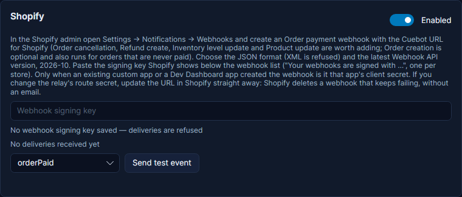
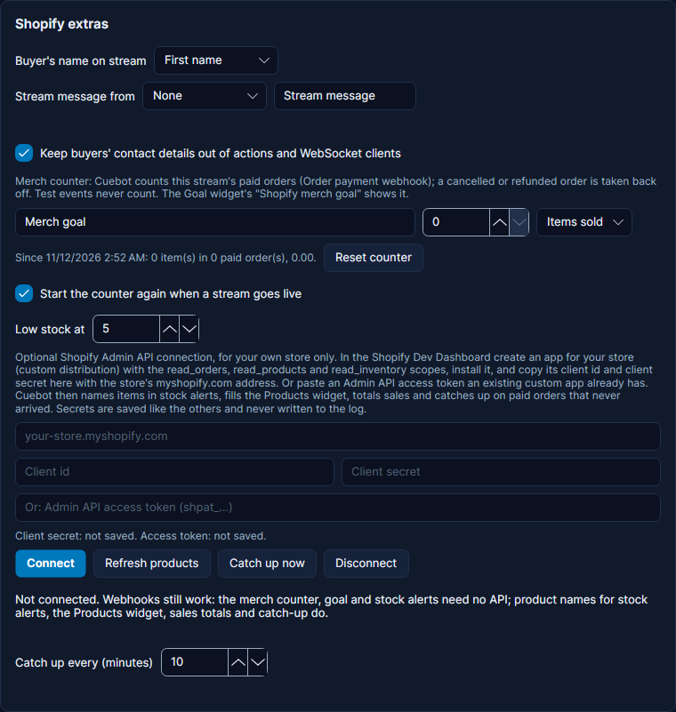

# Shopify

Shopify tells Cuebot about orders in your store: paid, created, cancelled and refunded orders, and stock running low.
Each one becomes a trigger. Paid orders show up in the activity feed, spoken events, merch alerts and top spenders,
and Cuebot keeps a merch counter and goal for the stream.

Shopify reaches Cuebot through a relay. Set one up first: see [Webhooks](webhooks.md).

## Set it up

1. In Cuebot, open **Apps > Webhooks**. On the **Relay** tab, click **Copy** next to **Shopify**.
2. In the Shopify admin, open **Settings > Notifications > Webhooks** and click **Create webhook**.
3. Pick the event **Order payment**, the format **JSON**, paste the address, and pick the newest **Webhook API
   version** (the Shopify card in Cuebot names it, for example 2026-10). Save.
4. Do the same for the other events you want (same address, format and version):
    - **Order cancellation** and **Refund create**: take cancelled and refunded orders back off the merch counter and
      goal.
    - **Inventory level update**: Low Stock, Sold Out and Restocked alerts.
    - **Product update**: refreshes the Products widget straight away (needs the API, below).
    - **Order creation** is optional. It also runs for orders that are never paid (bank deposit, cash on delivery,
      cancelled), so someone could set off an alert without paying. Celebrate on **Order Paid**.
5. Below the webhook list, Shopify shows the key your webhooks are signed with ("Your webhooks are signed with ..."). It
   is one key for the whole store. Copy it into the **Shopify** card on the **Services** tab and tick **Enabled**.
6. Click **Send test** next to the webhook in Shopify. The card shows the last delivery with its API version, and the
   event is marked as a test.

**Send test event** on the Shopify card makes a pretend event inside Cuebot only. There is one for every Shopify
trigger.

!!! note "Signing key or client secret?"
    Webhooks you create in the admin are signed with the store's key from step 5. Only a webhook that an app created
    itself (an existing custom app, or a Dev Dashboard app) is signed with that app's client secret instead. New custom
    apps can no longer be made in the Shopify admin.

!!! note "Two stores"
    Each store has its own key. A delivery from another store is refused, and the card names the store it came from.

!!! warning "Shopify deletes a webhook that keeps failing"
    If the address stops working, Shopify retries for a few hours and then **deletes the webhook**, without an email.
    This happens if you change your own relay's route secret, or delete the route. Update the address in Shopify
    straight away after such a change. If no Shopify delivery arrives for a week, **Shopify extras** says so: check
    the webhook is still there.

## Keep the Webhook API version current

Shopify releases a new API version every three months and supports each one for a year. When a version is retired,
Shopify quietly sends a newer one instead, and a field your actions read (`%shopify.<field>%`) could change.

The Shopify card's last delivery line shows the version your webhook uses. When it has under three months left, or is
already retired, the card and the log say so: edit the webhook in Shopify, pick the newest version and check your
actions. Cuebot's own arguments (`%user%`, `%amount%`, `%items%` and the others below) cope with old and new shapes.

## Privacy

Orders hold your buyers' personal details. Cuebot's defaults keep them off stream:

- **The order note is never read out.** The checkout's note is where buyers write delivery instructions: gate codes,
  "leave it at the back door", phone numbers. `%message%` is empty by default. Under **Shopify extras**, **Stream
  message from** can take it from a cart attribute instead: add a "Stream message" field to your cart (a cart
  attribute) and buyers can leave a message meant for the stream. Pick **Order note** only if your checkout asks for a
  stream message there. `%orderNote%` always has the note, for actions that need it (never show it on stream).
- **First names only.** `%user%` (feed, speech, alerts) is the buyer's first name. **Buyer's name on stream** can
  show the full name, or "Someone" for everyone. `%firstName%` always has the first name.
- **Contact details stay out.** **Keep buyers' contact details out of actions and WebSocket clients** (on by default)
  removes email, phone, addresses, IP address, browser details, the order note and the order-status link from the
  `%shopify.*%` arguments, `%_json%` and what Cuebot's Streamer.bot-compatible WebSocket server sends to other apps.
  Untick it only if an action really needs them.

## What you get in an order

Every order trigger has `%user%`, `%amount%`, `%currency%`, `%formattedAmount%`, `%orderName%` (like #1001), `%items%`
and `%itemCount%`, plus:

- `%item0.name%`, `%item0.variant%` (size or colour, like M / Black), `%item0.quantity%`, `%item0.sku%`: the first
  item; `item1` is the second, and so on. Overlays can show "M / Black".
- `%discountCodes%`: the codes used, for "thanks for using my code" shout-outs.
- `%financialStatus%` (paid, pending ...), `%sourceName%` (web, pos ...), `%presentmentAmount%` (in the buyer's
  currency).
- `%orderUrl%`: the order in your Shopify admin, for a message only mods see.
- `%shopDomain%`, `%apiVersion%`, `%triggeredAt%`, and every field of the order as `%shopify.<field>%`, like
  Streamer.bot.

**Order Paid**, **Order Created**, **Order Cancelled** and **Refund Created** can be limited to a product (**Product
name contains**, which also matches sizes and colours), a **SKU** or a **Discount code**. So a hoodie can play a
different alert from a sticker, and your creator code can get its own thank-you. **Order Created** can also be limited
to a **Payment status**.

Shopify sends each event at least once and in no set order: **Order Created** can arrive after **Order Paid**. Cuebot
shows an order once in the feed (`%isRepeatOrder%` on the second one, also after a restart), and runs each paid order,
cancellation and refund only once, even if you made two webhooks for the same event.

## Merch counter and goal

Cuebot counts this stream's merch from **Order Paid**: items, orders and money, per product. A cancelled order or a
refund (with those webhooks set up) comes back off. Test events never count.

- Under **Shopify extras**, set a **Goal title**, a target and whether it counts **Items sold** or **Revenue**. The
  **Goal** widget's **Shopify merch goal** shows it, and **Merch Goal Reached** runs once when it is reached.
- **Start the counter again when a stream goes live** is on by default. **Reset counter** does it by hand.
- Steps: **Get Shopify merch counter** (for a `!merch` command: `%shopifySalesItems%`, `%shopifyTopProduct%`,
  `%shopifySalesProductsText%`), **Reset Shopify merch counter** and **Set Shopify merch goal**.

Top spenders and the credits are not changed by a cancellation or refund: Cuebot's spending list only adds.

## Stock alerts

With the **Inventory level update** webhook, Cuebot follows each item's stock across your locations:

- **Low Stock** runs once when it falls to **Low stock at** (5 by default) or below: "Only 3 left!"
- **Sold Out** runs once when none are left. **Restocked** runs when it comes back.

Shopify's stock message only has the item's id. With the API connected, `%item%`, `%productName%`, `%variantName%` and
`%sku%` name it; without it, filter on the inventory item id (`%inventoryItemId%`).

## Connect the Shopify API (optional)

Webhooks alone work. Connecting the Admin API adds names in stock alerts, your products in the Products widget, sales
totals from Shopify, catch-up of paid orders that never arrived, and the steps **Get Shopify sales totals**, **Get
Shopify products**, **Refresh Shopify products** and **Catch up on Shopify orders**.

1. In the Shopify **Dev Dashboard**, create an app for your own store (custom distribution) with the scopes
   `read_orders`, `read_products` and `read_inventory`, and install it on the store.
2. Under **Shopify extras**, type the store's address (`your-store.myshopify.com`) and paste the app's **client id**
   and **client secret**. Already have an older custom app with an Admin API access token (`shpat_...`)? Paste that
   instead.
3. Click **Connect**. Cuebot shows your store and products.

Cuebot gets a token with the client id and secret (it lasts 24 hours and Cuebot renews it) and only reads. The secret
and tokens are hidden as dots, stored with your other secrets and never written to the log. If Shopify refuses them,
Cuebot stops asking and the card says so. When Shopify is busy, Cuebot waits and tries again.

### Catch-up

The shared relay drops what arrives while Cuebot is closed, and a webhook can fail for a while. Every few minutes
(**Catch up every**, 10 by default) Cuebot asks Shopify for paid orders and runs **Order Paid** for those that never
arrived, marked `%isReplay%`. Tick **Skip caught-up orders** on the trigger to keep a late alert off screen; the order
still counts, and the alert box does not pop them up (see [Missed alerts](../overlays/alerts.md#missed-alerts-catch-up)). Catch-up only looks at orders after you first connected, and at most 24 hours back.

### Products widget

Set the **Products** widget's **Products** option to **My Shopify store**. It shows your active products with pictures
and prices, and "Sold out" where they are. Cuebot reads them again after a **Product update** webhook and every 30
minutes, or click **Refresh products**.

## Not available

Shopify's newer "Events" (a replacement for webhooks) need a Shopify app built with Shopify's own tools, so Cuebot
uses classic webhooks, which keep working. Cuebot does not create webhooks through the API: the admin webhooks above
are signed with your store's key, which keeps the setup simple.

## Not checked with a real store yet

Everything here was tested against Shopify's published examples and a pretend Shopify, not a real store. These can
only be confirmed live: a real paid order through the relay, the admin's exact wording and version list, whether
**Send test** marks itself as a test, whether names reach admin webhooks on every Shopify plan, how quickly Shopify
deletes a failing webhook, and the API connection with a real Dev Dashboard app. See
[What's experimental](../help/experimental.md).
