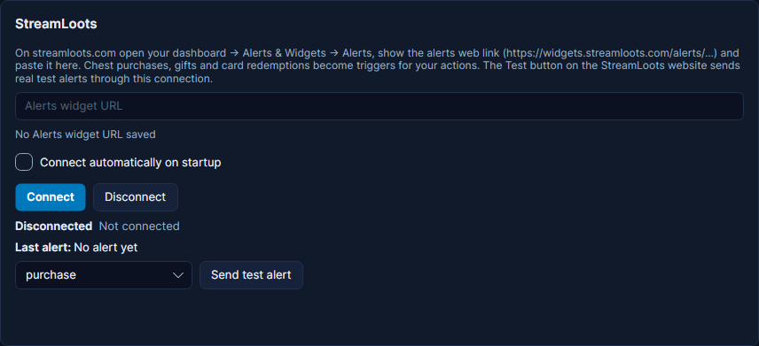

# StreamLoots

StreamLoots lets viewers buy **chests** (packs of cards) and play the **cards** on your stream, like "Hydrate" or "Play
with no HUD for 5 minutes". Cuebot listens to your StreamLoots alerts, and each purchase, gift and card becomes a
trigger. Example: a viewer plays the card "Hydrate", and Cuebot plays a gulping sound and shows a water bottle in OBS.

## What you need

- A StreamLoots account with a card collection.
- Your **Alerts widget URL**: the private web address of your StreamLoots alerts. StreamLoots has no other way for
  apps to connect, so this is what Cuebot uses.

## Set it up

1. On streamloots.com, open your dashboard and go to **Alerts & Widgets > Alerts**. Show the alerts web link (it starts
   with `https://widgets.streamloots.com/alerts/`) and copy it.
2. In Cuebot, go to **Apps > Apps & devices**, tab **Apps & services**, and find the **StreamLoots** card.
3. Paste the link into **Alerts widget URL**. It stays hidden as dots.
4. Tick **Connect automatically on startup** if Cuebot should connect by itself every time it starts.
5. Click **Connect**. The status says "Connected to the StreamLoots alerts stream; waiting for alerts".
6. On the StreamLoots website, use its **Test** button for alerts. That real test alert comes through this connection,
   and the card shows it after **Last alert:**.

StreamLoots accepts any alert id, even a wrong one, so "Connected" does not prove the link is right. The Test button on
the StreamLoots website does.

**Send test alert** (pick **purchase**, **gift**, **communityGift** or **redemption**) makes a pretend alert inside
Cuebot only, so you can try your actions. Nothing is sent to StreamLoots.

!!! warning "Treat the link like a password"
    Anyone with your Alerts widget URL can watch your alerts. Do not show it on stream.

## What Cuebot can do

| Trigger (under **StreamLoots**) | When it runs | Useful variables |
| --- | --- | --- |
| **Card redeemed** | A viewer plays a card. This is where the card's fun effect happens. | `%user%`, `%cardName%`, `%cardDescription%`, `%cardRarity%`, `%message%` |
| **Pack purchased** | A viewer buys chests. | `%user%`, `%quantity%`, `%message%` |
| **Pack gifted** | Someone gifts chests, to one viewer or to the community. | `%user%`, `%quantity%`, `%giftee%`, `%communityGift%` |
| **Other alert (e.g. reactions)** | Any other StreamLoots alert. | `%user%`, `%alertType%`, `%alertMessage%` |
| **Connected** / **Disconnected** | Cuebot connects, or the connection ends. | `%service%`, `%reason%` |

Settings that narrow a trigger down:

- **Card redeemed**: **Card names** (one or more, with commas) and **Rarity** (common, rare, epic, legendary).
- **Pack purchased** / **Pack gifted**: **Minimum chests**. **Pack gifted** also has **Include community gifts (random
  viewers)**.
- **Other alert**: **Alert types**.

Played cards go into the activity feed as redemptions, so they reach the credits. Purchases and gifts show as "3
chests": StreamLoots sends no money amount.

| Sub-action | What it does |
| --- | --- |
| **StreamLoots > Send test event** | Makes a pretend alert from an action: purchase, gift, communityGift or redemption. |

Full details: [StreamLoots triggers](../../reference/triggers/streamloots.md),
[StreamLoots sub-actions](../../reference/sub-actions/streamloots.md) and the script functions
[streamloots.*](../../reference/script-functions/streamloots.md).

## Examples

**One action per card**

1. Make an action called "Card: Hydrate".
2. Add the trigger **StreamLoots > Card redeemed** and type `Hydrate` into **Card names**.
3. Add a sound, an OBS source that shows a water bottle, a wait, and hide it again.
4. The pretend card from **Send test alert** has its own name, so it does not match `Hydrate`. To try this action,
   empty **Card names** for a moment, or use **Test trigger…** on the Actions page with `cardName=Hydrate`.

**Thank chest buyers**

1. Make an action called "Chest thanks".
2. Add the trigger **StreamLoots > Pack purchased**.
3. Add **Send chat message (any platform)** with `Thank you %user% for %quantity% chests!`

**Legendary moment**

1. Make an action with **StreamLoots > Card redeemed**, **Rarity** `legendary`.
2. Add a big sound and a [Show alert](../../reference/sub-actions/overlays.md#show-alert) step with **Message**
   `%user% played %cardName%!`.

## Troubleshooting

| You see | What to do |
| --- | --- |
| "Paste your StreamLoots Alerts widget URL first." or "No Alerts widget URL saved" | Paste the link, then click **Connect**. |
| "That does not look like a StreamLoots Alerts widget URL or alert id." | Copy the link again from **Alerts & Widgets > Alerts**. |
| "StreamLoots did not accept the alert id. Copy the Alerts widget URL again and click Connect." | The link is wrong. Copy it again. |
| **Reconnecting in ...** ("no data or keep-alive for 95 s") | StreamLoots went quiet. Cuebot reconnects by itself. |
| Connected, but the StreamLoots test alert never arrives | The link belongs to another account, or was renewed. Copy it again. |
| A card plays but the action does not run | Check the spelling in **Card names**, and the **Rarity** setting. |

!!! warning "Partly checked"
    Cuebot connected to StreamLoots for real. But no real card or chest has come in yet. See
    [What's experimental](../help/experimental.md).

## How it works (for the curious)

The link holds your alert id. Cuebot opens the same live event stream that StreamLoots' own alert overlay uses (a
"server-sent events" stream: a web page that never finishes loading and adds a line for each alert). StreamLoots sends
a keep-alive every 30 seconds; after 95 seconds of silence Cuebot reconnects. Alerts sent while Cuebot was offline are
not sent again. The link is stored locked in `integrations.json` in your [profile folder](../help/your-data.md).
