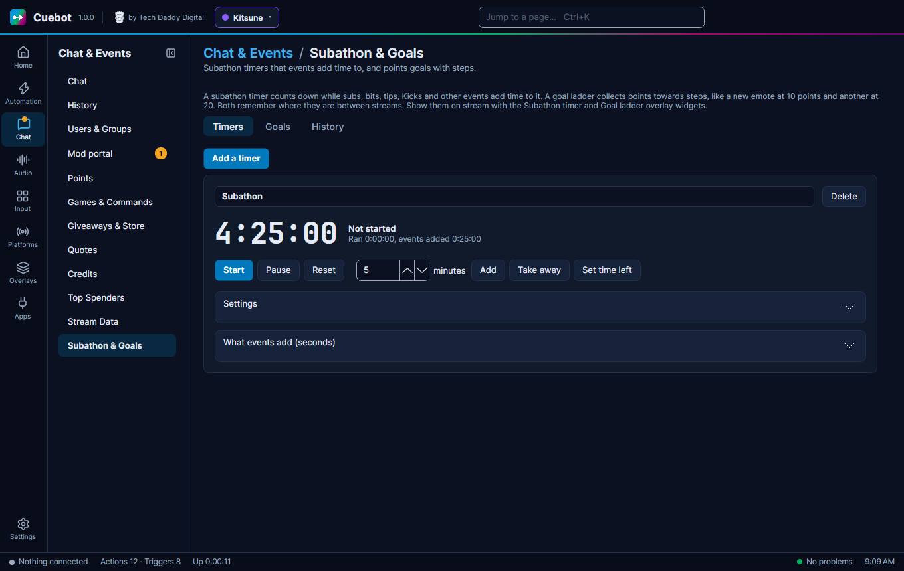
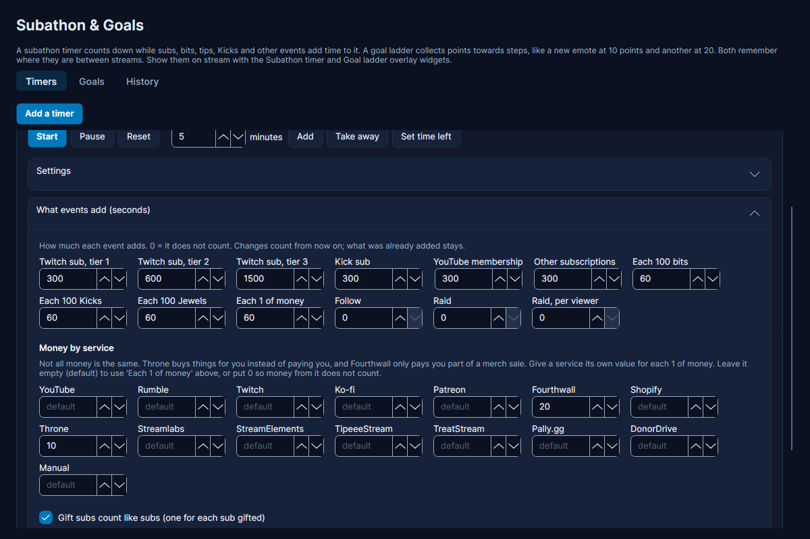
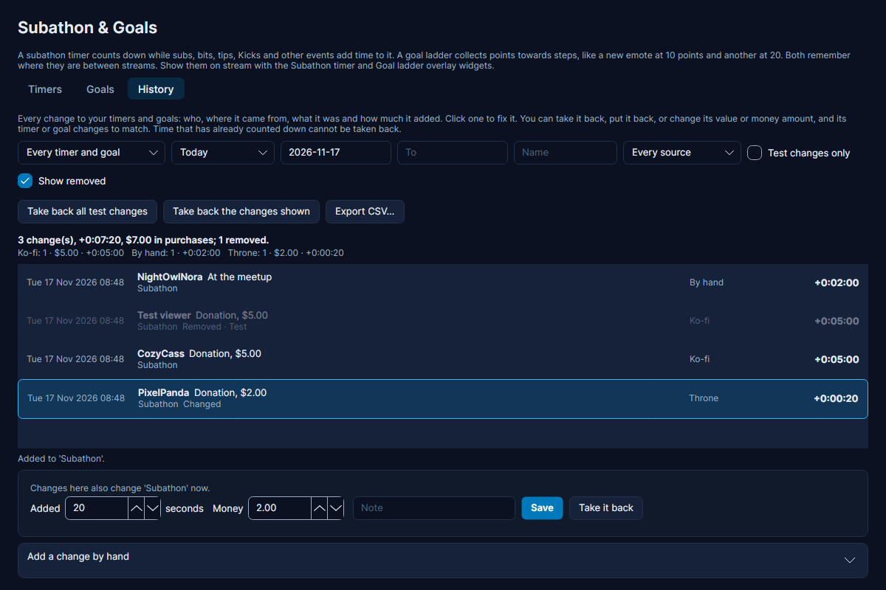

# Subathon timers

A **subathon timer** counts down. Subs, bits, tips, Kicks and other events add time to it. When it reaches
`0:00:00`, the subathon is over. People also call this a donothon or a marathon timer. It is on
**Chat > Subathon & Goals**, on the **Timers** tab.

It works on every platform you connected, and it remembers where it is between streams. You can have as many timers as
you like, each with its own name. The same page also has [goals](goals.md): a ladder of steps that events add points to.

## Make a timer

1. Click **Add a timer**. Give it a name.
2. Open **Settings**. Set the **Starting length**, like 240 minutes for 4 hours.
3. Open **What events add** and set what each event is worth (see [below](#what-events-are-worth)).
4. Click **Start**.

The buttons under the clock work at any time: **Start** (also carries on after a pause), **Pause**, **Reset** (click
twice), and **Add**, **Take away** or **Set time left** with the number of minutes next to them.

## What events are worth

Every timer and every goal has its own list under **What events add**. A timer's list is in seconds. A goal's list is
in points. 0 means the event does not count.

| Event | What the number is for |
| --- | --- |
| Twitch sub, tier 1, 2 and 3 | Each sub or resub |
| Kick sub, YouTube membership | Each sub or membership |
| Other subscriptions | Each sub that comes without a price, like Rumble's. Ko-fi, Patreon and Fourthwall memberships come with a price, so they count as money |
| Gift subs | Count like subs, one for each sub gifted. Untick **Gift subs count like subs** to leave them out |
| Each 100 bits, Kicks or Jewels | 500 bits count 5 times |
| Each 1 of money | Tips, Super Chats, Super Stickers, rants, donations and shop orders. A service can have its own number (see [below](#money-by-service)) |
| Follow | Each new follower |
| Raid, and Raid per viewer | A raid of 25 viewers counts *Raid* + 25 × *Raid per viewer* |
| Channel point rewards | One reward per line, like `Add a minute = 60` |

Money is counted in your currency from the [Top spenders](../chat/top-spenders.md) settings. A €5 Super Chat counts
as its value in your currency, with the exchange rate of that stream. Charity donations only count when **Count
charity donations** is ticked there. Test events from a platform or donation site (their test buttons) never count.
Sample events you send from Cuebot itself (the AI assistant's **emulate event** with "everything") do count, so you can
try your timers and goals before the stream; they are shown as tests in the activity feed.

You can change any number at any time, even in the middle of a subathon. The new numbers count from then on. Time and
points already added stay as they are.

### Money by service

Not every dollar is the same to you:

- **Throne** doesn't pay you. A viewer buys you something from your wishlist.
- **Fourthwall** and **Shopify** sell your merch, and you only keep part of each sale.
- A **Ko-fi** or **Streamlabs** donation is money in your pocket.

So under **Money by service** every service has its own box:

- **Empty box:** money from that service uses **Each 1 of money**.
- **A number:** money from that service uses that number instead.
- **0:** money from that service doesn't count at all.

For example: **Each 1 of money** is `60` (a minute per dollar), **Throne** is `30` and **Fourthwall** is `20`. A $10
donation adds 10 minutes, a $10 Throne gift adds 5 minutes, and a $10 hoodie sale adds a bit over 3 minutes.

**Manual** is money you add yourself on the [Top spenders](../chat/top-spenders.md) page, like cash at a meetup.

### Too much or too little: the multiplier

Each timer and goal has a **Multiplier**. Everything events add is multiplied by it:

- `2` is a double-time happy hour.
- `0.5` halves what events add, when the timer is filling up too fast.
- `1` is normal.

The **Set a subathon timer's multiplier** sub-action changes it from an action. For example, a Stream Deck button
can start a happy hour, and a second action can end it an hour later with a **Delay**.

## History: see and fix what added time

The **History** tab lists every change to your timers and goals, newest first. For each one you see:

- who it was
- where it came from (Twitch, Throne, Ko-fi... or **By hand** for a change you made)
- what it was, like `Wishlist gift, $10.00`
- how much time or how many points it added

### Look at a day, a week, a month or a year

Pick a timer or goal, then a period: **Today**, **This week**, **This month** or **This year**. Or type your own dates
in **From** and **To**, like `2026-11-01` and `2026-11-30`. You can also pick a name or a source.

The line above the list adds it all up. It shows how many changes there were, how much time they added, and how much
money came in, with a total for each source. **Export CSV…** saves what the list shows as a spreadsheet for your
records.

### Fix a mistake

Click a change, then:

- **Take it back:** its time comes off the timer and it stops counting in the totals. Use this for a chargeback, a
  refund or a test that slipped in. It stays in the list, faded, so you can still see it.
- **Put it back:** undoes **Take it back**.
- **Added:** type the right number of seconds (or points for a goal) and click **Save**. The timer moves by the
  difference.
- **Money:** type the right amount and click **Save**. The time follows at the same rate. A $50 entry that was really
  $5 then adds a tenth of the time.
- **Note:** write why, like `Refunded`. The note shows in the list and in the CSV.

**Take back all test changes** removes every test and sample event at once. **Take back the changes shown**
removes everything the list shows, like everything from one person on one day (it asks you to click twice).

Two things to know:

- **Time that has already counted down can't come back.** If a $10 donation added 10 minutes and only 4 are left,
  taking it back takes off those 4. The note says so.
- **A reset starts a new run.** After **Reset**, changes from before it stay in the list for your records, but fixing
  them doesn't move the clock any more. The list marks them **Before the last reset**.

### Add something Cuebot didn't see

Open **Add a change by hand** at the bottom of the History tab. Pick the timer or goal, type the seconds or points
(a negative number takes away), and add a name and a note, like `Cash at the meetup`. It's listed like any other
change.

The AI assistant can do all of this too: ask it "how much did Throne add to the donothon this week?" or "take back
the test donations".

## Settings

- **Longest in total** stops the subathon from going on forever. With 24 hours, the time already run plus the time
  left can never pass 24 hours. Extra time is not added. 0 means no limit.
- **Start or carry on when I go live** starts the timer, or carries on after a pause, when a platform goes live.
- **Pause when my stream ends** pauses it when your last live platform goes offline.
- **Events add time while it is paused** lets events count while the timer is paused. Untick it to count only while it
  runs. A timer that has not started, or has ended, never takes event time.

## Closing Cuebot

If Cuebot closes while a timer runs, the timer is frozen. When Cuebot opens again it is paused, with the time it had
when Cuebot closed. After a crash it has the time from its last save, at most 10 seconds earlier, so a crash never
takes time away. If **Start or carry on when I go live** is ticked, it carries on when you go live.

## When time is up

The timer stops at `0:00:00` and the **Timer ended** trigger runs. Use it to end the stream, for example with the OBS
**Streaming** sub-action set to stop, or to thank everyone. Adding time by hand to an ended timer brings it back, paused.
**Start** on an ended timer starts over from the starting length.

The [phone app](../mods/phone-app.md) shows an ended timer as **Ended**, and its **Start** button starts it over too.

## Show it on stream

Add the **Subathon timer** widget to an overlay (see [Subathon timer widget](../overlays/widgets/subathon-timer.md)). In its settings, type the
timer's name, or leave it empty for the first one.

The **Subathon timer** shows the time left, and a `+5:00` that floats up when time is added. It says **Paused** when
paused.

## Commands and alerts

| You want | Use |
| --- | --- |
| `!timer` in chat | **Get a subathon timer**, then **Send chat message** with `%subathonFormatted% left!` |
| An alert when time is added | The **Time added** trigger. `%formattedSeconds%` is like `+0:05:00` |
| Time from your own event | The **Add time to a subathon timer** sub-action, in any action |
| A mod-only pause | A command that runs **Start, pause or reset a subathon timer** with **Pause or resume** |

Scripts can do the same with `subathon.*` (see [Script functions](../../reference/script-functions/index.md)).
