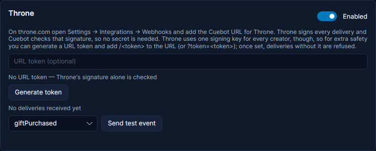

# Throne

Throne is a wishlist site: viewers buy you things from your list, or chip in towards an expensive item. Throne tells
Cuebot about each gift, and each one becomes a trigger. Example: a viewer buys you a new headset from your Throne
wishlist, and Cuebot thanks them in chat with the item's name.

Throne reaches Cuebot through a **webhook**: a small message Throne sends to a web address. Your computer has no public
web address, so the message goes through a **relay** first. If you have not set one up yet, read
[Webhooks](webhooks.md) first; the shared relay takes one tick.

## What you need

- A Throne account with a wishlist.
- A relay in Cuebot: the shared relay, or your own (see [Webhooks](webhooks.md)).
- No secret: Throne signs every message, and Cuebot already knows how to check that signature.

## Set it up

1. In Cuebot, open **Apps > Webhooks**, tab **Relay**. Make sure a relay is on (for example, tick **Use the shared
   relay**).
2. Under **Webhook URLs**, click **Copy** next to **Throne**.
3. On throne.com, open **Settings > Integrations > Webhooks**. Add a webhook and paste the address.
4. In Cuebot, on the **Services** tab, make sure the **Throne** card is **Enabled**.
5. On Throne's webhook page, click the test button. In Cuebot the Throne card shows "Last delivery ... Handled", and
   the gift appears under **Last events**.

**Send test event** (with **giftPurchased**, **contributionPurchased** or **giftCrowdfunded** in the list) makes a
pretend gift inside Cuebot only, so you can try your actions without Throne. It has `%isTest%` = True. Throne's own test
button carries no test mark, so it runs your actions like a real gift.

### Extra safety: a URL token (optional)

Throne uses the same signing key for every creator. So a message signed by Throne for someone else would also pass the
check. To make sure only *your* Throne webhook gets in, add a URL token:

1. On the **Throne** card, click **Generate token**. Cuebot shows a random token (a secret code).
2. In Throne, change the webhook address: add `/` and the token at the end, like `.../throne/abc123`. (`?token=abc123`
   works too.)
3. From now on, messages without the token are refused.

Clicking **Generate token** again makes a new one, and the old one stops working: update the address in Throne
straight away. Without a token the card says "No URL token — Throne's signature alone is checked".

## What Cuebot can do

| Trigger | When it runs | Useful variables |
| --- | --- | --- |
| **Gift Purchased** | Someone buys an item from your wishlist. | `%user%`, `%item%`, `%amount%`, `%formattedAmount%`, `%message%`, `%throne.isSurpriseGift%` |
| **Contribution Purchased** | Someone pays part of an item's price. | `%user%`, `%item%`, `%amount%` (their part), `%formattedAmount%`, `%message%` |
| **Gift Crowdfunded** | Several people together paid an item in full. | `%item%`, `%amount%`, `%formattedAmount%` |

Every Throne trigger also has `%currency%`, `%throne.itemThumbnailUrl%` (a picture of the item), `%isAnonymous%` and
`%isTest%`. An anonymous gifter's name is "Anonymous". **Gift Purchased** and **Contribution Purchased** have
**Minimum amount**, **Maximum amount** and **Currencies**.

Gifts and contributions go into the activity feed as tips, so they reach the credits and spoken events. Cuebot's
alert box does not show Throne gifts by itself; add a [Show alert](../../reference/sub-actions/overlays.md#show-alert)
step to an action if you want one. Full details: [Throne triggers](../../reference/triggers/throne.md).

## Examples

**Thank the gifter**

1. Make an action called "Throne thanks".
2. Add the trigger **Throne > Gift Purchased**.
3. Add the sub-action **Send chat message (any platform)** with `Thank you %user% for the %item%! %message%`.
4. Click **Send test event** on the Throne card to try it.

**An alert for each gift**

1. Make an action called "Throne alert".
2. Add the trigger **Throne > Gift Purchased**.
3. Add the sub-action **Show alert** with **Design** `tip`, **Name** `%user%`, **Message**
   `bought %item% from my wishlist!`, **Amount** `%amount%` and **Currency** `%currency%`.

**Celebrate a finished crowdfund**

1. Make an action called "Crowdfund done".
2. Add the trigger **Throne > Gift Crowdfunded**.
3. Add a chat message `Together you got me the %item%! Thank you all!` and a sound.

## Troubleshooting

Look at the **Last delivery** line on the Throne card, or **Recent deliveries** on the **Relay** tab.

| You see | What to do |
| --- | --- |
| "No deliveries received yet" after Throne's test | Check that a relay is on, and that the address in Throne is exactly the one from **Copy** (plus your token, if you made one). |
| **Rejected**: "The Throne signature (or the Cuebot URL token) did not match; the delivery was dropped." | The URL token is missing or old: copy the address again and add the current token. A message much older than 10 minutes is refused too. |
| **Ignored**: "Throne is switched off." | Switch the Throne card to **Enabled**. |
| **Ignored**: "Duplicate delivery (already handled)." | Throne sent the same gift twice; Cuebot ran it once. Nothing to do. |
| Gifts made while Cuebot was closed are missing | The shared relay drops messages while Cuebot is closed. [Your own relay](webhooks.md#or-your-own-relay) keeps them for 24 hours. |

!!! warning "Partly checked"
    The relay was tried for real, and Cuebot checks Throne's documented message format and signature. But no real
    message from Throne has come in yet. See [What's experimental](../help/experimental.md).

## How it works (for the curious)

Throne signs each message with Ed25519 (a kind of digital signature) over the time it was sent and the message itself.
Cuebot has Throne's public key built in and checks every message with it, and refuses one signed more than 10 minutes
before it arrived. Each gift has an id, and Cuebot remembers ids for two days, so a gift sent twice runs once. The
optional URL token is stored locked in `webhooks.json` in your [profile folder](../help/your-data.md).
