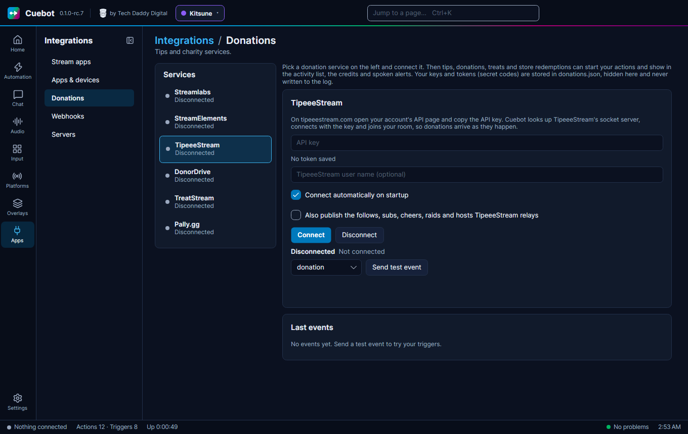

# TipeeeStream

TipeeeStream is a tip site for streamers: viewers send you money with a message. Cuebot listens to your TipeeeStream
account, and each donation becomes a trigger. Example: someone donates 5 euros, and Cuebot thanks them in chat and
shows a tip alert on your overlay.

## What you need

- A TipeeeStream account.
- Its **API key**: a secret code that lets Cuebot hear your donations. You find it on your account's API page.

## Set it up

1. On tipeeestream.com, open your account's **API** page and copy the **API key**.
2. In Cuebot, go to **Apps > Donations** and pick **TipeeeStream** on the left.
3. Paste the key into **API key**. Under the box it now says **Saved token:** with dots and the last few letters.
4. Optional: type your TipeeeStream name into **TipeeeStream user name**. Leave it empty if connecting works without
   it.
5. Tick **Connect automatically on startup** if Cuebot should connect by itself every time it starts.
6. Click **Connect**. The status line says **Connected** and "Connected to TipeeeStream (Socket.IO v2)".
7. Pick **donation** in the list and click **Send test event**. It appears under **Last events**, and your actions
   run (with `%isTest%` = True). Nothing is sent to TipeeeStream.

**Also publish the follows, subs, cheers, raids and hosts TipeeeStream relays**: TipeeeStream also passes on what
happens on Twitch or YouTube. Leave this off if Cuebot already hears Twitch or YouTube directly, or each follow runs
your actions twice.

## What Cuebot can do

| Trigger | When it runs | Useful variables |
| --- | --- | --- |
| **Donation** | Someone donates through TipeeeStream. | `%user%`, `%amount%`, `%currency%`, `%formattedAmount%`, `%message%`, `%fees%` |
| **Relayed follow / subscription / cheer / raid / host** | TipeeeStream passes one on (only with the "Also publish..." box ticked). | `%user%`, `%months%`, `%bits%`, `%viewers%` |
| **Connected** / **Disconnected** | Cuebot connects, or the connection ends. | `%service%`, `%reason%` |

The **Donation** trigger has **Minimum amount**, **Maximum amount** and **Currencies**, so one action can thank small
tips and another can do something big for large ones. Cuebot does not convert currencies.

Each donation also shows a **Tip / donation** alert in your [alert box](../overlays/alerts.md), and goes into the
activity feed, the credits and spoken events. Full details:
[TipeeeStream triggers](../../reference/triggers/tipeeestream.md) and the script functions
[tipeeestream.*](../../reference/script-functions/tipeeestream.md).

## Examples

**Thank every donor in chat**

1. Make an action called "TipeeeStream thanks".
2. Add the trigger **TipeeeStream > Donation**.
3. Add the sub-action **Send chat message (any platform)** with
   `Thank you %user% for the %formattedAmount%! %message%`.
4. Click **Send test event** on the TipeeeStream card to try it.

**A big moment for big tips**

1. Make an action called "Big tip".
2. Add the trigger **TipeeeStream > Donation** and set **Minimum amount** to `50`.
3. Add what you like: an OBS scene change, a sound, a [Show alert](../../reference/sub-actions/overlays.md#show-alert)
   with a special design.

## Troubleshooting

| You see | What to do |
| --- | --- |
| "Enter your TipeeeStream API key first." | Paste the key into **API key**, then click **Connect**. |
| "TipeeeStream rejected the API key. Copy it again from your TipeeeStream account (API)." | The key is wrong or was changed. Copy it again and click **Connect**. |
| **Reconnecting** (with a reason) | The connection dropped. Cuebot tries again by itself, waiting a little longer each time (up to a minute). |
| Follows or subs run twice | Untick **Also publish the follows, subs...**. |
| The test works but real donations do not arrive | Check that the key belongs to the TipeeeStream account that gets the donations. To test the whole way, use TipeeeStream's own "simulate alert" button: it arrives like a real donation, with `%isSimulation%` = True. |

!!! warning "Not checked yet"
    Connecting to TipeeeStream has not been confirmed with a real account, and no real donation has come in through
    Cuebot. Cuebot was built from TipeeeStream's own documentation and its example messages. Please tell us if it
    does not work. See [What's experimental](../help/experimental.md).

## How it works (for the curious)

Cuebot first checks the key with TipeeeStream's web API, so a wrong key gives a clear error instead of endless
retries. Then it asks TipeeeStream which server to use, opens a Socket.IO connection (an always-open line that
TipeeeStream pushes messages through) and joins your room. The key is stored locked in `donations.json` in your
[profile folder](../help/your-data.md) and is never written to the log.
