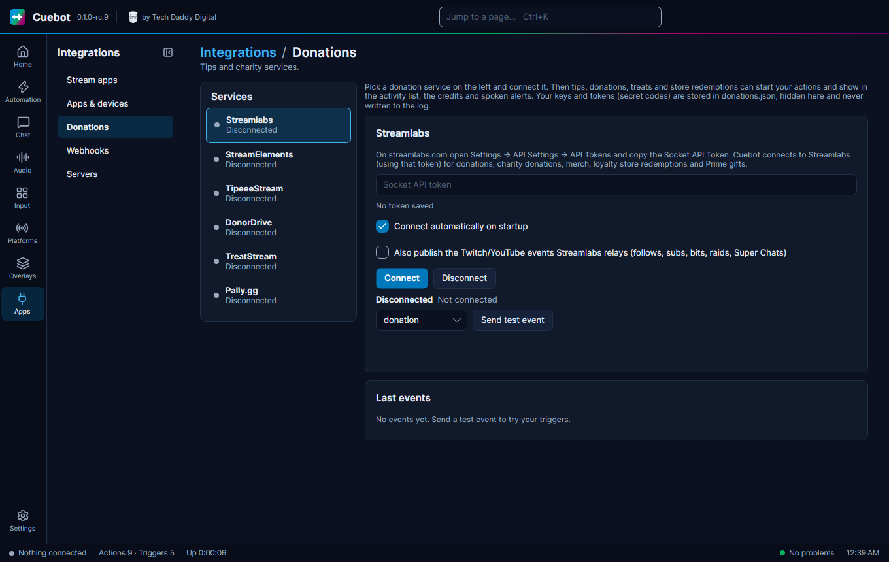

# Tips and donations

Cuebot can hear about tips, donations and purchases, and turn each one into a trigger. Example: someone tips $5 on
Streamlabs, and Cuebot thanks them in chat and shows an alert. Keys and tokens you type in are hidden on screen,
stored locked (encrypted) on your computer, and never written to the log.

## Connect a service

Go to **Apps > Donations**. Pick a service on the left.

| Service | What to paste |
| --- | --- |
| **Streamlabs** | On streamlabs.com open **Settings > API Settings > API Tokens** and copy the **Socket API Token** (or connect your own Streamlabs app, which fills it in). See [Streamlabs](streamlabs.md). |
| **StreamElements** | On streamelements.com click your avatar (top right), choose your channel name, pick the channel and copy the **JWT token** (it belongs to that one platform account). See [StreamElements](streamelements.md). |
| **TipeeeStream** | The **API key** from your TipeeeStream account's API page. |
| **Pally.gg** | On pally.gg open **Dashboard > Settings > API Keys** and make a key for Cuebot. |
| **DonorDrive (Extra Life and other charities)** | No key: the charity site's address and your **Participant or team id** (the number in your fundraising page's address). |
| **TreatStream** | Nothing to paste: click **Sign in with TreatStream** and allow Cuebot in your browser. |

Then:

1. Click **Connect**.
2. Tick **Connect automatically on startup**.
3. Click **Send test event** to check that your actions react.

Each tip then starts triggers (look in the [trigger reference](../../reference/triggers/index.md) under the service's
name), and shows up in your alerts, credits and spoken events.

Pressing **Replay Alert** in Pally.gg's activity feed sends the tip again with `%isReplay%` = True. Cuebot's alert box
plays it again, since that is what you asked for. Untick **Include replayed alerts** on the **Campaign tip** trigger if
your actions should not run again.

!!! warning "Partly checked"
    Streamlabs and StreamElements connected for real, and DonorDrive read a real Extra Life team. But no real tip or
    donation has come in through Cuebot yet. Use **Send test event** to check your actions, and please tell us if a
    real tip does not show up. See [What's experimental](../help/experimental.md).

Streamlabs can do more too (alert box control, the wheel, jar and credits, media share, loyalty points and fetching
donations missed while the connection was down) once you connect your own Streamlabs app: see [Streamlabs](streamlabs.md).

Tips only arrive while you are live on StreamElements (and on YouTube only for public streams). StreamElements also
does much more in Cuebot (tip moderation, going live, session data, its chatbot, store, contests and song
requests): see [StreamElements](streamelements.md).

Ko-fi, Patreon, Throne, Fourthwall and Shopify work differently: they send webhooks. See [Webhooks](webhooks.md).
