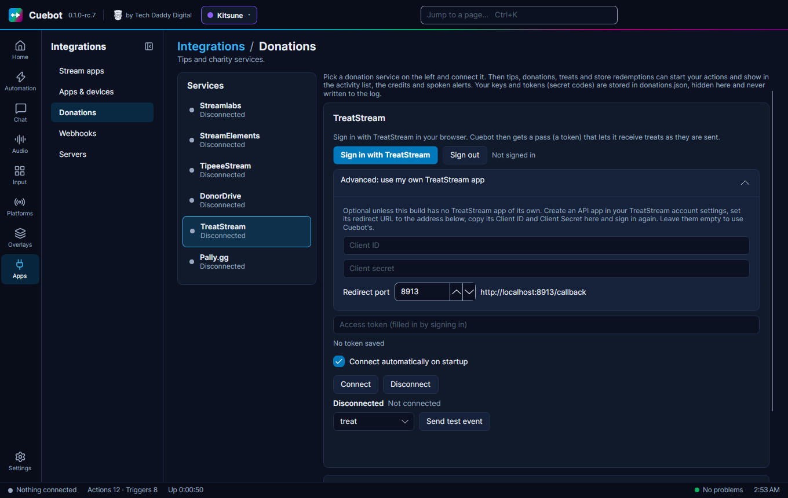

# TreatStream

TreatStream lets viewers send you a real treat, like a pizza or a coffee, delivered to your door. Cuebot listens to
TreatStream, and each treat becomes a trigger. Example: a viewer sends you a pizza, and Cuebot thanks them in chat and
shows a tip alert that says "Pizza".

## What you need

- A TreatStream account.
- A web browser on the same computer, to sign in once.
- Maybe your own TreatStream "API app" (see [Your own TreatStream app](#your-own-treatstream-app)). Some builds of
  Cuebot have one built in, some do not.

## Set it up

1. In Cuebot, go to **Apps > Donations** and pick **TreatStream** on the left.
2. Look at **Advanced: use my own TreatStream app**. If it is open when you first come here, this build of Cuebot has
   no TreatStream app of its own: set up your own first (next section), then come back.
3. Click **Sign in with TreatStream**. Your browser opens TreatStream. Log in there and allow Cuebot.
4. The browser shows "Cuebot is signed in to TreatStream. You can close this tab." In Cuebot, next to the buttons, it
   says **Signed in (token valid until** *date***)**, and Cuebot connects by itself.
5. The status line says **Connected** and "Connected to TreatStream".
6. Pick **treat** in the list and click **Send test event** to try your actions. Nothing is sent to TreatStream.

Tick **Connect automatically on startup** so Cuebot connects every time it starts. The **Access token** box fills in
by itself when you sign in; you normally never type there. **Sign out** forgets the sign-in on this computer.

Cuebot renews the sign-in by itself before it runs out (about every 10 days), so you only sign in again if TreatStream
says no.

## Your own TreatStream app

An **API app** is a small entry in your TreatStream account that lets a program like Cuebot sign in. If this build of
Cuebot has none built in, you make your own:

1. On treatstream.com, open your account settings and create an **API app**.
2. Set its **Redirect URL** to the address Cuebot shows next to **Redirect port**, like
   `http://localhost:8913/callback`. (A **port** is the door number a program listens on. Change it in Cuebot only if
   another program already uses 8913, and then change the Redirect URL to match.)
3. Copy the app's **Client ID** and **Client Secret** into the boxes under **Advanced: use my own TreatStream app**.
4. Click **Sign in with TreatStream** again.

Leave both boxes empty to use Cuebot's own app, when this build has one.

## What Cuebot can do

| Trigger | When it runs | Useful variables |
| --- | --- | --- |
| **Treat** | A viewer sends you a treat. | `%user%`, `%treat%` (like "Pizza"), `%message%`, `%receiver%`, `%senderType%` (like Twitch) |
| **Authenticated** | Cuebot has signed in to TreatStream. | `%service%` |
| **Connected** / **Disconnected** | Cuebot connects, or the connection ends. | `%service%`, `%reason%` |

The **Treat** trigger has a **Treat** box: type `Pizza` to run only for pizzas. Leave it empty for any treat.

TreatStream sends no money amount, only the treat. So a treat shows a **Tip / donation** alert in your
[alert box](../overlays/alerts.md) with the treat as its text, and the credits list the treat under tips. Full details:
[TreatStream triggers](../../reference/triggers/treatstream.md) and the script functions
[treatstream.*](../../reference/script-functions/treatstream.md).

## Examples

**Thank for every treat**

1. Make an action called "Treat thanks".
2. Add the trigger **TreatStream > Treat**.
3. Add the sub-action **Send chat message (any platform)** with `Thank you %user% for the %treat%! %message%`.
4. Click **Send test event** on the TreatStream card to try it.

**Pizza party**

1. Make an action called "Pizza party".
2. Add the trigger **TreatStream > Treat** and type `Pizza` into **Treat**.
3. Add a sound or an OBS scene change just for pizzas.

## Troubleshooting

| You see | What to do |
| --- | --- |
| "This build has no TreatStream app of its own; enter the Client ID and Client Secret of your TreatStream API app under Advanced." | Set up [your own TreatStream app](#your-own-treatstream-app). |
| "Enter the Client Secret of your TreatStream API app under Advanced, or clear its Client ID to use Cuebot's." | You typed a Client ID but no secret. Add the secret, or empty the Client ID. |
| "Could not listen on http://localhost:8913/ for the TreatStream sign-in (...)" | Another program uses that port. Pick another **Redirect port**, and change the Redirect URL in your TreatStream app to match. |
| "The TreatStream sign-in timed out. Try again." | You did not finish in the browser in time. Click **Sign in with TreatStream** again. |
| "Sign-in was cancelled on TreatStream." | You clicked no in the browser. Sign in again and allow Cuebot. |
| "The sign-in response did not match this request (state mismatch). Please try again." | An old browser tab answered. Close it and sign in again. |
| "TreatStream rejected the access token. Sign in again." | The sign-in ran out or was taken back. Click **Sign in with TreatStream**. |
| "Sign in to TreatStream first (or paste an access token)." | You clicked **Connect** before signing in. |

!!! warning "Not checked yet"
    Signing in and connecting to TreatStream has not been confirmed with a real account, and no real treat has come
    in through Cuebot. Cuebot was built from TreatStream's own documentation. Please tell us if it does not work. See
    [What's experimental](../help/experimental.md).

## How it works (for the curious)

Signing in uses OAuth: your browser asks TreatStream for permission, TreatStream sends the browser back to
`http://localhost:<port>/callback`, where Cuebot is listening, and Cuebot gets a pass (a token). With that pass it asks
TreatStream for a "socket token" and opens a Socket.IO connection (an always-open line) to TreatStream's server, which
pushes each treat as it happens. The tokens are stored locked in `donations.json` in your
[profile folder](../help/your-data.md) and are never written to the log.
