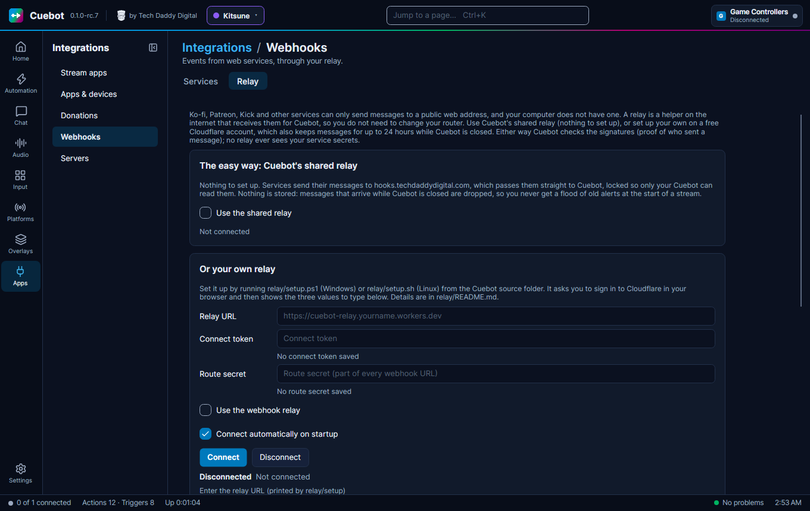
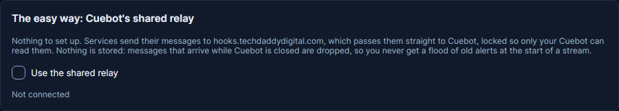
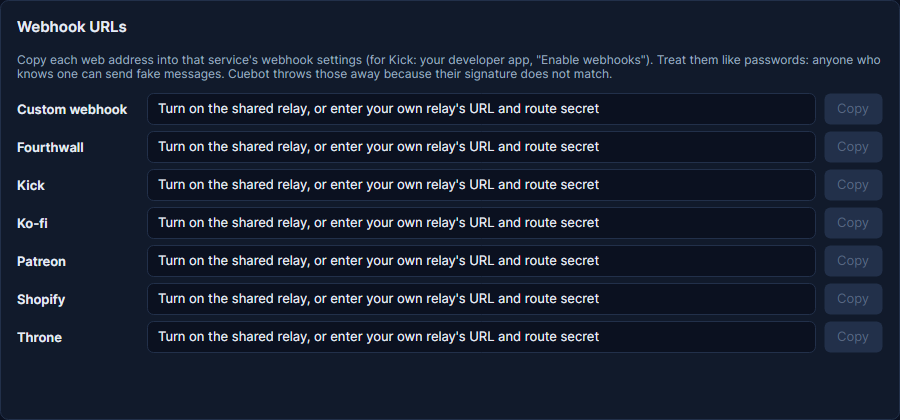
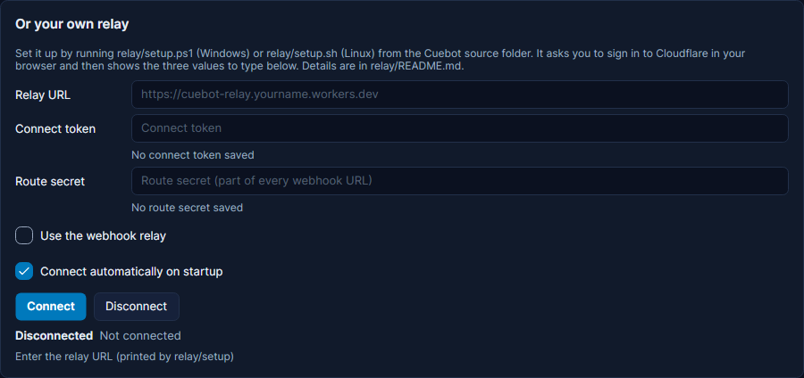
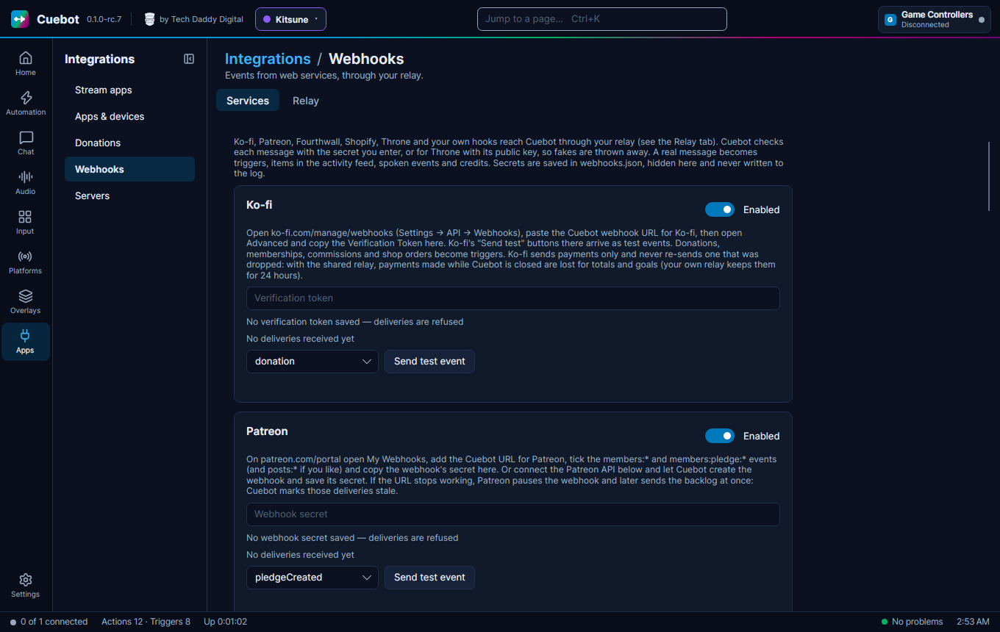

# Webhooks: Ko-fi, Patreon, Throne and more

Ko-fi, Patreon, Throne, Fourthwall and Shopify can tell Cuebot about tips, memberships, gifts and orders, and each one
becomes a trigger. Example: someone tips $5 on Ko-fi, and Cuebot thanks them in chat and shows an alert. This page
explains how those messages reach Cuebot, and links to each service's own page. For Streamlabs, StreamElements and the
other tip sites, see [Tips and donations](tips-and-donations.md).

Some services do not "call" Cuebot directly. Instead they send a **webhook**: a small message to a web address. Your
computer has no public web address, so these services need a helper in between, called a **relay**. You can use
Cuebot's shared relay, which needs no setup, or set up your own.

**Apps > Webhooks** has two tabs:

- **Services**: **Ko-fi**, **Patreon**, **Fourthwall**, **Shopify**, **Throne**, and **Custom webhooks** for anything
  else (IFTTT, Zapier, your own scripts).
- **Relay**: chooses the shared relay or connects Cuebot to your own, and lists the **Webhook URLs** to give each
  service.

## The easy way: the shared relay

On the **Relay** tab, tick **Use the shared relay**. That is all. Under **Webhook URLs**, click **Copy** next to each
service and paste the address into that service's webhook settings.

The shared relay passes each message straight to your Cuebot, locked so that only your Cuebot can read it. It stores
nothing. A message that arrives while Cuebot is closed is dropped, so you never get a flood of old alerts at the start
of a stream. If you want missed messages delivered later, set up your own relay instead.

!!! note "Patreon pauses a webhook it cannot deliver"
    The relay always accepts messages, so Patreon is happy while it works. If the address stops working (the relay is
    down, or the route was deleted), Patreon retries for up to a week and then pauses the webhook. Resuming it sends
    everything held back at once; Cuebot marks old pledges stale so alerts can skip them. See [Patreon](patreon.md).

!!! note "Fourthwall can catch up"
    Fourthwall keeps a list of the events it sent. With the Fourthwall API connected, Cuebot checks that list every few
    minutes and runs the events that never arrived. See [Fourthwall](fourthwall.md).

!!! note "Shopify can catch up, and deletes failing webhooks"
    With the Shopify API connected, Cuebot asks Shopify for paid orders every few minutes and runs those that never
    arrived. Shopify deletes a webhook whose address keeps failing (without an email), so after changing your own
    relay's route secret, update the address in Shopify straight away. See [Shopify](shopify.md).

!!! warning "Dropped means gone for Ko-fi"
    Ko-fi does not send a payment again, and has no way to look it up later. A Ko-fi payment made while Cuebot is
    closed is missing from your totals, goals, subathon timers and credits for good. Your own relay keeps it for 24
    hours instead. See [Ko-fi](ko-fi.md).

## Or: your own relay

Your own relay is a tiny program that runs on **your own free Cloudflare account**. The services send their messages to the
relay. Cuebot picks them up from there. While Cuebot is closed, the relay keeps them (up to 500 messages, for at most
24 hours) and hands them over when Cuebot comes back.

!!! note "This part is a bit technical"
    You need the Cuebot source folder from GitHub and a free Cloudflare account. If that sounds like too much, you can
    skip webhooks; everything else in Cuebot works without them.

1. Run `relay/setup.ps1` (Windows) or `relay/setup.sh` (Linux) from the Cuebot source folder. It asks you to sign in
   to Cloudflare in your browser.
2. At the end it shows three values. Type them into the **Relay** tab: **Relay URL**, **Connect token** and **Route
   secret**.
3. Untick **Use the shared relay** if it is on. Tick **Use the webhook relay** and click **Connect**.
4. Under **Webhook URLs**, click **Copy** next to each service and paste the address into that service's webhook
   settings.

The full steps are in the
[relay instructions](https://github.com/TechDaddyKB/cuebot/blob/main/relay/README.md).

!!! warning "Treat webhook addresses like passwords"
    Anyone who knows one could send fake messages. Cuebot checks every message with the service's secret (for Throne,
    with Throne's signature) and throws fakes away, but keep the addresses private anyway.

## Turning on a service

On the **Services** tab, each service has a card: switch it to **Enabled**, enter the secret or token the service
gives you, and click **Send test event** to try your actions. Each service's page has the exact steps:

| Service | What it sends | What you enter in Cuebot | Page |
| --- | --- | --- | --- |
| **Ko-fi** | Donations, memberships, commissions, shop orders | The **Verification Token** | [Ko-fi](ko-fi.md) |
| **Patreon** | New, changed and ended memberships, posts | The webhook's **secret** (or connect the Patreon API) | [Patreon](patreon.md) |
| **Fourthwall** | Donations, orders, memberships, stream gifts | The **webhook secret key** | [Fourthwall](fourthwall.md) |
| **Shopify** | Paid orders, cancellations, refunds, stock changes | The store's **signing key** | [Shopify](shopify.md) |
| **Throne** | Wishlist gifts, contributions, crowdfunded gifts | Nothing (optional URL token) | [Throne](throne.md) |
| **Custom webhooks** | Anything another program sends | A hook name (Cuebot makes the token) | [Custom webhooks](custom-webhooks.md) |

Each card shows its last delivery ("Last delivery 20:15:02: Handled ..."). The **Relay** tab lists **Recent
deliveries** with what happened to each one:

| Result | Meaning |
| --- | --- |
| **Handled** | Checked and turned into triggers. |
| **Ignored** | Checked, but nothing to do: the service is switched off, a duplicate, or a kind of message Cuebot does not use. |
| **Rejected** | The secret or signature did not match. Probably not from the service, so it was thrown away. |
| **NotConfigured** | No secret entered yet in Cuebot, so the message could not be checked. |
| **Failed** | The message could not be read. |

Fourthwall only accepts an `https` address with a name on the normal port, so a direct local address or a tunnel's IP
is refused: use the relay.

Going the other way, Cuebot can also *send* to a web service: see [IFTTT](ifttt.md), and the Discord **Basic
webhook** step in [Discord bot](discord-bot.md).

!!! warning "Partly checked"
    The relay was tried for real: a message sent to it reached Cuebot. Each service's own example messages were
    checked too. But no real message from Ko-fi, Patreon, Throne, Fourthwall or Shopify has come in yet. See
    [What's experimental](../help/experimental.md).
