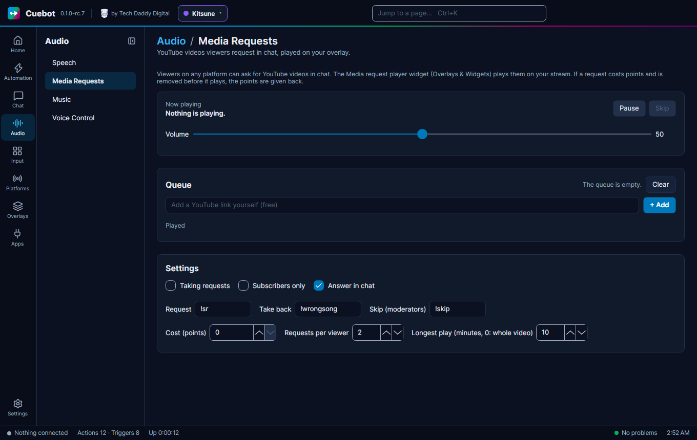

# Media requests

**Audio > Media Requests** lets viewers ask for YouTube videos in chat. The videos play on your stream, one after
another, in an overlay. Want Spotify songs instead? See [Song requests](song-requests.md).

## Set it up

1. Go to **Overlays > Overlays & Widgets**, open your overlay (or make one) and add the **Media request player**
   widget. See [Media request player](../overlays/widgets/media-player.md). The overlay must be in OBS as a browser source.
2. Go to **Audio > Media Requests**. Under **Settings**, tick **Taking requests**. It starts switched off, so chat
   can't fill a queue before your player is set up.
3. Viewers type `!sr` and a YouTube link, like `!sr https://youtu.be/dQw4w9WgXcQ` (or just the 11-letter video id at
   the end of it). The video goes into the **Queue**. Searching by name doesn't work here: anything that isn't a
   YouTube link gets the answer "that is not a YouTube link".

!!! warning "Spotify song requests can also use `!sr`"
    If you also made a `!sr` command for [Spotify song requests](song-requests.md), one `!sr` does both. Change one of
    the two words, for example the **Request** word here to `!video`.

## The commands

You can change these under **Settings**:

| Viewers type | What happens |
| --- | --- |
| `!sr` and a YouTube link (the **Request** word) | Adds a video to the queue. |
| `!wrongsong` (the **Take back** word) | Takes back their latest request. |
| `!skip` (the **Skip (moderators)** word) | Skips the video that plays. Only you and your moderators. |

## More settings

- **Cost (points)**: what a request costs in [points](../chat/points.md). `0` means free. Viewers get their points
  back when a request is removed.
- **Requests per viewer**: how many videos one viewer may have waiting.
- **Longest play (minutes, 0: whole video)**: longer videos are cut off.
- **Subscribers only** and **Answer in chat** (Cuebot says where the request is in the queue, or why it was turned
  down).

## Running the queue

On the page you can also **Pause** and **Skip**, set the **Volume**, move videos up and down, **Remove** one, **Clear**
the queue, and paste a YouTube link yourself (free) with **+ Add**. Actions can do the same with the
[Media requests sub-actions](../../reference/sub-actions/media-requests.md).
