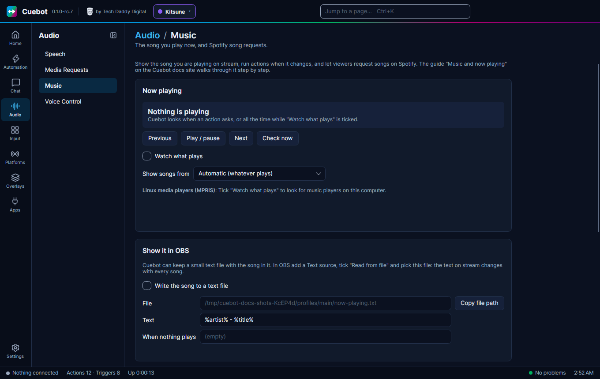
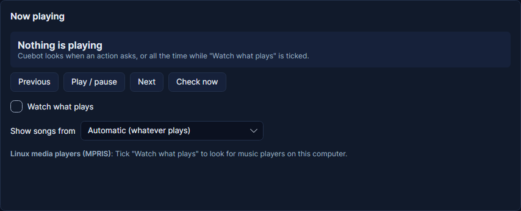

# Now playing

Cuebot can see which song you are playing and show it on stream. It can also answer a `!song` command, and run an
action every time the song changes. Everything is on the **Audio > Music** page.

There are two ways Cuebot finds your music:

| Way | Works with | Needs |
| --- | --- | --- |
| **Players on this computer** | Spotify, VLC, foobar2000, Firefox, Chrome, YouTube Music and most other players, on **Windows** and **Linux** | Nothing. No account, no password. |
| **Your Spotify account** | Spotify on any device: a PC, a Mac, a phone or a speaker | A free "Spotify app" you make once (about two minutes, see [Spotify](spotify.md)). Song requests and skipping need **Spotify Premium**. |

!!! note "Mac"
    On a Mac, Cuebot cannot see the players on your computer yet. [Sign in to your Spotify account](spotify.md) to
    show the songs you play in Spotify.

!!! warning "Experimental"
    **Now playing on Windows** is built and tested by Cuebot's own tests, but not yet on a real Windows computer. Now
    playing on **Linux** was tried with real players (mpv and VLC). See [What's experimental](../help/experimental.md).

Want viewers to pick the songs? See [Song requests](song-requests.md) (Spotify) or
[Media requests](media-requests.md) (YouTube videos).

## Show the song you are playing



1. Open **Audio > Music**.
2. Tick **Watch what plays**.
3. Start a song in your music player. Its name, artist and player show up at the top of the page within a second or
   two.
4. Leave **Show songs from** on **Automatic**. If you have several players open (say Spotify and a YouTube tab) and
   Cuebot shows the wrong one, pick **One player on this computer** and type part of its name, like `spotify`. The
   names Cuebot sees are listed under **Open players**.

The **Previous**, **Play / pause** and **Next** buttons press the media keys of the player that plays now. Handy to
test.



### Put it on stream (OBS)

1. On the Music page, tick **Write the song to a text file**.
2. Click **Copy file path**.
3. In OBS, click **+** under **Sources**, choose **Text** (on Linux: **Text (FreeType 2)**) and click **OK**.
4. Tick **Read from file**, click **Browse** and paste the path you copied. Click **OK**.

That is it: the text in OBS changes with every song. To change what it says, edit **Text**, for example
`Now playing: %title% by %artist%`. You can use `%title%`, `%artist%`, `%album%`, `%player%` and `%duration%`.
While the music is paused the file shows **When nothing plays** (empty by default, so the text disappears).

## A !song command

Viewers type `!song` and Cuebot answers with the song.

1. Go to **Automation > Commands**, click **+**, name it `song` and type `!song` under **Commands**.
2. Go to **Automation > Actions** and make an action called `Song`.
3. On **Triggers**, click **+ Trigger**, pick **Commands › Command triggered** and choose `song`.
4. On **Sub-actions**, click **+ Sub-action** and pick **Now playing › Get now playing**.
5. Add **Chat (all platforms) › Send chat message (any platform)** with this message:

    ```text
    Now playing: %nowPlaying.title% by %nowPlaying.artist%
    ```

    Tick **Reply on the platform the trigger came from**.

You do not even need **Watch what plays** for this: **Get now playing** looks when it runs.

## Say every new song in chat

1. Tick **Watch what plays** on the Music page.
2. Make an action with the trigger **Now playing › Song changed**.
3. Add **Send chat message (any platform)** with `🎵 %title% by %artist%`.

The trigger gives you `%title%`, `%artist%`, `%album%`, `%player%`, `%durationText%` (like `3:45`), `%artUrl%` (the cover
picture, when the player has one) and `%link%` (Spotify songs only). It runs once per song, not when you pause and play
again.

The **Now playing › Media control** step presses play/pause, next or previous on any player, including players on this
computer.

## Troubleshooting

| What you see | What to do |
| --- | --- |
| **Nothing is playing**, but music plays | Tick **Watch what plays** and click **Check now**. Cuebot sees players that show up in the Windows volume pop-up (Windows) or in your desktop's media controls (Linux). Some players do not share what they play: on Linux, mpv needs the `mpv-mpris` plug-in; older VLC versions on Windows do not share it at all. Browser tabs show up while they play. |
| **The wrong player shows** | Pick **One player on this computer** and type part of its name. |
| **Windows says it cannot read music players** | Cuebot needs Windows 10 (October 2018 update) or newer for this. [Sign in to Spotify](spotify.md) instead. |

## How it works (for the curious)

- On **Linux**, Cuebot reads players through MPRIS, the shared "media player" language of the Linux desktop (the same
  thing your desktop's media controls use).
- On **Windows**, Cuebot reads the same list as the volume pop-up (the Windows media controls). It starts a small
  helper for this, `powershell.exe`, which closes when Cuebot closes.
- **Spotify** is asked every 5 seconds what plays, while you are signed in. Your Spotify sign-in is stored encrypted on
  your computer, like your other sign-ins.
