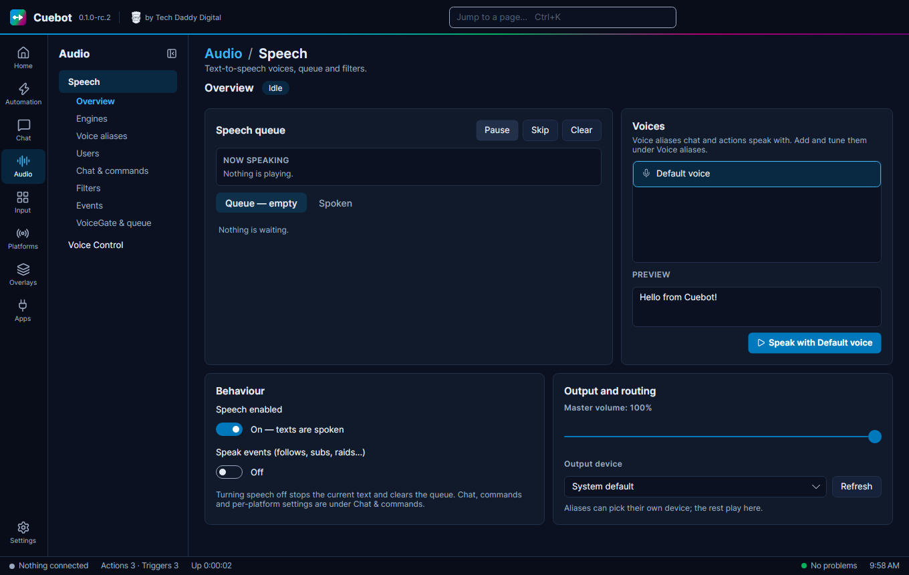
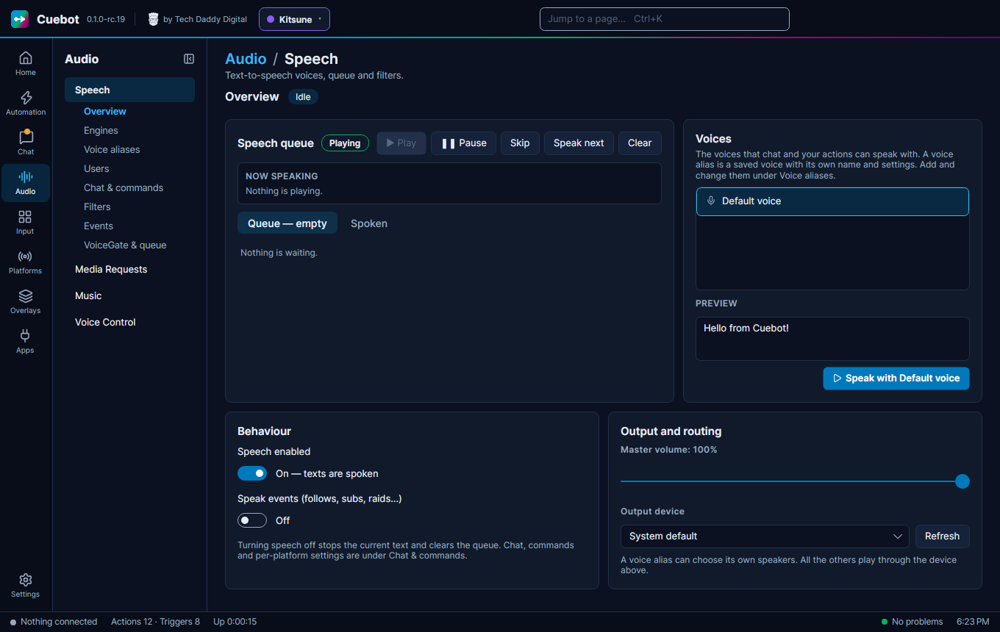
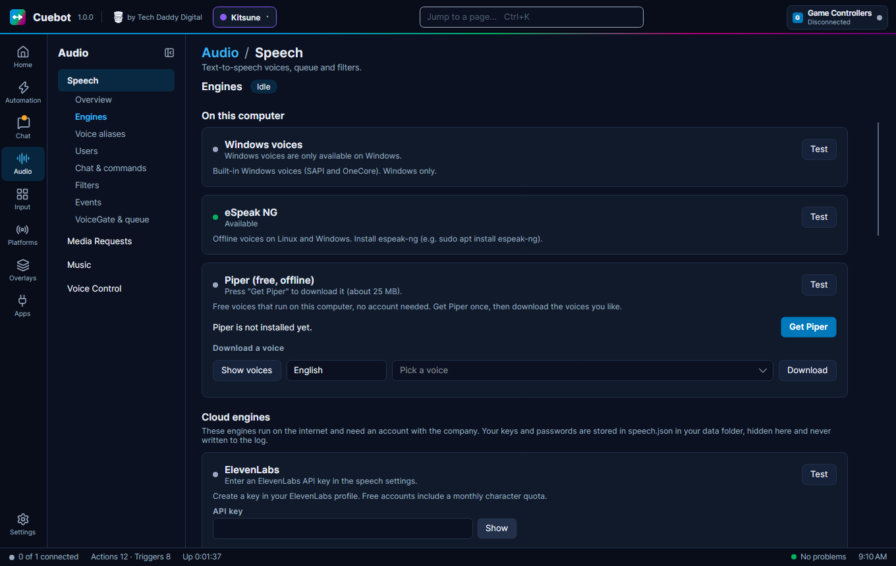
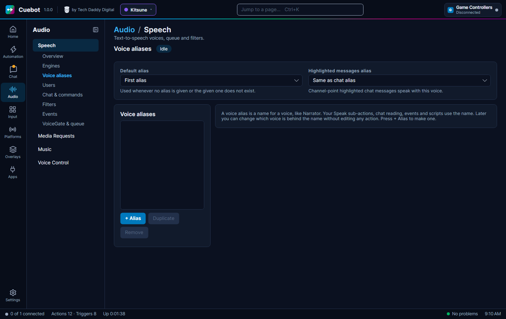
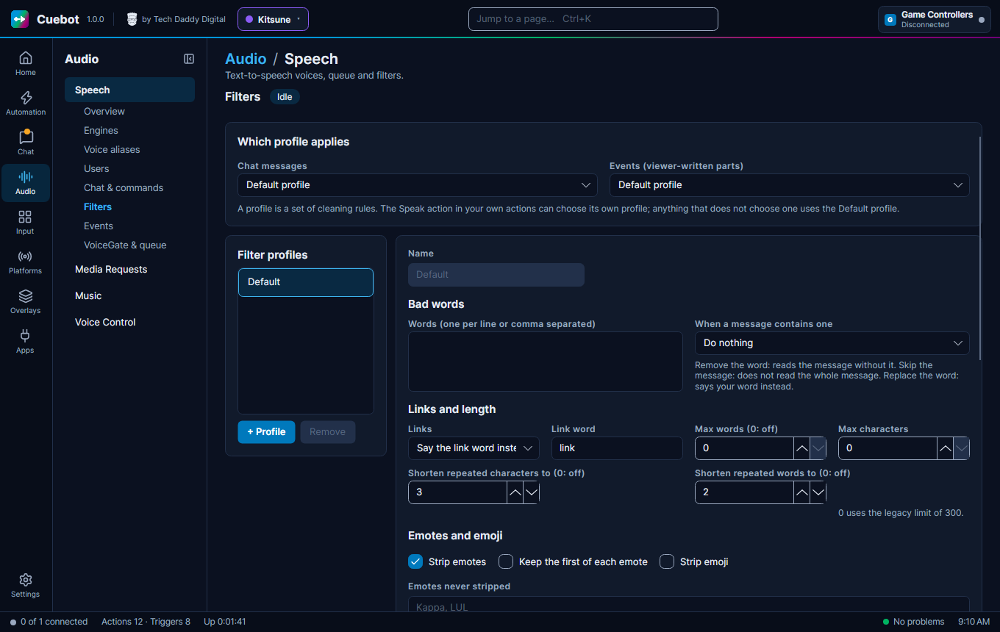
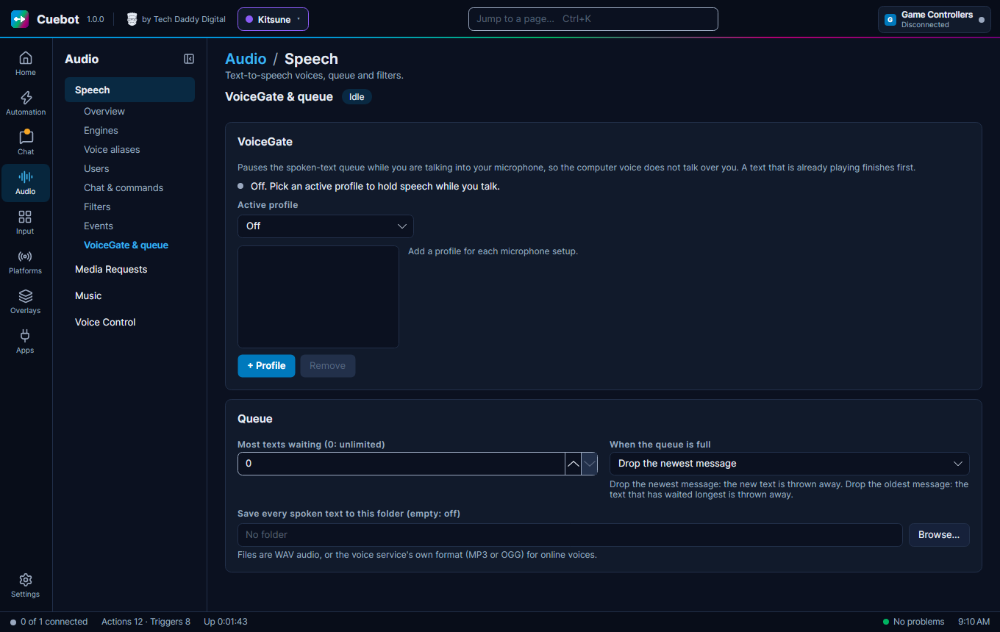

# Text-to-speech

**Text-to-speech** (TTS) means the computer reads text out loud. Cuebot can read chat, thank people for follows, and
say anything your actions tell it to. It is built in: you do not need Speaker.bot or any other app.

Everything is on **Audio > Speech**. It has these tabs: **Overview**, **Engines**, **Voice aliases**, **Users**,
**Chat & commands**, **Filters**, **Events** and **VoiceGate & queue**.

This page sets up a voice and makes an action talk. To read chat or events out loud, see
[Reading chat and events aloud](reading-chat-aloud.md).

## 1. Pick an engine

An **engine** is the thing that makes the voice. Open the **Engines** tab.

| Engine | Where it runs | What you need |
| --- | --- | --- |
| **Windows voices** | Windows | Nothing. These are the voices already in Windows. |
| **eSpeak NG** | Windows and Linux | Free, works without internet. On Linux, install `espeak-ng` (the Flatpak has it). |
| **Voice library** (Piper, Kokoro, Kitten, Matcha and other sherpa-onnx voices) | Windows, macOS and Linux | Free, works without internet, and sounds much more natural than eSpeak. Download voices in Cuebot or import ones you have: see [the voice library](#the-voice-library-free-voices-on-your-computer) below. |
| **OpenAI**, **ElevenLabs**, **Microsoft Azure**, **Google Cloud**, **Amazon Polly**, **IBM Watson** | The internet | Your own account and key with that company |
| **Acapela Cloud**, **CereProc (CereVoice Cloud)**, **TTS Monster**, **UberDuck** | The internet | Your own account and key |

Internet ("cloud") engines often sound nicer, but the company may charge you for each letter spoken. Cuebot only sends
them the text to say. Your keys are hidden on screen and never written to the log.

Acapela's own voice tags and sound codes, such as `\pau=500\` or `#LAUGH01#`, are not applied. Cuebot removes their
markers so chat can't change the voice or play sounds.

Click **Test** next to an engine to hear it.

!!! warning "Experimental"
    Of the internet engines, only **OpenAI** has been tried with a real account so far. **ElevenLabs**, **Microsoft
    Azure**, **Google Cloud**, **Amazon Polly**, **IBM Watson**, **Acapela Cloud**, **CereProc**, **TTS Monster** and
    **UberDuck** are built and tested with pretend services, but not yet with the real ones. Piper, eSpeak NG and
    OpenAI were tried for real. See [What's experimental](../help/experimental.md).

### The voice library: free voices on your computer

The voice library holds free voices that run on your own computer. They need no account, cost nothing, and keep
working without internet. It speaks these kinds of voices:

- **Piper voices**, old and new, from [Piper's voice collection](https://huggingface.co/rhasspy/piper-voices).
- **sherpa-onnx voice packages** ([list](https://k2-fsa.github.io/sherpa/onnx/tts/all/index.html)): Piper voices
  such as GLaDOS (`vits-piper-...`), **Kokoro**, **Kitten** and **Matcha** voices that use espeak-ng.

Kokoro's multi-language packages speak English, Spanish, French, Hindi, Italian and Brazilian Portuguese; each speaker
uses its own language. Their Japanese and Mandarin speakers are left out, and so are Matcha voices that read from a
word list (the Chinese ones), because Cuebot cannot turn text into their sounds.

All of them are on the **Engines** tab, on the **Voice library** card.

1. Press **Get voice engine**. It downloads Cuebot's voice engine (about 50 to 65 MB) once, on Windows, macOS and Linux.
2. Press **Show voices**. Type your language in the small box (for example `English` or `Spanish`) to make the list
   shorter.
3. Pick a voice and press **Download**. **Medium** voices sound good and are quick; **high** ones sound a little better
   but are bigger. Most voices are 20 to 120 MB.
4. Press **Test** on the card. Your voice is now in every voice picker, so you can use it in a voice alias.

**Voices you already have.** Press **Import voice...** and pick either:

- a Piper voice: its `.onnx` file together with its `.onnx.json` file (picking the `.onnx` is enough when the
  `.json` is next to it), or
- a voice package: a `.tar.bz2` or `.tar.gz` file, such as `vits-piper-en_US-glados-high.tar.bz2`,
  `kokoro-int8-multi-lang-v1_0.tar.bz2`, `kitten-nano-en-v0_8-int8.tar.bz2` or `matcha-icefall-en_US-ljspeech.tar.bz2`
  from sherpa-onnx. Matcha voices also need a *vocoder*, which sherpa-onnx publishes separately: Cuebot downloads it
  (`hifigan_v2.onnx`, 4 MB) and puts it with the voice.

Cuebot unpacks the voice, checks it, and puts it in a folder of its own inside the voices folder. Tick **Move the files
instead of copying them** to delete the originals afterwards; they are only deleted once the voice is in the voices
folder, so a refused import never loses them. Cuebot refuses packages that hold no voice, or that try
to write outside their folder.

**The voices folder.** Press **Open voices folder** to see it: one folder per voice. You can also copy a voice folder
in, or delete one, by hand. Cuebot notices within a second or two, without a restart.

Each voice shows what it is and what speaks it. If a voice can't speak, a red line under it says why, for example
**needs Cuebot's voice engine** or **uses a phonemizer Cuebot does not have**. Some voices contain many speakers, such
as `en_GB-vctk-medium` or Kokoro's; each speaker shows up as its own voice. To remove a voice, press **Delete** next to
it.

!!! note "Where the voice engine and the voices come from"
    The voice engine is [sherpa-onnx](https://github.com/k2-fsa/sherpa-onnx), running in its own copy of Python inside
    your Cuebot data folder. It turns text into sounds with espeak-ng, through
    [piper-phonemize](https://github.com/csukuangfj/piper-phonemize). Cuebot checks every file after downloading it
    and throws away anything that doesn't match. Each voice has its own licence, listed in its model card; most
    allow streaming.

!!! tip "Coming from Cuebot 1.0.6 or earlier"
    Your Piper voices move into the voice library by themselves, so you don't download them again. The Piper program
    you got then keeps speaking them until you press **Get voice engine**. Voices rebuilt in November 2026 for a newer
    Piper (most medium English voices, for example `en_US-amy-medium`) need the voice engine: without it, they say so
    instead of crashing Piper.

Cuebot changes the pitch of these voices itself. The speed stays the same.

### OpenAI: voices you can describe

OpenAI's voices are natural and you can tell them *how* to talk, like "cheerful and a bit fast" or "whisper like a
secret". It costs a little money: reading a normal chat message out loud costs a fraction of a cent.

1. Go to [platform.openai.com](https://platform.openai.com), sign in, open **API keys** and make a new key. You need
   to add a little credit (billing) to your OpenAI account first.
2. In Cuebot, on the **OpenAI** card, paste the key into **API key**.
3. Optional: type how the voices should sound into **How the voices should sound**. In a voice alias, pick a
   **Speaking style** (Cheerful, Calm, Excited, Spooky, Like a pirate and more) to change it for just that alias.
4. Press **Test** to see the 13 voices (Alloy, Coral, Marin and more).

**Model:** leave it on `gpt-4o-mini-tts`. The older `tts-1` models ignore the "how it should sound" text.

## 2. Make a voice alias

A **voice alias** is a nickname for a voice and its settings, like "Narrator" or "Robot". Your actions use the alias,
not the voice itself. Later you can change the voice behind "Narrator", and every action that uses it changes too.

1. Open **Voice aliases** and click **+ Alias**.
2. Give it a **Name**, like `Narrator`.
3. Under **Voices**, click **+ Voice** and pick a voice. (Add more than one and Cuebot picks between them by
   **Weight**.)
4. Choose an **Output device** (speaker) if you do not want your normal one.
5. Click **Test voice**.

Set **Default alias** at the top. It is used whenever an action does not name an alias.

**Volume**, **Rate** and **Pitch** set how the alias sounds. **Pitch** makes the voice higher or lower, like a
chipmunk or a giant.

- For Windows voices, Piper and OpenAI, Cuebot changes the pitch itself. So it works with every one of them, including
  the newer Windows voices such as "Microsoft Ana Online".
- UberDuck and TTS Monster can't change pitch. For those voices the slider is switched off, and a note says so.

## 3. Make an action talk

Add the **Speak** sub-action to any action:

- **Voice alias**: which alias to use. Empty means the default.
- **Text**: what to say, like `%user% just followed! Welcome!`
- **Wait until spoken**: tick it if the next step should wait until the voice is done.

The **Thank new followers** example action already uses **Speak**.

## Filters

**Filters** clean up what viewers write before it is spoken: swap or skip bad words, links and emotes, and limit very
long messages and "loooooool". You can make different filter profiles and pick one for reading chat, one for reading
events, and one for a single **Speak** step.

## The queue and VoiceGate

Texts are spoken one after another, like a line at a shop. The **Overview** tab shows what is speaking now, what is
waiting and what was spoken.

| You want | Do this |
| --- | --- |
| A break from the voice | Click **Pause**. The text being read finishes first, then the rest waits. |
| The voice to carry on | Click **Play**. |
| To skip the text being read | Click **Skip**. |
| To throw away everything waiting | Click **Clear**. |
| To go through the line one text at a time | Click **Pause**, then **Speak next** for each text. |

A label next to **Play** and **Pause** says what the queue is doing: **Playing**, **Paused**, or **Held while you
talk** (when VoiceGate waits for you).

**VoiceGate** (on **VoiceGate & queue**) waits while *you* are talking into your microphone, so the computer voice does
not talk over you. Pick your **Microphone** in a profile. The same tab sets how long the waiting line may get.

## Silent on Linux?

Install `espeak-ng` for the free voice. If there is still no sound, see [Linux](../help/linux.md#sound-and-speech).
