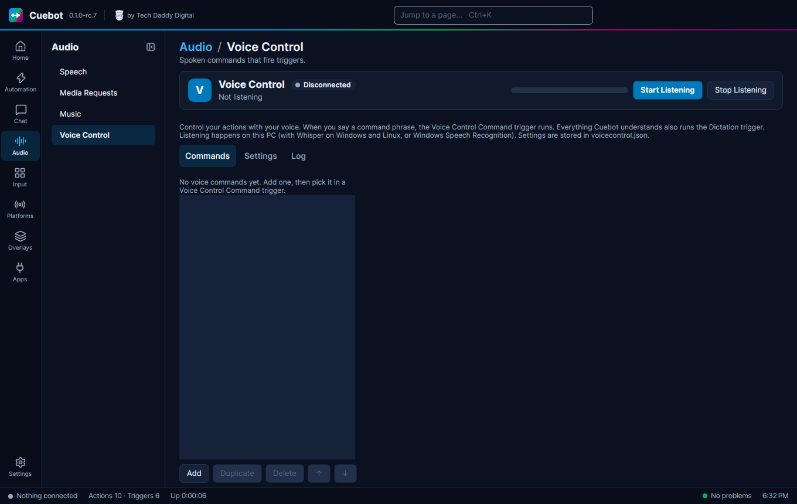

# Voice control

Voice control lets *you* say a phrase, and Cuebot runs an action. For example, say "start the countdown" to start a
countdown, with your hands still on the game. It is on **Audio > Voice Control**.

## Set it up

1. Under **Settings**, pick your **Audio Input Device** (microphone) and a **Recognition engine**: **Whisper** (Windows
   and Linux) or Windows Speech Recognition.
2. Using Whisper? Pick a **Whisper model** and click **Download** once. Bigger models understand better but are slower.
3. Under **Commands**, click **Add** and type what to say in **Command**.
4. Click **Start Listening**.
5. In an action, add the **Voice Control › Command** trigger and pick your voice command.

Listening happens on your own computer. Nothing you say is sent to the internet.

## Each command

Each command has a few more settings:

- **Location**: **Exact** means the phrase on its own, with a pause before and after. **Start** means what you say
  begins with it, and the rest becomes `%spokenTextInput%` (say "shout out Pixel Panda" and the action gets
  "Pixel Panda"). **Anywhere** means the phrase can be anywhere in a sentence.
- **Stop After** runs the command the moment the phrase is heard, even while you are still talking.
- **Override Global confidence** gives this command its own **Confidence Threshold**: how sure Cuebot must be
  that it heard right.

## The Settings tab

The **Settings** tab has more for fine-tuning:

- **Auto Start Listen (when Cuebot starts)**: no need to click **Start Listening** every time.
- **Confidence Threshold** and **Match tolerance**: raise the first if Cuebot hears commands you didn't say; raise
  the second if it misses ones you did (it lets a few letters be different).
- **Locale**: the language you speak.
- **Use a GPU runtime** makes Whisper faster on a graphics card. **Interim results** lets **Stop After** commands
  react sooner, using more processor. **Hint the command phrases to Whisper** helps it spell your phrases the way you
  wrote them. **Delete model** frees the disk space again.
- **Log Speech to Text Dictation** writes everything it understood into the log file. The **Log** tab shows it live.
  Everything it understands also runs the **Dictation** trigger, for actions that listen to all you say.
