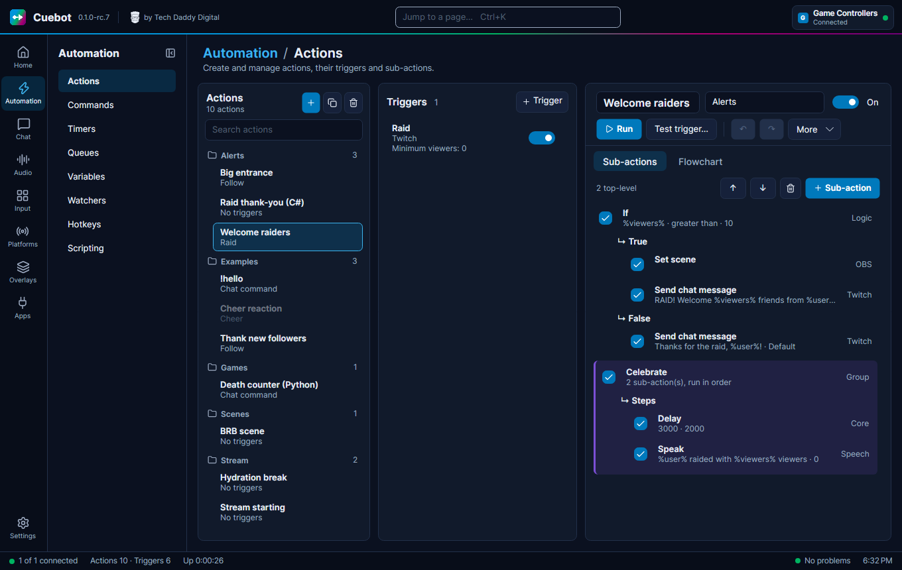

# Words you will see

A small dictionary of the words these guides use. If a word on another page is new to you, look here.

**Action**: A job for Cuebot, with a name, like "Thank new followers". It is a list of steps (sub-actions). See [How
actions work](../actions/how-actions-work.md).

**Alert**: A pop-up on your stream when something happens, like a follow. Shown by the **Alert box** widget. See
[Alerts](../overlays/alerts.md).

**API**: A door that lets one program talk to another. "Cuebot uses the OBS API" means Cuebot talks to OBS through it.

**API key**, **token**: A long secret code that proves a program is allowed to use something, a bit like a password.
Keep them secret.

**Argument**: Another name for a [variable](../actions/variables.md) of the current run, like `%user%`.

**Bot account**: An optional second account on a platform, like "MyChannelBot", that writes Cuebot's chat messages for
you. See [Your platforms](../platforms/index.md#broadcaster-account-and-bot-account).

**Branch**: One of the lists inside a step like **If**: the "yes" list or the "no" list. New steps can go into a
branch.

**Broadcaster account**: Your own channel, the one you stream on. Cuebot gets events like follows and raids through
it.

**Browser source**: A source in OBS that shows a web page. Cuebot's overlays are shown this way.

**cb**: The helper Python code uses, like `cb.send_chat("Hi")`. Every script function has its own `cb` method
too, like `cb.obs_set_scene("Gameplay")`. See [Python in detail](../developers/python.md).

**Code step**: A **Run C# code** or **Run Python code** sub-action: a small program inside an action. See [Writing
code (C# and Python)](../developers/writing-code.md).

**CPH**: The toolbox C# code uses, like `CPH.SendMessage("Hi")`. The same names as in Streamer.bot. See [C#
methods](../../reference/csharp/index.md).

**Command**: A word viewers type in chat, usually with a `!` in front, like `!hello`. See [Chat
commands](../chat/commands.md).

**Cooldown**: A wait time before a command can be used again, so it cannot be spammed.

**Cron**: A short way to write a schedule, with five parts: minute, hour, day, month, weekday. `0 20 * * 5` means
"every Friday at 20:00". Used by [timers](../actions/timers.md).

**Data folder**: The folder where Cuebot keeps all your settings and actions. See [Your data and
privacy](../help/your-data.md).

**Deck**: A page of buttons Cuebot shows in a web browser, for your phone or tablet. Not the same as a [Stream
Deck](../apps/stream-deck.md). See [Decks](../apps/decks.md).

**Engine**: The thing that makes a text-to-speech voice, like Windows voices or ElevenLabs.

**Encrypted**: Scrambled with a secret key, so that nobody else can read it. Cuebot stores your sign-ins this way.

**Export to code**: Turns a whole action into one C# or Python script, so you can read or change it as code. See
[Export to code](../developers/export-to-code.md).

**Experimental**: Built and checked by Cuebot's own tests, but not yet tried with the real app or service, so it may
not work. See [What's experimental](../help/experimental.md).

**Flowchart**: A drawing of an action, with boxes and lines, instead of a list.

**Global variable**: A value Cuebot remembers between runs, like a death counter. Written with `~` signs: `~deaths~`.
See [Variables](../actions/variables.md#global-variables).

**Group**: Two meanings. A **group of actions or commands** is a folder that keeps a list tidy. A **group of viewers**
(on **Chat > Users & Groups**, see [Users and groups](../chat/users-and-groups.md)) is a named list of people, like "Regulars", that you can allow on a command.

**Invite**: A one-time link (or QR code) that lets a mod join your [mod portal](../mods/mod-portal.md) with the role
you picked.

**Lane**: One of the lists inside a **Run at the same time** step. All lanes run at once, and the action carries on
when every lane is done. See [How actions work](../actions/how-actions-work.md).

**LAN**: Your home network: the computers, phones and tablets connected to your router. "Allow LAN connections" lets
those devices reach Cuebot.

**MCP**: A common way for AI apps to use another program's tools. Lets an AI app work on Cuebot. See [AI
apps](../ai/ai-apps.md).

**Mod portal**: A web page (and a tab in the phone app) where your mods help from anywhere, with only the things
their **role** allows. See [The mod portal](../mods/mod-portal.md).

**Now playing**: The song your music player is playing right now. See [Now
playing](../sound/now-playing.md).

**OSC**: A simple language some apps use to send each other short messages, like VRChat and OBSBOT cameras. VMC, used
by 3D VTuber apps, is built on it.

**Overlay**: A see-through layer on top of your stream, like a chat box or alerts. See [Overlays](../overlays/overlays.md).

**Pairing**: Linking the phone app to your Cuebot once, by scanning the code on **Apps > Servers**, **Pair a
phone**. See [The phone app](../mods/phone-app.md).

**Phone app** (**Cuebot Companion**): Cuebot's app for Android phones and tablets. It shows your decks, a dashboard
and your mods' changes. See [The phone app](../mods/phone-app.md).

**Platform**: A site you stream on: Twitch, YouTube, Kick or Rumble.

**Points**: Cuebot's own channel money that viewers earn by watching and chatting. See [Points](../chat/points.md).

**Queue**: A waiting line for actions. A **blocking** queue runs one action at a time, so alerts do not overlap. See
[Queues](../actions/queues.md).

**Port**: A door number. Programs on one computer use different port numbers, so their messages do not get mixed up.
Example: OBS listens on port 4455. See [Cuebot's servers](../developers/servers.md).

**REST API**: Cuebot's main door for other programs: web addresses that run actions and change things, with a
**token**. See [REST API](../developers/rest-api.md).

**Relay**: A small helper on your own free Cloudflare account that passes webhooks on to Cuebot. See
[Webhooks](../services/webhooks.md). The [mod portal](../mods/mod-portal.md) uses another relay: a shared portal
service, so you do not set that one up.

**Role**: What a mod may do in the [mod portal](../mods/mod-portal.md), like run actions or change commands. You pick
one for every invite.

**Run**: One time an action does its job. Every run is listed on **Chat > History** (see [History](../actions/history.md)).

**Script function**: One of Cuebot's tools for code, with a name like `speech.speak`. C# and Python can both use
them. In Python each one also has its own `cb` method, like `cb.speech_speak(...)`. See [Script functions](../../reference/script-functions/index.md).

**Scope**, **permission**: What you allow Cuebot to do on a platform, like "read chat" or "change the title". You pick
them when you sign in.

**Server**: Here: a part of Cuebot that other programs can connect to, like the overlay server that OBS uses. See
**Apps > Servers**.

**Server-Sent Events**: A web address that stays open and sends a message every time something happens. Cuebot's
REST API has one at `/events` (see [REST API](../developers/rest-api.md)).

**Signal**: A short named message one Cuebot sends to another, like `go-live`. See [Linking two
Cuebots](../developers/linking-two-cuebots.md).

**Sign-in**: Letting Cuebot use your account on a platform. You do it once in your browser, and Cuebot remembers it,
locked (encrypted) on your computer.

**Slash command**: A command people type in Discord that starts with `/`, like `/socials`. See [Discord
bot](../services/discord-bot.md#4-slash-commands).

**Song request**: A viewer asks for a song in chat, like `!sr bohemian rhapsody`. See [Song
requests](../sound/song-requests.md).

**Subathon timer**: A countdown on your stream that subs, bits, tips and other events add time to. See [Subathon
timers](../services/subathon-timers.md).

**Sub-action**: One step inside an action, like "send chat message" or "switch scene". Every sub-action is listed in
the [sub-action reference](../../reference/sub-actions/index.md).

**Text-to-speech (TTS)**: The computer reading text out loud. See [Text-to-speech](../sound/text-to-speech.md).

**Timer**: Starts actions on a clock, like every 15 minutes. See [Timers](../actions/timers.md).

**Top spenders**: The viewers who spent the most money (bits, subs, tips and more) this stream, today, this week,
month, year or all time. See [Top spenders](../chat/top-spenders.md).

**Trigger**: What starts an action, like "someone followed" or "someone typed `!hello`". Every trigger is listed in
the [trigger reference](../../reference/triggers/index.md).

**Variable**: A word with a value behind it, written in `%` signs, like `%user%`. Cuebot swaps it for the real value
when the action runs. See [Variables](../actions/variables.md).

**VTuber**: A streamer who shows an animated avatar instead of their face. See [VTuber apps](../apps/vtuber/index.md).

**Voice alias**: A nickname for a voice and its settings, like "Narrator", used by text-to-speech.

**Webhook**: A small message one web service sends to another when something happens, like a Ko-fi tip.

**WebSocket**: A line between two programs that stays open, so both can send messages at any time. Streamer.bot
tools use one to talk to Cuebot.

**Widget**: One piece of an overlay, like the chat box, a goal bar or the alert box.
