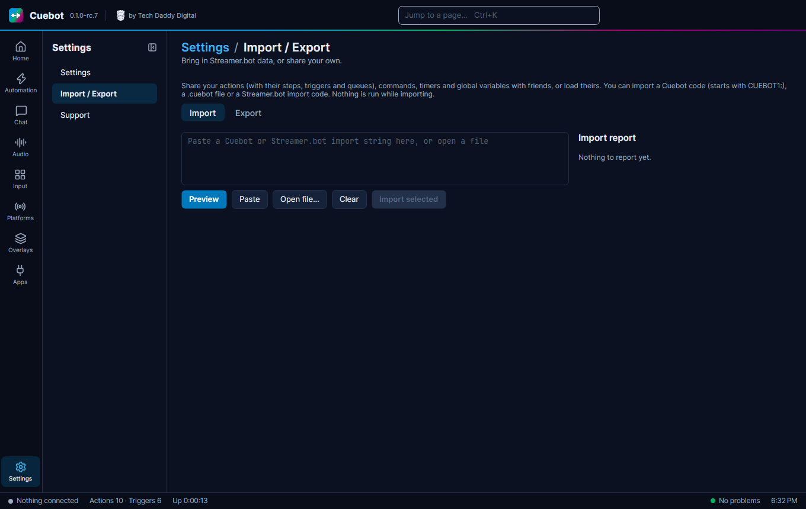
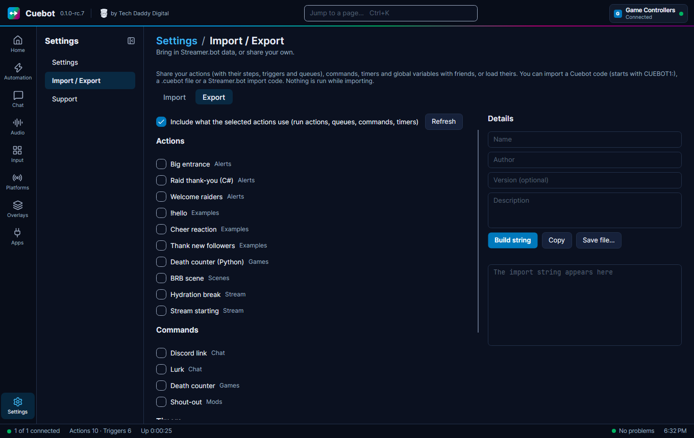

# Moving from Streamer.bot

Cuebot works the way Streamer.bot does: actions, sub-actions, triggers, `%arguments%`, `~globals~` and queues. You
can bring your Streamer.bot actions across. Text-to-speech is built in, so you do not need Speaker.bot either.

!!! note
    Cuebot is its own project, written from scratch. It is not made by the Streamer.bot team.

## Bring your actions across

1. In **Streamer.bot**, right-click the actions you want, choose **Export**, and copy the export text.
2. In **Cuebot**, go to **Settings > Import / Export**, tab **Import**.
3. Paste the text into the big box (or click **Paste**). You can also load a file with **Open file…**.
4. Click **Preview**. Nothing runs while you import.
5. Tick what you want and click **Import selected**.

Imports bring actions (with their sub-actions, triggers and queues), commands, timers and global variables. The same
box also takes a Cuebot code (it starts with `CUEBOT1:`) or a `.cuebot` file from a friend.

Before an import replaces anything, Cuebot makes a [backup](../help/backups.md) of your data folder, so you can go
back.

### Read the import report

After an import, the **Import report** has three lists:

- **Converted**: brought across and ready.
- **Kept as disabled placeholders**: things Cuebot does not have yet. They are kept, switched off, with all their
  settings, so nothing is lost.
- **Please check**: things that may not fit your new setup, like a file path that only exists on your old computer.

## After the import

1. **Sign in again.** Streamer.bot sign-ins do not come across. Sign in on each page under **Platforms** (see
   [Your platforms](../platforms/index.md)).
2. **Connect OBS** on **Apps > Stream apps** (see [OBS Studio](../apps/obs.md)).
3. Test your most important actions with **Test trigger…**.

## What stays the same

- The same variable signs: `%user%`, `%input0%`, `~myGlobal~` and functions like `$math()$`. See
  [Variables](../actions/variables.md).
- **Run C# code** (Streamer.bot's "Execute C# Code") runs your C# code, with Streamer.bot's `CPH` methods. Almost all of them work. See
  [Writing code](../developers/writing-code.md).
- Cuebot's **WebSocket server (Streamer.bot API)** on **Apps > Servers** speaks Streamer.bot's language, so overlays
  and tools made for Streamer.bot keep working. Turn it on there first (see
  [WebSocket API](../developers/websocket-api.md)).
- The start options `/headless` and `/resetwindow` work (see [Command-line options](../help/command-line-options.md)).

## What is different

- Cuebot runs on **Linux** and **Mac** as well as Windows (see [Installing Cuebot](installing.md)).
- Code steps can also be **Python**, with the **Run Python code** sub-action (see [Python](../developers/python.md)).
- Any action can be turned into one C# or Python script (see [Export to code](../developers/export-to-code.md)).
- Every action can also be seen and edited as a [flowchart](../actions/flowchart.md).
- Commands are made on **Automation > Commands** and linked with the **Command triggered** trigger (see
  [Chat commands](../chat/commands.md)).
- Cloud backups go to **your own Google Drive** (see [Backups on Google Drive](../help/google-drive-backups.md)).

## Sharing your own actions

**Settings > Import / Export**, tab **Export**: tick the actions, commands, timers and global variables you want, and
click **Build string**. You can add an **Author**, a **Description** and a **Version** first, if you like. You get a code that starts with `CUEBOT1:`. Click **Copy** to share it, or **Save file…** for a
`.cuebot` file. Tick **Include what the selected actions use** so your friend gets everything they need.
