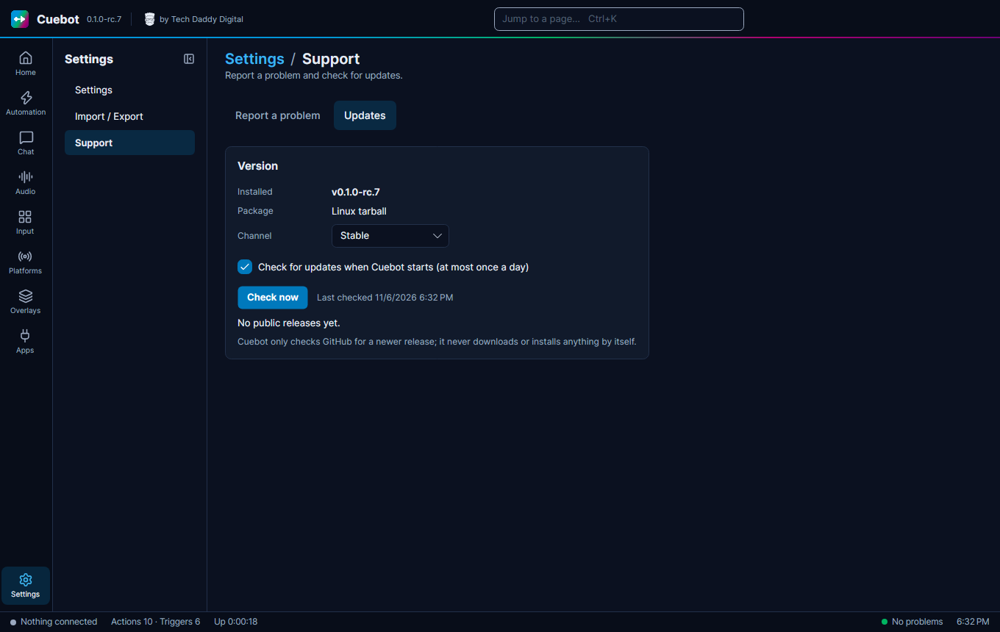

# Updating Cuebot

A new Cuebot version brings fixes and new features. This page shows how to put it in place without losing anything,
and how to let Cuebot tell you when a new version is out.

## Getting the new version

1. Close Cuebot.
2. Download the new version from the [releases page](https://github.com/TechDaddyKB/cuebot/releases), the same file
   you picked when [installing](installing.md).
3. Unzip it over the old folder, or into a new folder. On a Mac, drag the new Cuebot into **Applications** and
   choose **Replace**.

Your actions and settings are **not** in the program folder, so nothing is lost. They live in your
[data folder](../help/your-data.md).

!!! note "On a Mac"
    If hotkeys or key presses stop working after an update, see "After updating on a Mac" on
    [Installing Cuebot](installing.md#mac).

## Being told about new versions

In the left rail click **Settings**, then the **Support** page, then the **Updates** tab.

- "Check for updates when Cuebot starts (at most once a day)" is ticked from the start. Untick it if you would rather
  check yourself.
- **Check now** looks right away.
- **Channel** is **Stable** at first. Set it to **Prerelease** to also hear about test versions. While Cuebot is in
  testing, every release is a test version, so pick **Prerelease** for now.
- When there is a new version, **Open release page** takes you to its download.

Cuebot only checks GitHub for a newer release. It never downloads or installs anything by itself.
