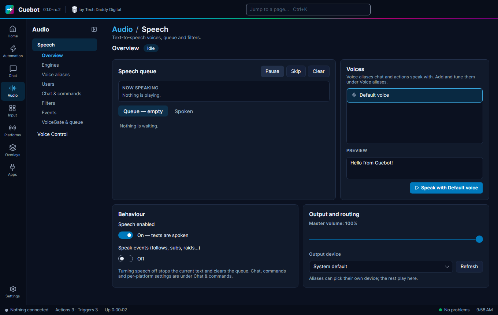

# Text-to-speech

**Text-to-speech** (TTS) means the computer reads text out loud. Cuebot can read chat, thank people for follows, and
say anything your actions tell it to. It is built in: you do not need Speaker.bot or any other app.

Everything is on **Audio > Speech**. It has these tabs: **Overview**, **Engines**, **Voice aliases**, **Users**,
**Chat & commands**, **Filters**, **Events** and **VoiceGate & queue**.

## 1. Pick an engine

An **engine** is the thing that makes the voice. Open the **Engines** tab.

| Engine | Where it runs | What you need |
| --- | --- | --- |
| **Windows voices** | Windows | Nothing. These are the voices already in Windows. |
| **eSpeak NG** | Windows and Linux | Free, works without internet. On Linux, install `espeak-ng` (the Flatpak has it). |
| **ElevenLabs**, **Microsoft Azure**, **Google Cloud**, **Amazon Polly**, **IBM Watson** | The internet | Your own account and key with that company |
| **Acapela Cloud**, **CereProc (CereVoice Cloud)**, **TTS Monster**, **UberDuck** | The internet | Your own account and key |

Internet ("cloud") engines often sound nicer, but the company may charge you for each letter spoken. Cuebot only sends
them the text to say. Your keys are hidden on screen and never written to the log.

Click **Test** next to an engine to hear it.

## 2. Make a voice alias

A **voice alias** is a nickname for a voice and its settings, like "Narrator" or "Robot". Your actions use the alias,
not the voice itself. Later you can change the voice behind "Narrator", and every action that uses it changes too.

1. Open **Voice aliases** and click **+ Alias**.
2. Give it a **Name**, like `Narrator`.
3. Under **Voices**, click **+ Voice** and pick a voice. (Add more than one and Cuebot picks between them by
   **Weight**.)
4. Choose an **Output device** (speaker) if you do not want your normal one.
5. Click **Test voice**.

Set **Default alias** at the top. It is used whenever an action does not name an alias.

## 3. Make an action talk

Add the **Speak** sub-action to any action:

- **Voice alias**: which alias to use. Empty means the default.
- **Text**: what to say, like `%user% just followed! Welcome!`
- **Wait until spoken**: tick it if the next step should wait until the voice is done.

The **Thank new followers** example action already uses **Speak**.

## Reading chat out loud

Open **Chat & commands**.

**Read chat aloud**: switch it **On**, then choose:

- **Who is read aloud**: everyone, or only some roles, like subscribers.
- **Message template**: how a message is read, for example with the name first.
- **Speak nicknames instead of names**: handy for names like "xX_Gamer_1987_Xx".
- **Random voice per user**: each viewer gets their own voice.

**The !tts command**: switch it **On** and viewers can type `!tts hello there` to have it read. The **Command word**
is `!tts`, and you can change it. Set a **Viewer cooldown (seconds)** and which aliases viewers may pick.

The **Moderation** part can stop a message when a moderator deletes it, or stop a viewer's messages when they are timed
out or banned.

**Users** tab: give one viewer their own voice or nickname, or mark them **Ignored** (never read).

## Reading events out loud

Open **Events**. Choose which follows, subs, gifts, raids, cheers and redemptions are spoken, and the text for each.
In the text, `%name%` is the viewer, `%gift%` the number of gifted subs, `%title%` the reward and `%input%` what the
viewer typed.

## Filters

**Filters** clean up what viewers write before it is spoken: swap or skip bad words, links and emotes, and limit very
long messages and "loooooool". You can make different filter profiles and use them per alias.

## The queue and VoiceGate

Texts are spoken one after another, like a line at a shop. The **Overview** tab shows what is speaking now, what is
waiting and what was spoken, with **Pause**, **Skip**, **Clear** and **Speak next**.

**VoiceGate** (on **VoiceGate & queue**) waits while *you* are talking into your microphone, so the computer voice does
not talk over you. Pick your **Microphone** in a profile. The same tab sets how long the waiting line may get.

## Voice control: talking to Cuebot

**Audio > Voice Control** goes the other way: *you* say a phrase, and Cuebot runs an action. For example, say "start
the countdown" to start a countdown.

1. Under **Settings**, pick your **Audio Input Device** (microphone) and a **Recognition engine**: **Whisper** (Windows
   and Linux) or Windows Speech Recognition.
2. Using Whisper? Pick a **Whisper model** and click **Download** once. Bigger models understand better but are slower.
3. Under **Commands**, click **Add** and type what to say in **Command**.
4. Click **Start Listening**.
5. In an action, add the **Voice Control › Command** trigger and pick your voice command.

Listening happens on your own computer. Nothing you say is sent to the internet.

## Silent on Linux?

Install `espeak-ng` for the free voice. If there is still no sound, see [Linux](linux.md#sound-and-speech).
