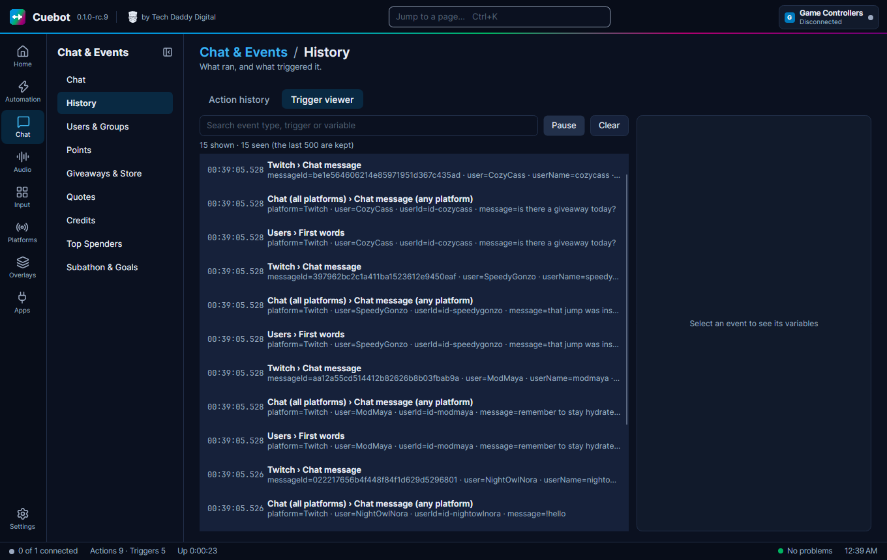
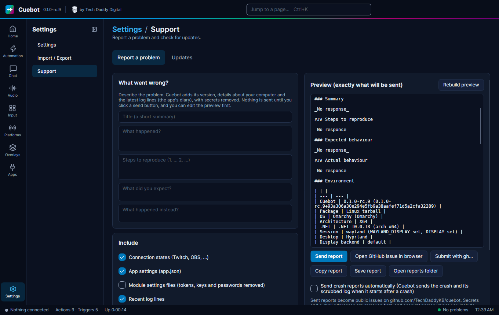
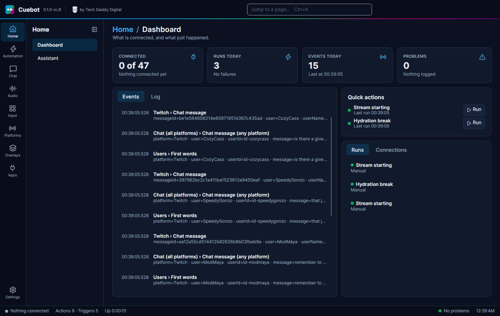

# Troubleshooting

## Something does not happen

Your action did not run when it should have? Check these, in order:

1. **Is it connected?** The top bar shows a chip for each connection. No Twitch chip means Twitch is not connected.
2. **Is it switched on?** The action must be **On**, and its trigger's switch must be on too. For a command, the
   command must be **Enabled** on **Automation > Commands**.
3. **Did the trigger fire?** Open **Chat > History**. Every run is listed. Your action is missing? Then the trigger did
   not match. Check its settings, like the command name or reward name.
4. **Did a step fail?** In **History**, click the run to see its values. Then look at the log: **Home > Dashboard**, tab
   **Log**. Warnings show up there, for example a Twitch permission you did not give.
5. **Is the queue paused?** Look at **Automation > Queues**.

## Common problems

**Windows says "Windows protected your PC".**
Windows does not know Cuebot well yet, because it is new. Click **More info**, then **Run anyway**.

**Google says "Google hasn't verified this app".**
Google is still checking Cuebot's YouTube access. Click **Advanced**, then **Go to Cuebot**.

**A platform says "sign in again".**
The platform ended the sign-in, for example after you changed your password or removed Cuebot's access there. Open
the platform's page under **Platforms** and sign in again.

**The bot signed in as me (or the other way round).**
Your browser was logged in as the wrong account. Log in as the right one on the platform's website first, or use a
private window, then sign in again.

**OBS does not connect.**
In OBS, check **Tools > WebSocket Server Settings**: **Enable WebSocket server** must be ticked, and the port and
password must match Cuebot's. If OBS runs on another computer, use that computer's address as **Host** and allow the
port through its firewall.

**My overlay is empty in OBS.**
Check that the overlay server is on (**Apps > Servers**, **Overlay server**). Copy the link again with **Copy link**:
if someone clicked **New link**, the old link stopped working. Right-click the browser source in OBS and choose
**Refresh**.

**Chat gets two answers to one command.**
Two actions react to it. Often it is the example **!hello** action in the **Examples** group. Turn one of them off.

**Text-to-speech is silent on Linux.**
Install `espeak-ng`, and one of `pw-play` (PipeWire), `paplay` or `aplay`. See [Linux](linux.md#sound-and-speech).

**The window does not show up on Linux.**
Start Cuebot from a terminal to see what it says, or try `--backend=x11`. See [Linux](linux.md).

**A feature does not work at all.**
Check whether it is on the [What's experimental](experimental.md) list. Those features have not been tried with the
real app or service yet, so a report helps a lot.

**`!sr` adds a YouTube video and a Spotify song.**
The **Media Requests** page answers `!sr` too. See
[Media Requests also listens for !sr](music-and-now-playing.md#a-sr-song-request-command).

**I lost the window.**
Start Cuebot again: the running copy comes to the front. Still off-screen? Close Cuebot and start it with
`--reset-window`.

## Asking for help

**Settings > Support**, tab **Report a problem**, builds a report for you: your Cuebot version, your system and the
recent log.

1. Type a short **Title**, like "Follow alert does not show".
2. Fill in **What happened?**, the steps, what you expected and what happened instead.
3. Under **Include**, leave the boxes as they are, unless you have a reason to change them.
4. Read the **Preview** on the right. That is exactly what will be sent. You can change or delete anything in it.
5. Click **Send report**. You do not need a GitHub account. **Open the issue** then shows your report in the browser.

Good to know:

- Tokens, passwords, stream keys and private web links are **always removed**. Account names are replaced too, unless
  you tick **Include account names**.
- Reports become **public** issues on GitHub, so anyone can read them.
- Prefer to send it yourself? **Open GitHub issue in browser** opens GitHub with the report filled in, for your own
  GitHub account. You can also **Copy report** or **Save report**.

If Cuebot closed unexpectedly, it says so the next time it starts and offers to send a report. Tick **Send crash
reports automatically** to let Cuebot do that by itself.

Trying an [experimental feature](experimental.md)? Please report how it went, even when it worked.

!!! warning
    Never paste tokens, passwords or stream keys into an issue or a chat by hand.

Press ++f1++ anywhere in Cuebot to open the Support page.

## Where the log is

In the `logs` folder inside your [data folder](backups-and-your-data.md). ++ctrl+alt+l++ opens it. The **Log** tab on
**Home > Dashboard** shows the current log.
