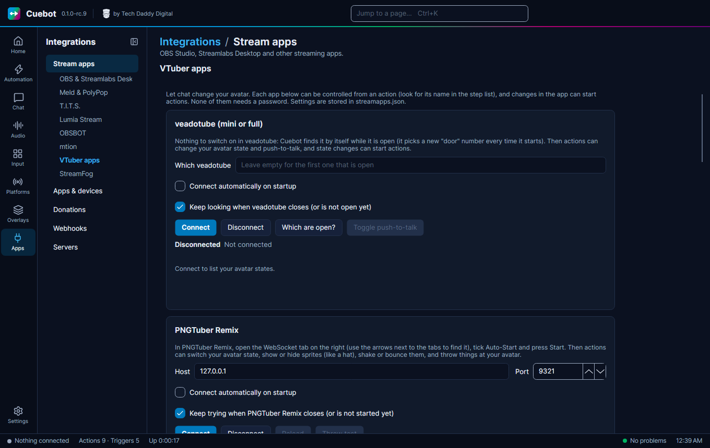

# VTuber apps

Cuebot can talk to the apps that move your avatar. A viewer redeems a reward, and your model changes outfit, throws a
prop, or shows a new face. Each app has a card on the **Stream apps** page, under **VTuber apps**. None of these apps
needs a password.

veadotube mini, PNGTuber Remix, RahiTuber, VNyan and Warudo were tried with the real apps. VRChat, nizima LIVE, Animaze
and VMC are [experimental](experimental.md): they may not work yet.

| App | What Cuebot can do | What you switch on in the app |
| --- | --- | --- |
| **veadotube mini** and **veadotube** | Change your avatar state, turn push-to-talk on or off. Starts actions when the state or push-to-talk changes. | Nothing. Cuebot finds veadotube by itself while it is open. |
| **PNGTuber Remix** | Change your avatar state, show or hide sprites, shake, bounce or move them, throw things at your avatar, load another model. | The **WebSocket** tab: tick **Auto-Start** and press **Start**. |
| **RahiTuber** | Press your states, like their hotkeys: tap them, let go, or hold them for some seconds. | **Preferences > Integration > Control States via HTTP**. |
| **VNyan** | Run your node graph with the **Send to VNyan** step. | Nothing. Add an **API Message** node in VNyan's node graph. |
| **VRChat** | Set avatar parameters, write in your chatbox, show the typing bubble. Starts actions when you change avatar or a parameter changes. | **Action Menu > Options > OSC > Enabled**. |
| **Warudo** | Run blueprints, flip toggles and send text. Starts actions when a toggle changes. | Add an **On Stream Deck Trigger**, **Toggle** or **Message** node to a blueprint. |
| **nizima LIVE** | Turn expressions on and off, play motions, press the model's hotkeys, show and hide items, swap models, switch effects. Starts actions when you select another model. | **Plugin Manager**: switch plug-ins on, then switch **Cuebot** on after the first Connect. |
| **Animaze** | Change avatar, background or quickscene, play emotes, special actions, poses and idles, turn the virtual camera on or off. Starts actions when you change avatar. | **Settings > Animaze API**: switch it on. |
| **VSeeFace**, **VMagicMirror** and other 3D apps (VMC) | Show expressions like a smile or an angry face, for a few seconds or until you change them. | The app's **VMC receiver** (VMC is a shared language many 3D apps speak). |

## veadotube

1. Open veadotube mini (or veadotube).
2. In Cuebot open **Stream apps > VTuber apps** and press **Connect** in the veadotube card. Your avatar states appear in
   a list; press **Show** next to one to test it.
3. In an action, add **veadotube > Change avatar state** and type the state's name, or **Push-to-talk on/off**.

veadotube picks a new "door" (port) number every time it starts, so there is nothing to type in. Leave **Which
veadotube** empty unless you run more than one: then type its name, for example `veadotube mini`. For veadotube on
another computer, type its address and port, like `192.168.1.20:2424`.

**How to change the state.** "Switch to this state" just shows it. "Show on top" shows it but remembers the state before,
so a later "Take this state off" goes back. That is handy for a short reaction: show *surprised* on top, wait 5 seconds,
take it off.

The trigger **Avatar state changed** runs whenever the state changes, also when you click it in veadotube yourself.

## PNGTuber Remix

[PNGTuber Remix](https://mudkipworld.itch.io/pngremix) is a free PNGTuber app for Windows and Linux.

1. In PNGTuber Remix, look at the tabs on the right side (Properties, Movement and so on). Press the small arrow next to
   them until you see **WebSocket**, and open it.
2. Tick **Auto-Start** (so you never have to do this again) and press **Start**.
3. In Cuebot open **Stream apps > VTuber apps** and press **Connect** in the PNGTuber Remix card. Your states appear in a
   list; press **Show** next to one to test it.
4. Use the steps under **PNGTuber Remix** in an action, for example **Change avatar state** or **Throw things at avatar**.

**Sprites** are the pieces your model is made of, like `Hat`, `Glasses` or `Head`. Type the name exactly as it is in
PNGTuber Remix's **Sprites** list (the name box suggests them once you are connected). A sprite with pieces attached
to it is a **group**: pick **This sprite and everything attached to it** to show or hide them all together.

Some ideas:

- **Raid:** **Shake sprite** on your top sprite for 2 seconds.
- **Bits:** **Throw things at avatar** with **How many** set to `%bits%`. It throws the images you added as throwables
  in PNGTuber Remix.
- **Channel point "Hat on":** **Show/hide sprite**, sprite `Hat`, **Visible**; then **Delay** 60 seconds; then the same
  step with **Hidden**.
- **Make it big:** **Move, grow or spin sprite** with **Size** `2` and **Go back after** `5`.

## RahiTuber

[RahiTuber](https://rahisaurus.itch.io/rahituber) is a free PNGTuber app for Windows and Linux.

1. In RahiTuber press ++esc++ to open the menu, then **Preferences > Integration**, and tick **Control States via
   HTTP**. Leave the port at 8000.
2. In Cuebot, the RahiTuber card on **Stream apps > VTuber apps** has a **Test state** box. Type `0` and press
   **Press it**: your first state should switch on.
3. In an action, add **RahiTuber > RahiTuber state** and type the state.

**Which state?** Type its name, or its place in RahiTuber's states list counted from **0**: the top state is 0, the
next one 1, and so on. Names are safer, because the numbers shift when you add or move states. To give a state a name,
type it in the state's settings in RahiTuber.

**Press, let go or hold.** "Press it" works like tapping the state's hotkey. If the state is set to **while held**, it
stays on until a step lets go, so use "Hold it for some seconds" to show it for a while and then let go by itself.

!!! note "RahiTuber always says OK"
    RahiTuber answers every request, even for a state it does not have. If nothing happens, check the state's name
    (capital letters matter) or number.

## VNyan

1. In VNyan's node graph, add an **API Message** node and type a name into it, for example
   `Wave`. Connect whatever should happen after it.
2. In Cuebot, add the step **VNyan > Send to VNyan** to an action and type the same name.
3. Optional: under **Values** add lines like `user=%user%`. The node passes them on; if you type a dictionary name into
   the node, VNyan also stores the values there for other nodes to read.

VNyan's API listens on port 8069. To check the connection, type the name in the VNyan card on the **VTuber apps** tab
and press **Send test**. VNyan only says it got the message, not whether a node used it, so check that your node's
name matches exactly (capital letters matter).

## VRChat

!!! warning "Experimental"
    VRChat is only checked by Cuebot's own tests so far. The real test stopped at VRChat's terms page. See
    [What's experimental](experimental.md).

1. In VRChat open the **Action Menu**, then **Options > OSC**, and make sure OSC is **Enabled**.
2. In Cuebot press **Connect** in the VRChat card.
3. Use the steps **VRChat > Set avatar parameter**, **Send chatbox message** or **Show typing bubble**.

**Parameters** are the switches and sliders your avatar has, like `Hat` or `Outfit`. Type the name exactly as in your
avatar and pick its type: **Bool** for on/off (you can also type `toggle`), **Int** for a whole number from 0 to 255,
**Float** for a number from -1 to 1. When you change avatar or a parameter changes, Cuebot remembers it, and the
parameter name box suggests the ones it has heard.

The **chatbox** shows text above your head for everyone in your world, up to 144 characters.

!!! note "Only one app can listen on port 9001"
    VRChat sends to port 9001. If another OSC app (for example a face-tracking or OSC router app) already listens
    there, Cuebot can still *send* to VRChat but cannot *hear* it, and the card says so. Close the other app, or set
    your OSC router to forward to another port and type that port into **Listen on**.

## Warudo

Cuebot uses the same connection as Warudo's built-in Stream Deck support, so you need no mod.

1. In Warudo, open a blueprint and add one of these nodes. Type a **Receiver Name** into it, for example `Confetti`:
    - **On Stream Deck Trigger**: runs once each time Cuebot sends it.
    - **On Stream Deck Toggle**: has an On and an Off path, for things like showing a hat.
    - **On Stream Deck Message**: runs and passes on text, for example a viewer's name.
2. In Cuebot press **Connect** in the Warudo card. Your receiver names appear in a list with a test button each.
3. Use the steps **Warudo > Trigger Warudo blueprint**, **Warudo toggle on/off** or **Send message to Warudo**.

Warudo only opens this connection once the open scene has at least one of these nodes. If Cuebot says Warudo is not
reachable, add a node first, then press **Connect** again. After adding more nodes, press **Reload receivers**.

### Warudo and the Streamer.bot plugin

The community **StreamerBot Integration** plugin for Warudo ("Do StreamerBot Action" node) also works with Cuebot. Turn
on Cuebot's Streamer.bot-compatible WebSocket server (**Servers** page, port 8080) and point the plugin's StreamerBot
asset at it. Its node lists your Cuebot actions and runs them.

## nizima LIVE

[nizima LIVE](https://nizimalive.com/en/) is the Live2D app made by Live2D, the company behind Live2D models. It runs on
Windows and Mac.

!!! warning "Experimental"
    nizima LIVE is only checked by Cuebot's own tests so far: nizima LIVE did not start on the test computer. See
    [What's experimental](experimental.md).

1. In nizima LIVE open the **Plugin Manager** and switch the plug-in function on. It shows a port number, usually 22022.
2. In Cuebot press **Connect** in the nizima LIVE card. The first time, **Cuebot** now appears in nizima LIVE's
   Plugin Manager: switch it on there. Cuebot remembers this, so you only do it once.
3. The card lists your model's expressions, each with an **On/off** test button.
4. Use the steps under **nizima LIVE** in an action, for example **nizima LIVE expression on/off** or **Play nizima LIVE
   motion**. The name boxes suggest what your model has once you are connected.

Steps act on the **selected** model unless you name one. Most people only have one model on screen, so leave
**Model** empty.

Some ideas:

- **Channel point "Blush":** **nizima LIVE expression on/off** with `Blush`, **On**, and **Turn the other expressions off
  first** ticked; then **Delay** 10 seconds; then **nizima LIVE expressions off**.
- **Follow:** **Play nizima LIVE motion** with your wave motion.
- **Anything else:** give it a hotkey in nizima LIVE, then use **Press nizima LIVE hotkey** with that key, like `F1`.
- **Hats and props:** **Show nizima LIVE item** puts an item from your item list on screen; **Hide nizima LIVE item**
  takes it off again.

If you remove Cuebot from the Plugin Manager, press **Connect** again: Cuebot registers again and you switch it on once
more.

## Animaze

!!! warning "Experimental"
    Animaze is only checked by Cuebot's own tests so far, not with the real app. See
    [What's experimental](experimental.md).

1. In Animaze, open **Settings > Animaze API** and switch it on. It is off at first, and it uses port 9000.
2. In Cuebot press **Connect** in the Animaze card. Your avatar's emotes appear with a **Play** button each.
3. Use the steps under **Animaze**: **Load Animaze avatar**, **Play Animaze emote**, **Play Animaze special action**,
   **Animaze pose** and so on. The name boxes suggest what your avatar has once you are connected.

Emotes, special actions, poses and idle animations belong to the avatar you are using, so the lists change when you
change avatar. Cuebot reads them again by itself. The trigger **Avatar changed** runs whenever Animaze switches avatar.

## VSeeFace, VMagicMirror and other 3D apps (VMC)

VMC is a shared language that many 3D VTuber apps understand. Cuebot uses it to change your avatar's **expression**:
a smile, an angry face, a surprised face and so on.

!!! warning "Experimental"
    In a test, VSeeFace got Cuebot's messages and moved the avatar's head, but the expressions did not visibly change.
    So this may not work yet. See [What's experimental](experimental.md).

1. Switch on your app's **VMC receiver**:
    - **VSeeFace:** **Settings > General settings > VMC protocol > VMC receiver**. Then untick **Apply expressions**
      under it, or VSeeFace's own expressions cover Cuebot's.
    - **VMagicMirror**, **VNyan**, **Warudo**: look for "VMC" or "VMC protocol" in the settings and switch on receiving.
2. Check the port number. Most apps use **39539**, which is Cuebot's default.
3. In Cuebot press **Connect** in the VMC card, type an expression like `Joy` and press **Show for 3 seconds**. Watch
   your avatar: VMC never answers, so Cuebot cannot tell whether the app heard it.
4. In an action, use **Show avatar expression (VMC)** and pick an expression. Set **For (seconds)** to make it go away
   by itself.

Every VRM avatar has the expressions `Joy`, `Angry`, `Sorrow`, `Fun` and `Surprised`. Yours may have more; use the
exact name from your avatar. If nothing happens, check that the receiver is on, the port matches, and only one app
listens on that port.

!!! note "Keep VSeeFace tracking your face"
    VSeeFace's VMC receiver says "disables tracking". To keep VSeeFace tracking your face as well, tick **Apply
    VSeeFace tracking** under it, and tick the parts it should keep tracking (**Track face features**, **Track head and
    neck** and so on). Leave **Apply expressions** unticked so Cuebot's expressions show.
