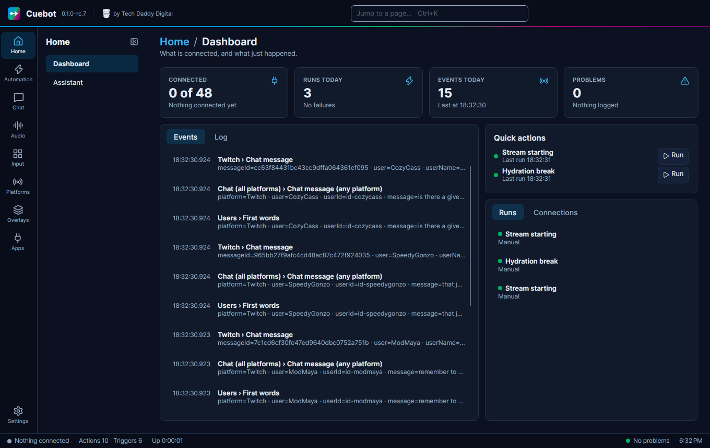
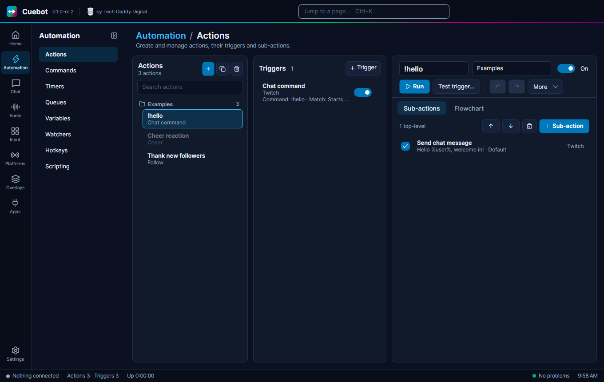

# Cuebot

Cuebot is a free app for your computer that does jobs on your stream for you. When something happens, like a new
follower or someone typing `!hello` in chat, Cuebot does what you told it to: post a message, switch an OBS scene,
play a sound or read a message out loud.

It works with **Twitch, YouTube, Kick and Rumble**, and runs on **Windows, Linux and macOS**.

!!! warning "Cuebot is still being tested"
    Cuebot is at version 0.1, in **release candidates** (test versions before the first full release). It works, but
    you may find rough edges. If something does not work the way these pages say, please
    [tell us about it](https://github.com/TechDaddyKB/cuebot/issues/new/choose).

## Who it is for

- **Streamers** who want chat commands, alerts and thank-you messages without writing code.
- **Streamers on more than one platform**, who want one app for every chat.
- **Streamer.bot users** who want the same way of working, also on Linux. Cuebot can bring your Streamer.bot actions
  across.

You do not need to be good with computers. Every page here explains one thing at a time, with a stream example.

## Start here

1. [Install Cuebot](guides/start/installing.md) on Windows, Linux or a Mac.
2. [Your first five minutes](guides/start/first-five-minutes.md): sign in, connect OBS and make a `!hello` command.
3. [Connect your platforms](guides/platforms/index.md): Twitch, YouTube, Kick and Rumble.
4. [How actions work](guides/actions/how-actions-work.md): the idea behind everything in Cuebot. Like pictures? See
   [the flowchart editor](guides/actions/flowchart.md).
5. [Variables, the %words%](guides/actions/variables.md): put the viewer's name and other values into your messages.
6. [Words you will see](guides/start/glossary.md): a small dictionary for when a word is new.

## Download

Get Cuebot from the [releases page on GitHub](https://github.com/TechDaddyKB/cuebot/releases). While Cuebot is in
testing, every download is marked **Pre-release**. The [installation guide](guides/start/installing.md) tells you which
file to pick.

## What else is here

- **[Guides](guides/index.md)**: one page for each job, grouped by topic, from [chat commands](guides/chat/commands.md)
  to [overlays](guides/overlays/overlays.md), [text-to-speech](guides/sound/text-to-speech.md) and the
  [Stream Deck](guides/apps/stream-deck.md).
- **[Every page in Cuebot](guides/start/every-page.md)**: a map of the whole app, with a picture and a link to the guide
  for each page.
- **[The mod portal](guides/mods/mod-portal.md)**: let your mods help from their own browser, and approve their changes
  from your [phone](guides/mods/phone-app.md).
- **Writing code**: [C# and Python](guides/developers/writing-code.md), [Python in detail](guides/developers/python.md),
  and [using your own code editor](guides/developers/code-editors.md) (Visual Studio Code, Visual Studio, Rider,
  PyCharm…).
- **[What's experimental](guides/help/experimental.md)**: the features that have not been tried with the real app or
  service yet.
- **[Reference](reference/index.md)**: every trigger and sub-action, with what each setting does.

## Your data stays with you

Cuebot keeps your settings and sign-ins on your own computer. It has no tracking. It only talks to a service (like
Twitch or OBS) when you connect it. See [Your data and privacy](guides/help/your-data.md).

Cuebot is free and open source. It is made by [Tech Daddy Digital](https://techdaddydigital.com/cuebot/) and is not
made by, or part of, Streamer.bot, Twitch, YouTube, Kick, Rumble or OBS.
