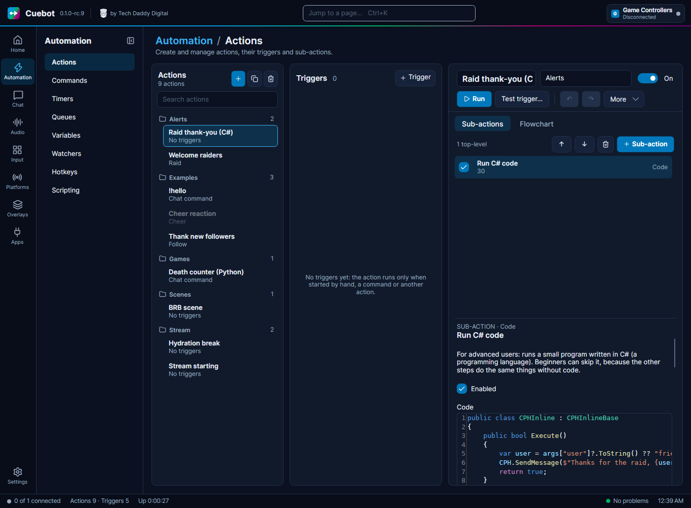

<!-- Generated by DeveloperReferenceTests from the code and src/Cuebot.Scripting/Help. Do not edit by hand. -->
# Twitch polls, predictions, raids, rewards and Guest Star

C# methods for a **Run C# code** step. See [C# methods](index.md) for how to use them.



## TwitchPollCreate

Starts a Twitch poll with 2 to 5 choices. The time is in seconds (15 to 1800). Channel points per vote lets viewers buy extra votes. Bits voting no longer exists, so bitsPerVote is ignored.

```csharp
bool TwitchPollCreate(string title, List<string> choices, int duration, int bitsPerVote = 0, int channelPointsPerVote = 0)
```

**Gives back:** true when the poll started. False when the title is empty or Twitch said no (a warning goes to the log).

**Example**

```csharp
bool started = CPH.TwitchPollCreate("Which game next?", new List<string> { "Minecraft", "Celeste" }, 120);
CPH.LogInfo($"Poll started: {started}");
```

## TwitchPollTerminate

Ends the poll that is running now and keeps the results on screen. Twitch allows only one poll at a time, so the poll id you pass is not used.

```csharp
void TwitchPollTerminate(string pollId)
```

**Gives back:** Nothing. If it fails, a warning goes to the log.

**Example**

```csharp
CPH.TwitchPollTerminate("");
```

## TwitchPollArchive

Ends the poll that is running now and hides its results. Twitch allows only one poll at a time, so the poll id you pass is not used.

```csharp
void TwitchPollArchive(string pollId)
```

**Gives back:** Nothing. If it fails, a warning goes to the log.

**Example**

```csharp
CPH.TwitchPollArchive("");
```

## TwitchPredictionCreate

Starts a Twitch prediction with 2 to 10 outcomes, open for the given seconds (30 to 1800). One version takes a list of outcomes; the other takes just two outcomes.

```csharp
string? TwitchPredictionCreate(string title, List<string> options, int duration)
string? TwitchPredictionCreate(string title, string firstOption, string secondOption, int duration)
```

**Gives back:** The new prediction's id as text, or null when the title is empty or Twitch said no.

**Example**

```csharp
var id = CPH.TwitchPredictionCreate("Will I beat the boss?", "Yes", "No", 120);
CPH.LogInfo($"Prediction id: {id}");
```

## TwitchPredictionLock

Locks the open prediction so nobody can vote any more. Twitch allows only one at a time, so the id you pass is not used.

```csharp
void TwitchPredictionLock(string predictionId)
```

**Gives back:** Nothing. If it fails, a warning goes to the log.

**Example**

```csharp
CPH.TwitchPredictionLock("");
```

## TwitchPredictionCancel

Cancels the open prediction and gives everyone their points back. The id you pass is not used; Cuebot cancels the open one.

```csharp
void TwitchPredictionCancel(string predictionId)
```

**Gives back:** Nothing. If it fails, a warning goes to the log.

**Example**

```csharp
CPH.TwitchPredictionCancel("");
```

## TwitchPredictionResolve

Picks the winning outcome of the open prediction and pays out the points. winningId can be the outcome's id, its title ("Yes") or its number (1, 2, ...). The prediction id is not used.

```csharp
void TwitchPredictionResolve(string predictionId, string winningId)
```

**Gives back:** Nothing. If it fails, a warning goes to the log.

**Example**

```csharp
CPH.TwitchPredictionResolve("", "Yes");
```

## TwitchStartRaidByName

Starts a raid to another channel, using its login name (a leading @ is fine).

```csharp
bool TwitchStartRaidByName(string userName)
```

**Gives back:** true when the raid started. When Twitch refuses or is not signed in, it gives back false and writes a warning to the log.

**Example**

```csharp
bool ok = CPH.TwitchStartRaidByName("coolstreamer");
CPH.LogInfo($"Raid started: {ok}");
```

## TwitchStartRaidById

Starts a raid to another channel, using its Twitch user id.

```csharp
bool TwitchStartRaidById(string userId)
```

**Gives back:** true when the raid started. When Twitch refuses or is not signed in, it gives back false and writes a warning to the log.

**Example**

```csharp
bool ok = CPH.TwitchStartRaidById("12345678");
CPH.LogInfo($"Raid started: {ok}");
```

## TwitchCancelRaid

Cancels the raid you started, before it goes out.

```csharp
bool TwitchCancelRaid()
```

**Gives back:** true when it worked. When Twitch refuses or is not signed in, it gives back false and writes a warning to the log.

**Example**

```csharp
bool ok = CPH.TwitchCancelRaid();
CPH.LogInfo($"Raid cancelled: {ok}");
```

## TwitchSendShoutoutByLogin

Sends a Twitch shoutout to another channel, using its login name (a leading @ is fine).

```csharp
bool TwitchSendShoutoutByLogin(string userLogin)
```

**Gives back:** true when it worked. When Twitch refuses or is not signed in, it gives back false and writes a warning to the log.

**Example**

```csharp
bool ok = CPH.TwitchSendShoutoutByLogin("coolstreamer");
CPH.LogInfo($"Shoutout sent: {ok}");
```

## TwitchSendShoutoutById

Sends a Twitch shoutout to another channel, using its Twitch user id.

```csharp
bool TwitchSendShoutoutById(string userId)
```

**Gives back:** true when it worked. When Twitch refuses or is not signed in, it gives back false and writes a warning to the log.

**Example**

```csharp
bool ok = CPH.TwitchSendShoutoutById("12345678");
CPH.LogInfo($"Shoutout sent: {ok}");
```

## TwitchAddChannelTag

Adds one tag to your Twitch channel and keeps the tags you already have.

```csharp
bool TwitchAddChannelTag(string tag)
```

**Gives back:** true when it worked. False when the tag is empty or Twitch said no.

**Example**

```csharp
bool ok = CPH.TwitchAddChannelTag("Cozy");
CPH.LogInfo($"Tag added: {ok}");
```

## TwitchRemoveChannelTag

Removes one tag from your Twitch channel. Upper and lower case do not matter.

```csharp
bool TwitchRemoveChannelTag(string tag)
```

**Gives back:** true when it worked. False when the tag is empty or Twitch said no.

**Example**

```csharp
bool ok = CPH.TwitchRemoveChannelTag("Cozy");
CPH.LogInfo($"Tag removed: {ok}");
```

## TwitchClearChannelTags

Removes every tag from your Twitch channel.

```csharp
bool TwitchClearChannelTags()
```

**Gives back:** true when it worked. When Twitch refuses or is not signed in, it gives back false and writes a warning to the log.

**Example**

```csharp
bool ok = CPH.TwitchClearChannelTags();
CPH.LogInfo($"Tags cleared: {ok}");
```

## TwitchSetChannelTags

Replaces all your channel tags with the ones in the list. Twitch allows up to 10 tags.

```csharp
bool TwitchSetChannelTags(List<string> tags)
```

**Gives back:** true when it worked. When Twitch refuses or is not signed in, it gives back false and writes a warning to the log.

**Example**

```csharp
bool ok = CPH.TwitchSetChannelTags(new List<string> { "English", "Cozy", "Speedrun" });
CPH.LogInfo($"Tags set: {ok}");
```

## TwitchAddModerator

Makes a viewer a moderator in your channel, using their login name.

```csharp
bool TwitchAddModerator(string userName)
```

**Gives back:** true when it worked. When Twitch refuses or is not signed in, it gives back false and writes a warning to the log.

**Example**

```csharp
bool ok = CPH.TwitchAddModerator("trustedfriend");
CPH.LogInfo($"Mod added: {ok}");
```

## TwitchRemoveModerator

Takes away a viewer's moderator role, using their login name.

```csharp
bool TwitchRemoveModerator(string userName)
```

**Gives back:** true when it worked. When Twitch refuses or is not signed in, it gives back false and writes a warning to the log.

**Example**

```csharp
bool ok = CPH.TwitchRemoveModerator("trustedfriend");
CPH.LogInfo($"Mod removed: {ok}");
```

## TwitchAddVip

Makes a viewer a VIP in your channel, using their login name.

```csharp
bool TwitchAddVip(string userName)
```

**Gives back:** true when it worked. When Twitch refuses or is not signed in, it gives back false and writes a warning to the log.

**Example**

```csharp
bool ok = CPH.TwitchAddVip("loyalviewer");
CPH.LogInfo($"VIP added: {ok}");
```

## TwitchRemoveVip

Takes away a viewer's VIP badge, using their login name.

```csharp
bool TwitchRemoveVip(string userName)
```

**Gives back:** true when it worked. When Twitch refuses or is not signed in, it gives back false and writes a warning to the log.

**Example**

```csharp
bool ok = CPH.TwitchRemoveVip("loyalviewer");
CPH.LogInfo($"VIP removed: {ok}");
```

## TwitchEmoteOnly

Turns emote-only chat on (true, the default) or off (false). In emote-only chat, viewers can only send emotes.

```csharp
void TwitchEmoteOnly(bool enabled = true)
```

**Gives back:** Nothing. If it fails, a warning goes to the log.

**Example**

```csharp
CPH.TwitchEmoteOnly(true);
```

## TwitchSubscriberOnly

Turns subscriber-only chat on (true, the default) or off (false). Then only subscribers can chat.

```csharp
void TwitchSubscriberOnly(bool enabled = true)
```

**Gives back:** Nothing. If it fails, a warning goes to the log.

**Example**

```csharp
CPH.TwitchSubscriberOnly(false);
```

## TwitchFollowMode

Turns follower-only chat on or off. duration is how many minutes people must have followed before they can chat (0 to 129600; 0 means any follower).

```csharp
void TwitchFollowMode(bool enabled = true, int duration = 0)
```

**Gives back:** Nothing. If it fails, a warning goes to the log.

**Example**

```csharp
CPH.TwitchFollowMode(true, 10);
```

## TwitchSlowMode

Turns slow mode on or off. duration is how many seconds each viewer waits between messages (3 to 120). 0 uses 30 seconds.

```csharp
void TwitchSlowMode(bool enabled = true, int duration = 0)
```

**Gives back:** Nothing. If it fails, a warning goes to the log.

**Example**

```csharp
CPH.TwitchSlowMode(true, 15);
```

## TwitchShieldModeOn

Turns on Shield Mode, Twitch's panic button against hate raids.

```csharp
bool TwitchShieldModeOn()
```

**Gives back:** true when it worked. When Twitch refuses or is not signed in, it gives back false and writes a warning to the log.

**Example**

```csharp
bool ok = CPH.TwitchShieldModeOn();
CPH.LogInfo($"Shield mode on: {ok}");
```

## TwitchShieldModeOff

Turns Shield Mode off again.

```csharp
bool TwitchShieldModeOff()
```

**Gives back:** true when it worked. When Twitch refuses or is not signed in, it gives back false and writes a warning to the log.

**Example**

```csharp
bool ok = CPH.TwitchShieldModeOff();
CPH.LogInfo($"Shield mode off: {ok}");
```

## UpdateReward

Changes a channel point reward's title, prompt, cost and colour in one go. Leave a value out to keep it. rewardId is the reward's id or title. Twitch only lets Cuebot change rewards Cuebot created.

```csharp
bool UpdateReward(string rewardId, string? title = null, string? prompt = null, int? cost = null, string? backgroundColor = null)
```

**Gives back:** true when Twitch accepted every change, otherwise false (with a warning in the log).

**Example**

```csharp
bool ok = CPH.UpdateReward("Hydrate", cost: 500, backgroundColor: "#00AAFF");
CPH.LogInfo($"Reward updated: {ok}");
```

## UpdateRewardTitle

Changes a channel point reward's title. rewardId is the reward's id or title. Only works for rewards Cuebot created.

```csharp
bool UpdateRewardTitle(string rewardId, string title)
```

**Gives back:** true when it worked. False when the new title is empty or Twitch said no.

**Example**

```csharp
bool ok = CPH.UpdateRewardTitle("Hydrate", "Drink some water!");
CPH.LogInfo($"Title changed: {ok}");
```

## UpdateRewardPrompt

Changes the text viewers see under a channel point reward. rewardId is the reward's id or title. An empty prompt changes nothing. Only works for rewards Cuebot created.

```csharp
bool UpdateRewardPrompt(string rewardId, string prompt)
```

**Gives back:** true when it worked. When Twitch refuses or is not signed in, it gives back false and writes a warning to the log.

**Example**

```csharp
bool ok = CPH.UpdateRewardPrompt("Hydrate", "Make me take a sip of water.");
CPH.LogInfo($"Prompt changed: {ok}");
```

## UpdateRewardBackgroundColor

Changes a channel point reward's colour, written like "#9147FF". rewardId is the reward's id or title. Only works for rewards Cuebot created.

```csharp
bool UpdateRewardBackgroundColor(string rewardId, string backgroundColor)
```

**Gives back:** true when it worked. False when the colour is empty or Twitch said no.

**Example**

```csharp
bool ok = CPH.UpdateRewardBackgroundColor("Hydrate", "#9147FF");
CPH.LogInfo($"Colour changed: {ok}");
```

## UpdateRewardCost

Sets a channel point reward's cost. With additive true, it adds the number to the current cost instead. A cost you set is at least 1. Only works for rewards Cuebot created.

```csharp
void UpdateRewardCost(string rewardId, int cost, bool additive = false)
```

**Gives back:** Nothing. If it fails, a warning goes to the log.

**Example**

```csharp
CPH.UpdateRewardCost("Hydrate", 100, true);
```

## UpdateRewardCooldown

Sets how many seconds everyone must wait before a reward can be used again. 0 turns the cooldown off. With additive true, it adds to the current cooldown. Only works for rewards Cuebot created.

```csharp
void UpdateRewardCooldown(string rewardId, int cooldown, bool additive = false)
```

**Gives back:** Nothing. If it fails, a warning goes to the log.

**Example**

```csharp
CPH.UpdateRewardCooldown("Hydrate", 300);
```

## TwitchRewardGroupEnable

Turns on every reward in a reward group. You set up reward groups on Cuebot's Twitch page. Rewards Cuebot did not create are skipped.

```csharp
void TwitchRewardGroupEnable(string groupName)
```

**Gives back:** Nothing. If it fails (for example the group has no rewards), a warning goes to the log.

**Example**

```csharp
CPH.TwitchRewardGroupEnable("Games");
```

## TwitchRewardGroupDisable

Turns off every reward in a reward group, so viewers no longer see them. Rewards Cuebot did not create are skipped.

```csharp
void TwitchRewardGroupDisable(string groupName)
```

**Gives back:** Nothing. If it fails, a warning goes to the log.

**Example**

```csharp
CPH.TwitchRewardGroupDisable("Games");
```

## TwitchRewardGroupToggleEnable

Flips a reward group on or off. If any reward in it is on, all go off; otherwise all go on. Rewards Cuebot did not create are skipped.

```csharp
void TwitchRewardGroupToggleEnable(string groupName)
```

**Gives back:** Nothing. If it fails, a warning goes to the log.

**Example**

```csharp
CPH.TwitchRewardGroupToggleEnable("Games");
```

## TwitchRewardGroupPause

Pauses every reward in a reward group. Viewers still see them but cannot redeem them. Rewards Cuebot did not create are skipped.

```csharp
void TwitchRewardGroupPause(string groupName)
```

**Gives back:** Nothing. If it fails, a warning goes to the log.

**Example**

```csharp
CPH.TwitchRewardGroupPause("Games");
```

## TwitchRewardGroupUnPause

Unpauses every reward in a reward group, so viewers can redeem them again. Rewards Cuebot did not create are skipped.

```csharp
void TwitchRewardGroupUnPause(string groupName)
```

**Gives back:** Nothing. If it fails, a warning goes to the log.

**Example**

```csharp
CPH.TwitchRewardGroupUnPause("Games");
```

## TwitchRewardGroupTogglePause

Flips a reward group between paused and not paused. If any reward in it is paused, all are unpaused; otherwise all are paused.

```csharp
void TwitchRewardGroupTogglePause(string groupName)
```

**Gives back:** Nothing. If it fails, a warning goes to the log.

**Example**

```csharp
CPH.TwitchRewardGroupTogglePause("Games");
```

## TwitchIsUserSubscribed

Checks whether a viewer (by Twitch user id) subscribes to your channel. It also gives you their tier: "1000", "2000" or "3000" for tier 1, 2 or 3.

```csharp
bool TwitchIsUserSubscribed(string userId, out string tier)
```

**Gives back:** true when they subscribe, otherwise false (also when the check failed). tier is empty when they do not subscribe.

**Example**

```csharp
if (CPH.TwitchIsUserSubscribed("12345678", out string tier))
{
    CPH.LogInfo($"Subscribed at tier {tier}");
}
```

## GetTeamInfoById

Lists the Twitch teams a channel belongs to, using its Twitch user id. Cuebot fills in only the team names.

```csharp
List<TeamInfo> GetTeamInfoById(string userId)
```

**Gives back:** A list of teams (each with its name). Empty when the channel has no team or the check failed.

**Example**

```csharp
var teams = CPH.GetTeamInfoById("12345678");
CPH.LogInfo($"Teams: {string.Join(", ", teams.Select(t => t.TeamDisplayName))}");
```

## GetTeamInfoByLogin

Lists the Twitch teams a channel belongs to, using its login name. Cuebot fills in only the team names.

```csharp
List<TeamInfo> GetTeamInfoByLogin(string userLogin)
```

**Gives back:** A list of teams (each with its name). Empty when the channel has no team or the check failed.

**Example**

```csharp
var teams = CPH.GetTeamInfoByLogin("coolstreamer");
CPH.LogInfo($"In {teams.Count} teams");
```

## TwitchGetChannelGuestStarSettings

Reads your channel's Guest Star settings: number of slots, layout, whether moderators can send guests live, and browser source audio.

```csharp
GuestStarSettings? TwitchGetChannelGuestStarSettings()
```

**Gives back:** The settings, or null when Twitch said no.

**Example**

```csharp
var settings = CPH.TwitchGetChannelGuestStarSettings();
CPH.LogInfo($"Guest Star slots: {settings?.SlotCount}");
```

## TwitchUpdateChannelGuestStarSettings

Changes your Guest Star settings. Leave a value out to keep it. Layout is a Twitch name like "TILED_LAYOUT". regeneratgeBrowserSource true makes new browser source links (old ones stop working).

```csharp
bool TwitchUpdateChannelGuestStarSettings(bool? isModeratorSendLiveEnabled = null, int? slotCount = null, bool? isBrowserSourceAudioEnabled = null, string? groupLayout = null, bool? regeneratgeBrowserSource = null)
```

**Gives back:** true when it worked. When Twitch refuses or is not signed in, it gives back false and writes a warning to the log.

**Example**

```csharp
bool ok = CPH.TwitchUpdateChannelGuestStarSettings(slotCount: 4, groupLayout: "TILED_LAYOUT");
CPH.LogInfo($"Settings changed: {ok}");
```

## TwitchGetGuestStarSession

Reads the Guest Star session that is running now, with its guests and their slots.

```csharp
GuestSession? TwitchGetGuestStarSession()
```

**Gives back:** The session, or null when none is running (or the check failed).

**Example**

```csharp
var session = CPH.TwitchGetGuestStarSession();
CPH.LogInfo($"Guests: {session?.Guests.Count ?? 0}");
```

## TwitchCreateGuestStarSession

Starts a Guest Star session. If one is already running, you get that one.

```csharp
GuestSession? TwitchCreateGuestStarSession()
```

**Gives back:** The session, or null when Twitch said no.

**Example**

```csharp
var session = CPH.TwitchCreateGuestStarSession();
CPH.LogInfo($"Session id: {session?.Id}");
```

## TwitchEndGuestStarSession

Ends the Guest Star session that is running now.

```csharp
GuestSession? TwitchEndGuestStarSession()
```

**Gives back:** The session as it was just before it ended, or null when none was running or ending failed.

**Example**

```csharp
var ended = CPH.TwitchEndGuestStarSession();
CPH.LogInfo($"Ended session: {ended?.Id}");
```

## TwitchGetGuestStarInvites

Lists the people invited to your Guest Star session, with each one's status.

```csharp
List<GuestStarInvite> TwitchGetGuestStarInvites()
```

**Gives back:** A list of invites (each with the user id and status). Empty when there are none or the check failed.

**Example**

```csharp
var invites = CPH.TwitchGetGuestStarInvites();
CPH.LogInfo($"Invites: {invites.Count}");
```

## TwitchSendGuestStarInvite

Invites someone (by login name) to your Guest Star session.

```csharp
bool TwitchSendGuestStarInvite(string userLogin)
```

**Gives back:** true when it worked. When Twitch refuses or is not signed in, it gives back false and writes a warning to the log.

**Example**

```csharp
bool ok = CPH.TwitchSendGuestStarInvite("coolguest");
CPH.LogInfo($"Invite sent: {ok}");
```

## TwitchDeleteGuestStarInvite

Takes back a Guest Star invite (by login name).

```csharp
bool TwitchDeleteGuestStarInvite(string userLogin)
```

**Gives back:** true when it worked. When Twitch refuses or is not signed in, it gives back false and writes a warning to the log.

**Example**

```csharp
bool ok = CPH.TwitchDeleteGuestStarInvite("coolguest");
CPH.LogInfo($"Invite removed: {ok}");
```

## TwitchAssignGuestStarSlot

Puts an invited guest (by login name) into a Guest Star slot, by slot number.

```csharp
bool TwitchAssignGuestStarSlot(string userLogin, int slot)
```

**Gives back:** true when it worked. When Twitch refuses or is not signed in, it gives back false and writes a warning to the log.

**Example**

```csharp
bool ok = CPH.TwitchAssignGuestStarSlot("coolguest", 1);
CPH.LogInfo($"Guest placed: {ok}");
```

## TwitchUpdateGuestStarSlot

Moves the guest in one Guest Star slot to another slot.

```csharp
bool TwitchUpdateGuestStarSlot(int sourceSlot, int destinationSlot)
```

**Gives back:** true when it worked. When Twitch refuses or is not signed in, it gives back false and writes a warning to the log.

**Example**

```csharp
bool ok = CPH.TwitchUpdateGuestStarSlot(1, 2);
CPH.LogInfo($"Guest moved: {ok}");
```

## TwitchDeleteGuestStarSlot

Takes a guest (by login name) out of their Guest Star slot.

```csharp
bool TwitchDeleteGuestStarSlot(string userLogin, int slot)
```

**Gives back:** true when it worked. When Twitch refuses or is not signed in, it gives back false and writes a warning to the log.

**Example**

```csharp
bool ok = CPH.TwitchDeleteGuestStarSlot("coolguest", 1);
CPH.LogInfo($"Guest removed: {ok}");
```

## TwitchUpdateGuestStarSlotSettings

Changes a Guest Star slot: audio on or off, video on or off, live or not, and volume (0 to 100). Leave a value out to keep it.

```csharp
bool TwitchUpdateGuestStarSlotSettings(int slotId, bool? isAudioEnabled = null, bool? isVideoEnabled = null, bool? isLive = null, int? volume = null)
```

**Gives back:** true when it worked. When Twitch refuses or is not signed in, it gives back false and writes a warning to the log.

**Example**

```csharp
bool ok = CPH.TwitchUpdateGuestStarSlotSettings(1, isAudioEnabled: true, volume: 80);
CPH.LogInfo($"Slot changed: {ok}");
```

## SendYouTubeMessage

Sends a message in YouTube chat. This version takes a broadcast id to pick which live chat. useBot true sends with your bot account. With null, it sends to your YouTube chat the normal way.

```csharp
void SendYouTubeMessage(string message, bool useBot, string? broadcastId)
```

**Gives back:** Nothing.

**Example**

```csharp
CPH.SendYouTubeMessage("Thanks for watching!", true, "dQw4w9WgXcQ");
```

## SendYouTubeMessageToAllMonitored

Sends the same message to the chat of every YouTube broadcast Cuebot is watching. bot (true by default) sends with your bot account; when the bot is not signed in, your main account sends it.

```csharp
void SendYouTubeMessageToAllMonitored(string message, bool bot = true)
```

**Gives back:** Nothing. An empty message sends nothing.

**Example**

```csharp
CPH.SendYouTubeMessageToAllMonitored("Giveaway starts in 5 minutes!");
```

## SetTwitchUsersVarById

Saves the same user variable for every Twitch user id in the list. Handy for giving several viewers the same value at once.

```csharp
void SetTwitchUsersVarById(List<string> userIds, string varName, object? value, bool persisted = true)
```

**Gives back:** Nothing.

**Example**

```csharp
CPH.SetTwitchUsersVarById(new List<string> { "12345678", "87654321" }, "team", "red");
```

## SetYouTubeUsersVarById

Saves the same user variable for every YouTube user id (channel id) in the list.

```csharp
void SetYouTubeUsersVarById(List<string> userIds, string varName, object? value, bool persisted = true)
```

**Gives back:** Nothing.

**Example**

```csharp
CPH.SetYouTubeUsersVarById(new List<string> { "UCabc123", "UCdef456" }, "team", "blue");
```

## IncrementKickUsersVarById

Adds a number to a user variable for each Kick user id in the list. Users who do not have that variable yet are skipped. If the value is not a number, a warning goes to the log.

```csharp
void IncrementKickUsersVarById(List<string> userIds, string varName, object? value, bool persisted = true)
```

**Gives back:** Nothing.

**Example**

```csharp
CPH.IncrementKickUsersVarById(new List<string> { "1234", "5678" }, "points", 10);
```

## UnsetTwitchUser

Deletes every user variable of one Twitch viewer, found by name. Cuebot keeps one set per viewer, so persisted is ignored.

```csharp
void UnsetTwitchUser(string userName, bool persisted = true)
```

**Gives back:** Nothing. Nothing happens when the viewer is not known.

**Example**

```csharp
CPH.UnsetTwitchUser("oldviewer");
```

## UnsetTwitchUserById

Deletes every user variable of one Twitch viewer, found by user id. persisted is ignored.

```csharp
void UnsetTwitchUserById(string userId, bool persisted = true)
```

**Gives back:** Nothing.

**Example**

```csharp
CPH.UnsetTwitchUserById("12345678");
```

## UnsetYouTubeUser

Deletes every user variable of one YouTube viewer, found by name. persisted is ignored.

```csharp
void UnsetYouTubeUser(string userName, bool persisted = true)
```

**Gives back:** Nothing. Nothing happens when the viewer is not known.

**Example**

```csharp
CPH.UnsetYouTubeUser("oldviewer");
```

## UnsetYouTubeUserById

Deletes every user variable of one YouTube viewer, found by user id. persisted is ignored.

```csharp
void UnsetYouTubeUserById(string userId, bool persisted = true)
```

**Gives back:** Nothing.

**Example**

```csharp
CPH.UnsetYouTubeUserById("UCabc123");
```

## UnsetKickUser

Deletes every user variable of one Kick viewer, found by name. persisted is ignored.

```csharp
void UnsetKickUser(string userName, bool persisted = true)
```

**Gives back:** Nothing. Nothing happens when the viewer is not known.

**Example**

```csharp
CPH.UnsetKickUser("oldviewer");
```

## UnsetKickUserById

Deletes every user variable of one Kick viewer, found by user id. persisted is ignored.

```csharp
void UnsetKickUserById(string userId, bool persisted = true)
```

**Gives back:** Nothing.

**Example**

```csharp
CPH.UnsetKickUserById("1234");
```
