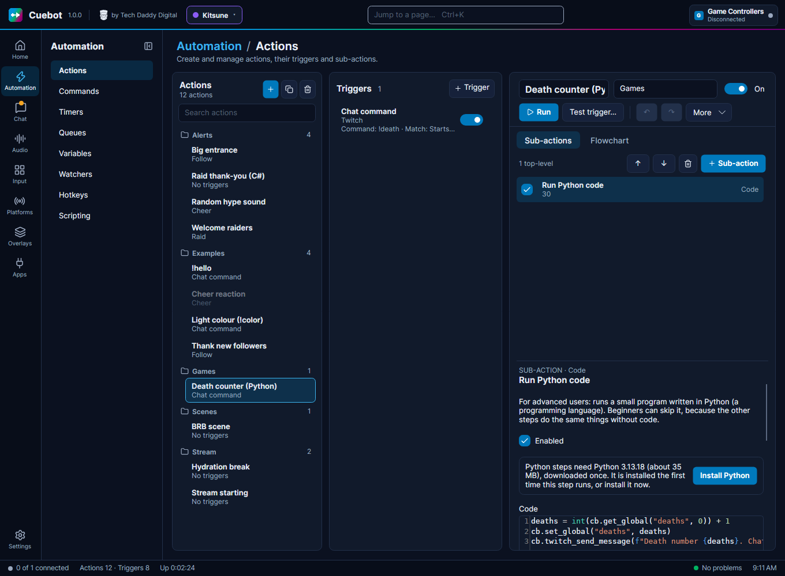

<!-- Generated by DeveloperReferenceTests from the code and src/Cuebot.Scripting/Help. Do not edit by hand. -->
# Actions script functions

Functions for C# (`Cb.Call`) and Python (a `cb` method each, or `cb.call`). See [Script functions](index.md) for how to use them.



## actions.cancel

Stops the runs of an action that are going on or waiting in a queue. A run stops at its next step or wait. Fails when no action has that name.

| Value | In Python | What to put in |
| --- | --- | --- |
| `name` | `name` | The action's name. Leave it empty for the action this script is in. |
| `includePending` | `include_pending` | Optional. false leaves runs waiting in a queue alone. Starts as true. |
| `includeThisRun` | `include_this_run` | Optional. true also stops the run this script is in. Starts as false, which keeps this run and whatever started it going. |

**Gives back:** How many runs were cancelled.

=== "C#"

    ```csharp
    var answer = await Cb.Call("actions.cancel", new { name = "Shoutout" });
    ```

=== "Python"

    ```python
    answer = cb.actions_cancel(name="Shoutout")
    ```

## actions.run

Runs another action by its name and waits until it is done. It gets a copy of this action's variables. Fails when no action has that name.

| Value | In Python | What to put in |
| --- | --- | --- |
| `name` | `name` | The action's name as shown on the Actions page, like "Shoutout". Upper or lower case does not matter. |

**Gives back:** true when the action finished without errors, otherwise false.

=== "C#"

    ```csharp
    var answer = await Cb.Call("actions.run", new { name = "Shoutout" });
    ```

=== "Python"

    ```python
    answer = cb.actions_run(name="Shoutout")
    ```
