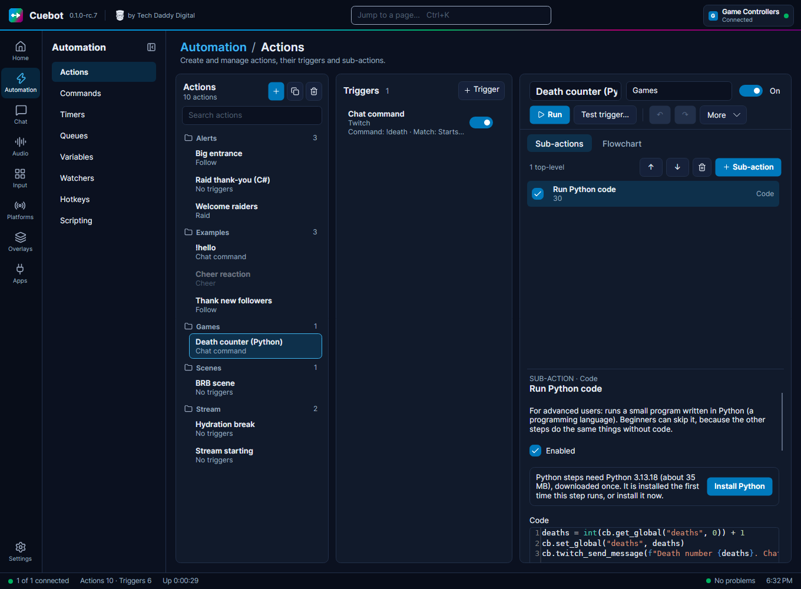

<!-- Generated by DeveloperReferenceTests from the code and src/Cuebot.Scripting/Help. Do not edit by hand. -->
# Script functions



Script functions are Cuebot's own tools for code. **C# and Python can both use them.** Each one has a name, like `speech.speak`, and takes named values, like `text`.

```csharp
// C#: await the call; the answer is JSON
var answer = await Cb.Call("speech.speak", new { text = "Hello!" });
```

```python
# Python: no await needed, and every function has its own method
answer = cb.speech_speak(text="Hello!")
```

In C#, `Cb.Call` works in plain C# code. Inside a Streamer.bot-style `CPHInline` class, use the [`CPH` methods](../csharp/index.md) instead. See [Writing code (C# and Python)](../../guides/developers/writing-code.md) for whole examples.

## In Python

In Python every function is also a method of `cb`, named after it in Python style: `vtubestudio.moveModel` is `cb.vtubestudio_move_model(...)`, and its value `positionX` is `position_x`. Values marked Optional can be left out; the others can also be given in order, like `cb.twitch_send_message("Hi!")`. A value of `None` counts as left out. `cb.call("vtubestudio.moveModel", positionX=0.5)` still works too.

`help(cb.vtubestudio_move_model)` in your code prints a method's help. For completion in a code editor such as VS Code, download [cuebot.pyi](cuebot.pyi) and put it next to your script.

## Areas

| Area | Functions |
| --- | --- |
| [Actions](actions.md) | 1 |
| [Arguments](args.md) | 4 |
| [Game controllers](controllers.md) | 7 |
| [Credits](credits.md) | 4 |
| [Crowd Control](crowdcontrol.md) | 3 |
| [Desktop](desktop.md) | 3 |
| [DonorDrive](donordrive.md) | 3 |
| [Elgato](elgato.md) | 15 |
| [Emotes](emotes.md) | 3 |
| [Global variables](globals.md) | 6 |
| [Goals](goals.md) | 6 |
| [GoXLR](goxlr.md) | 20 |
| [Groups](groups.md) | 9 |
| [Heart rate](heartrate.md) | 1 |
| [Hotkeys](hotkeys.md) | 2 |
| [HypeRate](hyperate.md) | 1 |
| [Keyboard and mouse](input.md) | 2 |
| [Kick](kick.md) | 10 |
| [Log](log.md) | 1 |
| [Lumia Stream](lumia.md) | 13 |
| [Meld Studio](meldstudio.md) | 19 |
| [MIDI](midi.md) | 12 |
| [mtion studio](mtion.md) | 5 |
| [Now playing](nowplaying.md) | 2 |
| [OBS](obs.md) | 5 |
| [OBSBOT](obsbot.md) | 8 |
| [Pally.gg](pally.md) | 2 |
| [Points](points.md) | 13 |
| [PolyPop](polypop.md) | 2 |
| [Pronouns](pronouns.md) | 1 |
| [Pulsoid](pulsoid.md) | 1 |
| [Quotes](quotes.md) | 8 |
| [Remote instances](remote.md) | 3 |
| [Rumble](rumble.md) | 1 |
| [Streamlabs Desktop](slobs.md) | 2 |
| [Speech](speech.md) | 10 |
| [Spending](spending.md) | 6 |
| [Spotify](spotify.md) | 2 |
| [Steps](steps.md) | 4 |
| [Stream Deck](streamdeck.md) | 9 |
| [StreamElements](streamelements.md) | 7 |
| [Streamlabs](streamlabs.md) | 2 |
| [Streamloots](streamloots.md) | 2 |
| [Subathon](subathon.md) | 9 |
| [Text](text.md) | 1 |
| [TipeeeStream](tipeeestream.md) | 2 |
| [T.I.T.S.](tits.md) | 9 |
| [Import and export](transfer.md) | 1 |
| [TreatStream](treatstream.md) | 2 |
| [Twitch](twitch.md) | 118 |
| [User variables](uservars.md) | 7 |
| [Voice control](voicecontrol.md) | 10 |
| [Voicemod](voicemod.md) | 14 |
| [VTube Studio](vtubestudio.md) | 10 |
| [Wave Link](wavelink.md) | 25 |
| [Webhooks](webhooks.md) | 2 |
| [WebSocket](websocket.md) | 13 |
| [YouTube](youtube.md) | 25 |
