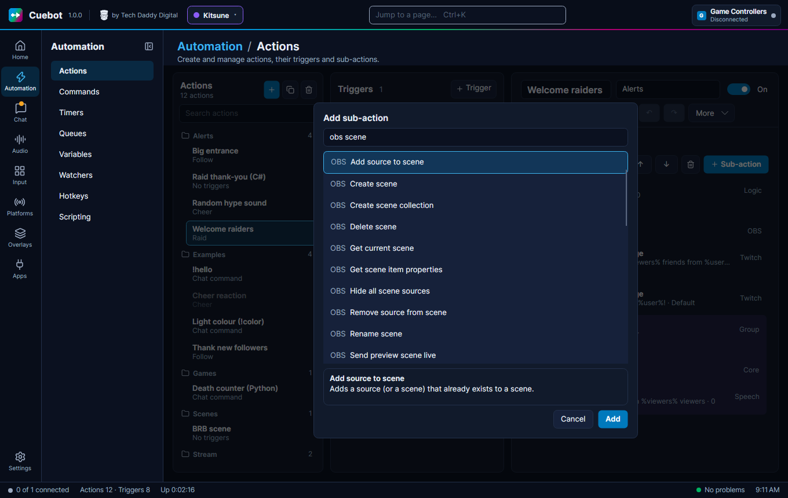

<!-- Generated by ActionHelpTests from src/Cuebot.Core/Help. Do not edit by hand. -->
# Discord sub-actions

## Basic webhook

Posts a message in a Discord channel through a webhook (a private address Discord gives you for that channel). It can send embeds and link buttons, post in a thread or start a forum post. To give roles or answer slash commands, use the Discord bot instead.

| Setting | What to put in |
| --- | --- |
| **Webhook name** | A name for you to remember this webhook by. It is not sent to Discord. |
| **Webhook URL** | The webhook link. Copy it in Discord: Server Settings, Integrations, Webhooks, then Copy Webhook URL. Keep it private. |
| **Content** | The message text. Up to 2000 letters. To ping someone use <@USER_ID>, for a role use <@&ROLE_ID>. |
| **Username** | The name shown as the sender. Empty uses the webhook's own name. |
| **Avatar URL** | Web link to a picture for the sender. Empty uses the webhook's own picture. |
| **Text to speech** | Tick to let Discord read the message out loud to people watching that channel. Starts as: `false`. |
| **Message body** | Simple sends the Content text. JSON sends the Message JSON instead, for embeds and link buttons. Options: Simple, JSON. Starts as: `Simple`. |
| **Message JSON** | Used when Message body is JSON. Paste Discord webhook JSON or a Discohook export. Put %variables% inside quotes. Only mentions you typed here can ping people, so a viewer's name cannot ping @everyone. |
| **Thread ID** | Optional. The ID of a thread or forum post to post in. |
| **New forum post title** | Optional, for forum channels: starts a new post with this title. Use this or Thread ID, not both. |
| **Remember it as** | A name like "live post", so a later step can edit or delete this message, even after a restart. |

**Variables it adds**

| Variable | What it holds |
| --- | --- |
| `%discordMessageId%` | ID of the Discord message that was posted |
| `%messageId%` | The same ID. This replaces the chat message ID from the trigger, so use %discordMessageId% when you need both |
| `%discordChannelId%` | ID of the channel it was posted in (the thread's ID for a thread or forum post) |
| `%discordThreadId%` | ID of the thread or forum post, empty for a normal channel |

<small>Type id: `discord.basicWebhook`</small>

## Delete message (bot)

Deletes a message your bot posted earlier.

| Setting | What to put in |
| --- | --- |
| **Message** | Which message: the name you typed in "Remember it as" when posting it, like "live post". A message link works too. Starts as: `%discordMessageLink%`. |

<small>Type id: `discord.deleteMessage`</small>

## Delete webhook message

Deletes a message that a webhook posted earlier. Only the same webhook can delete it.

| Setting | What to put in |
| --- | --- |
| **Webhook URL** | The link of the webhook that posted the message. |
| **Message** | Which message: the name you typed in "Remember it as", a message ID, or a message link. Starts as: `%discordMessageId%`. |
| **Thread ID** | The thread or forum post the message is in. Not needed when you use a remembered name. |

<small>Type id: `discord.deleteWebhookMessage`</small>

## Edit message (bot)

Changes a message your bot posted earlier. Handy to turn your "I'm live!" post into "Stream ended, thanks for watching".

| Setting | What to put in |
| --- | --- |
| **Message** | Which message: the name you typed in "Remember it as" when posting it, like "live post". A message link works too. Starts as: `%discordMessageLink%`. |
| **New text** | The new text. Leave it empty to keep the old text and change only the embed. |
| **Embed title** | The new embed title. Fill in any embed box to replace the whole embed. |
| **Embed text** | The new text inside the embed. |
| **Embed link** | The new link for the embed's title. |
| **Embed colour** | The new colour, like #808080 for grey. |
| **Embed image URL** | A web link to a new picture. |
| **Remove the embed** | Tick to take the embed off the message (when you leave the embed boxes empty). Starts as: `false`. |

<small>Type id: `discord.editMessage`</small>

## Edit webhook message

Changes a message that a webhook posted earlier, such as turning "we're live" into "thanks for watching". Only the same webhook can edit it.

| Setting | What to put in |
| --- | --- |
| **Webhook URL** | The link of the webhook that posted the message. |
| **Message** | Which message: the name you typed in "Remember it as", a message ID, or a message link. Starts as: `%discordMessageId%`. |
| **Message body** | Simple replaces the text with Content. JSON sends the Message JSON, for embeds and link buttons. Options: Simple, JSON. Starts as: `Simple`. |
| **Content** | The new text, used when Message body is Simple. Up to 2000 letters. |
| **Message JSON** | Used when Message body is JSON. Paste Discord webhook JSON or a Discohook export. Parts you leave out stay as they are. Put %variables% inside quotes. |
| **Thread ID** | The thread or forum post the message is in. Not needed when you use a remembered name. |

**Variables it adds**

| Variable | What it holds |
| --- | --- |
| `%discordMessageId%` | ID of the message that was edited |
| `%discordChannelId%` | ID of its channel or thread |

<small>Type id: `discord.editWebhookMessage`</small>

## Give a role

Gives someone a role in your Discord server, like "Live notifications". The bot's own role must be above that role in Server Settings, Roles.

| Setting | What to put in |
| --- | --- |
| **Member** | Who gets the role: %userId% from a Discord trigger, a user ID, or their name in the server. |
| **Role** | The role to give. Pick it from the list or type its name exactly. |
| **Reason** | A note shown in your server's audit log, like "Asked with /notify". You can leave it empty. |

<small>Type id: `discord.addRole`</small>

## Reply to slash command

Answers the slash command that started this action. Using it twice sends a second message. Without it the bot answers with the default reply.

| Setting | What to put in |
| --- | --- |
| **Answer** | The answer, up to 2000 characters, like "Find me on twitch.tv/yourname". |
| **Embed title** | An embed title for the answer. Leave every embed box empty for plain text. |
| **Embed text** | The text inside the embed. |
| **Embed link** | A web link: clicking the title opens it. |
| **Embed colour** | The colour of the embed's edge, like #9146FF. |
| **Embed image URL** | A web link to a picture shown in the embed. |
| **Slash command use** | Which command use to answer. Leave it as %discordInteractionId%. Starts as: `%discordInteractionId%`. |

<small>Type id: `discord.replyToSlashCommand`</small>

## Send a direct message

Sends a private message from your bot to one person in your server. Some people block messages from servers, so it may not arrive.

| Setting | What to put in |
| --- | --- |
| **Member** | Who gets it: %userId% from a Discord trigger, a user ID, or their name in your server. |
| **Text** | The message, up to 2000 characters. %variables% work here. |

<small>Type id: `discord.sendDirectMessage`</small>

## Send message (bot)

Posts a message with your own Discord bot, like your "I'm live!" post. It can have an embed (a coloured box with a title, text and picture).

| Setting | What to put in |
| --- | --- |
| **Channel** | The channel to post in. Pick it from the list (it shows your bot's servers), or type its name like #announcements. |
| **Text** | The message, up to 2000 characters. %variables% work, like "I'm live! Come say hi, %user%". To ping a role, use <@&ROLE_ID>. |
| **Embed title** | The embed's title, like "I'm live!". Leave every embed box empty for a plain message. |
| **Embed text** | The text inside the embed. Can be long (up to 4096 characters). |
| **Embed link** | A web link: clicking the title opens it. Your stream link is a good choice. |
| **Embed colour** | The colour of the embed's edge, like #9146FF. Words work too: twitch, youtube, kick, red, green, blue, purple. |
| **Embed image URL** | A web link to a picture shown big in the embed, like your stream thumbnail. |
| **Remember it as** | A name like "live post". Cuebot saves where the message is under this name, so the edit or delete step can find it later, even after a restart. |

**Variables it adds**

| Variable | What it holds |
| --- | --- |
| `%discordMessageLink%` | A link to the message that was posted |
| `%discordMessageId%` | The message's ID |
| `%discordChannelId%` | The ID of the channel it was posted in |

<small>Type id: `discord.sendMessage`</small>

## Set the bot's status

Changes what people see under your bot's name, like "Watching my stream". Needs the bot to be connected.

| Setting | What to put in |
| --- | --- |
| **Status** | The coloured dot: Online (green), Away (yellow), Do not disturb (red) or Invisible. Options: Online, Away, Do not disturb, Invisible. Starts as: `Online`. |
| **Activity** | The word before your text: Playing, Streaming, Listening to, Watching or Competing in. "Just the text" shows only your text. "No activity" clears it. Options: No activity, Playing …, Streaming …, Listening to …, Watching …, Competing in …, Just the text. Starts as: `Watching …`. |
| **Activity text** | What it says after that word, like "my stream". |
| **Stream link** | Only for Streaming: your Twitch or YouTube channel link, so the status turns purple and links to it. |

<small>Type id: `discord.setStatus`</small>

## Take away a role

Takes a role away from someone in your Discord server. The bot's own role must be above that role in Server Settings, Roles.

| Setting | What to put in |
| --- | --- |
| **Member** | Who loses the role: %userId% from a Discord trigger, a user ID, or their name in the server. |
| **Role** | The role to take away. Pick it from the list or type its name exactly. |
| **Reason** | A note shown in your server's audit log. You can leave it empty. |

<small>Type id: `discord.removeRole`</small>
