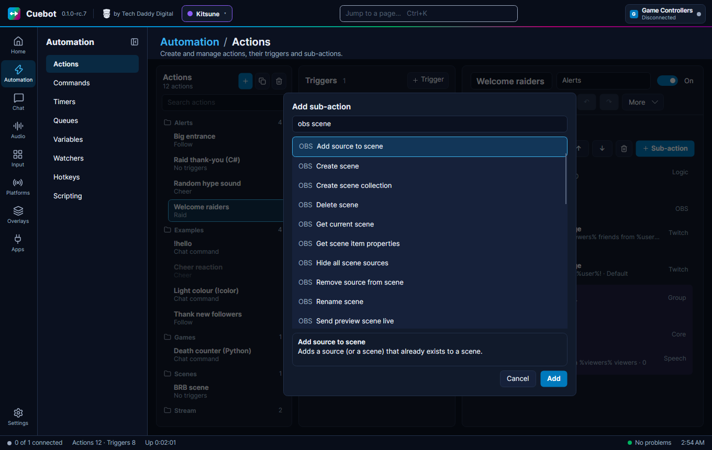

<!-- Generated by ActionHelpTests from src/Cuebot.Core/Help. Do not edit by hand. -->
# Ko-fi sub-actions

## Add a commission

Adds a commission to the list by hand. Ko-fi commissions are added for you.

| Setting | What to put in |
| --- | --- |
| **Who** | Who it is for. Starts as: `%user%`. |
| **What they asked for** | What they asked for. Starts as: `%message%`. |
| **Amount** | What they paid. Leave 0 if you like. Starts as: `0`. |
| **Currency** | The currency code, like USD. |

**Variables it adds**

| Variable | What it holds |
| --- | --- |
| `%commissionId%` | The new commission's id |
| `%commissionsOpen%` | How many commissions are open now |

<small>Type id: `kofi.addCommission`</small>

## Add to the Ko-fi goal

Adds an amount to the Ko-fi goal by hand, like money that came in another way. A negative number takes it away.

| Setting | What to put in |
| --- | --- |
| **Amount** | How much to add, like 5. Use -5 to take 5 away. Starts as: `5`. |

**Variables it adds**

| Variable | What it holds |
| --- | --- |
| `%kofiGoalTitle%` | The goal's title |
| `%kofiGoalCurrent%` | The progress |
| `%kofiGoalTarget%` | The target |
| `%kofiGoalPercent%` | The progress in whole percent |
| `%kofiGoalCurrency%` | The currency the goal counts |

<small>Type id: `kofi.addToGoal`</small>

## Clear done commissions

Removes done commissions from the list.

| Setting | What to put in |
| --- | --- |
| **Clear open ones too** | Tick to remove open ones too (empties the list). Starts as: `false`. |

**Variables it adds**

| Variable | What it holds |
| --- | --- |
| `%commissionsCleared%` | How many were removed |

<small>Type id: `kofi.clearCommissions`</small>

## Get open commissions

Reads the open commissions, oldest first. Handy for a !queue chat command.

**Variables it adds**

| Variable | What it holds |
| --- | --- |
| `%commissionsOpen%` | How many are open |
| `%commissionsText%` | The list as one line, like "1. Ana: a cat portrait; 2. Ben: a logo" |
| `%commission0.name%` | The oldest one's name (commission1... for the next) |
| `%commission0.text%` | What they asked for |
| `%commission0.id%` | Its id |
| `%commission0.amount%` | What they paid |

<small>Type id: `kofi.getCommissions`</small>

## Get the Ko-fi goal

Reads the Ko-fi goal Cuebot keeps, so you can say it in chat or show it.

**Variables it adds**

| Variable | What it holds |
| --- | --- |
| `%kofiGoalTitle%` | The goal's title |
| `%kofiGoalCurrent%` | The progress |
| `%kofiGoalTarget%` | The target |
| `%kofiGoalPercent%` | The progress in whole percent |
| `%kofiGoalCurrency%` | The currency the goal counts |

<small>Type id: `kofi.getGoal`</small>

## Mark a commission done

Marks a commission done, so it leaves the open list and overlays.

| Setting | What to put in |
| --- | --- |
| **Which** | Leave empty for the oldest open one. Or type its number in the list (1 is the oldest), or its id. |

**Variables it adds**

| Variable | What it holds |
| --- | --- |
| `%commissionFound%` | False when there was no such open commission |
| `%commissionName%` | Who it was for |
| `%commissionText%` | What they asked for |
| `%commissionsOpen%` | How many are still open |

<small>Type id: `kofi.completeCommission`</small>

## Reset the Ko-fi goal

Starts the Ko-fi goal again from its start amount.

| Setting | What to put in |
| --- | --- |
| **Also clear the start amount** | Tick to set the start amount to 0 too. Starts as: `false`. |

**Variables it adds**

| Variable | What it holds |
| --- | --- |
| `%kofiGoalTitle%` | The goal's title |
| `%kofiGoalCurrent%` | The progress |
| `%kofiGoalTarget%` | The target |
| `%kofiGoalPercent%` | The progress in whole percent |
| `%kofiGoalCurrency%` | The currency the goal counts |

<small>Type id: `kofi.resetGoal`</small>

## Set the Ko-fi goal

Changes the Ko-fi goal. Handy for a chat command that sets a new target. Empty boxes keep what is there.

| Setting | What to put in |
| --- | --- |
| **Title** | The goal's new name. Leave empty to keep it. |
| **Target** | The new target, like 200. 0 turns the goal off. Leave empty to keep it. |
| **Raised before Cuebot counted** | What your Ko-fi goal already showed before Cuebot counted. Leave empty to keep it. |
| **Currency** | Only payments in this currency count, like USD. Leave empty to keep it. |

**Variables it adds**

| Variable | What it holds |
| --- | --- |
| `%kofiGoalTitle%` | The goal's title |
| `%kofiGoalCurrent%` | The progress |
| `%kofiGoalTarget%` | The target |
| `%kofiGoalPercent%` | The progress in whole percent |
| `%kofiGoalCurrency%` | The currency the goal counts |

<small>Type id: `kofi.setGoal`</small>
