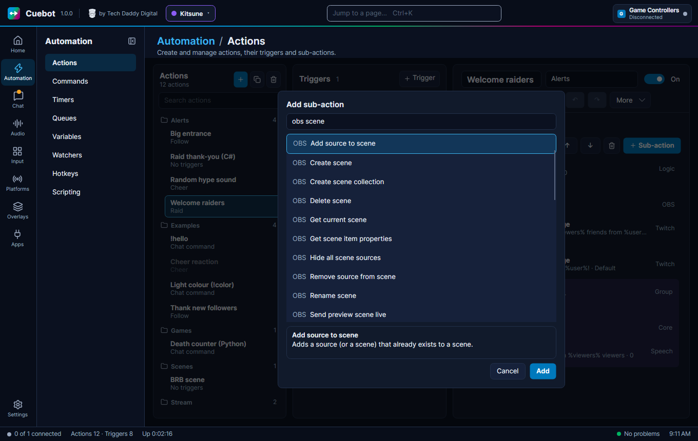

<!-- Generated by ActionHelpTests from src/Cuebot.Core/Help. Do not edit by hand. -->
# Stream totals sub-actions

## Choose when this stream's totals reset

Chooses when this stream's totals start again: 15 minutes after your last platform goes offline, or only by hand.

| Setting | What to put in |
| --- | --- |
| **Reset** | 15 minutes after going offline, or Only by hand. Options: 15 minutes after going offline, Only by hand. Starts as: `15 minutes after going offline`. |

<small>Type id: `streamTotals.resetMode`</small>

## Get a stream total

Gets one of your stream totals (a count, an amount, the latest entry and the top donation), for a !subs or !tips command.

| Setting | What to put in |
| --- | --- |
| **Type** | What kind of event: follower, subscriber, tip, cheer, raid, superchat, kicks and so on. |
| **Period** | This stream, this week, this month or all time. Options: This stream, This week, This month, All time. Starts as: `This stream`. |

**Variables it adds**

| Variable | What it holds |
| --- | --- |
| `%totalType%` | The type you picked |
| `%totalPeriod%` | The period you picked (session, week, month or total) |
| `%totalCount%` | How many events |
| `%totalAmount%` | The amount added up (for follows and subs, the same as the count) |
| `%totalGoal%` | The type's goal (0 when there is none) |
| `%latestName%` | Who was the latest |
| `%latestAmount%` | The latest amount |
| `%topDonationName%` | Who gave the biggest single amount in that period |
| `%topDonationAmount%` | That amount |
| `%topDonatorName%` | Who gave the most in all in that period |
| `%topDonatorAmount%` | How much they gave in all |

<small>Type id: `streamTotals.get`</small>

## Remove stored events from the totals

Takes stored events out of the totals and recalculates everything they counted in. By default it removes test and emulated events, for example after setting up overlays.

| Setting | What to put in |
| --- | --- |
| **Only test events** | Ticked: only test and emulated events. Starts as: `true`. |
| **Type** | Only this type. Leave it empty for every type. |
| **Platform** | Only events from this platform or service. Leave it empty for all. |
| **From** | Only events from this date and time on, like 2026-11-17 18:00. Leave it empty for the oldest. |
| **To** | Only events up to this date and time. Leave it empty for now. |

**Variables it adds**

| Variable | What it holds |
| --- | --- |
| `%removedEvents%` | How many events were removed |

<small>Type id: `streamTotals.removeEvents`</small>

## Reset this stream's totals

Starts this stream's totals again from zero. Week, month and all-time totals are kept.

<small>Type id: `streamTotals.reset`</small>

## Set a stream total

Changes a total by hand, for example to fix a count after a test or to carry over a total from another bot.

| Setting | What to put in |
| --- | --- |
| **Type** | What kind of event: follower, subscriber, tip, cheer and so on. |
| **Period** | This stream, this week, this month or all time. Options: This stream, This week, This month, All time. Starts as: `This stream`. |
| **Count** | The new count. Leave it empty to keep it. |
| **Amount** | The new amount. Leave it empty to keep it. For follows and subs the amount follows the count. |

<small>Type id: `streamTotals.set`</small>

## Set a stream total's goal

Sets the goal a goal bar shows for one type, like 100 followers.

| Setting | What to put in |
| --- | --- |
| **Type** | What kind of event: follower, subscriber, tip, cheer and so on. |
| **Goal** | The goal. 0 clears it. Starts as: `100`. |

<small>Type id: `streamTotals.setGoal`</small>

## Set or clear a latest entry

Changes or clears the latest entry of one type (what a 'latest tip' label shows).

| Setting | What to put in |
| --- | --- |
| **Type** | What kind of event: follower, subscriber, tip, cheer and so on. |
| **Name** | The name to show. Leave it empty to clear the latest entry. |
| **Amount** | The amount to show. Starts as: `0`. |

<small>Type id: `streamTotals.setLatest`</small>

## Set or clear a top donation

Changes or clears the top donation (the biggest single amount) of one type for a period.

| Setting | What to put in |
| --- | --- |
| **Type** | tip, cheer, superchat, kicks, jewels, merch and so on. |
| **Period** | This stream, this week, this month or all time. Options: This stream, This week, This month, All time. Starts as: `All time`. |
| **Name** | Who gave it. Leave it empty to clear the top donation. |
| **Amount** | How much. Starts as: `0`. |

<small>Type id: `streamTotals.setTopDonation`</small>
