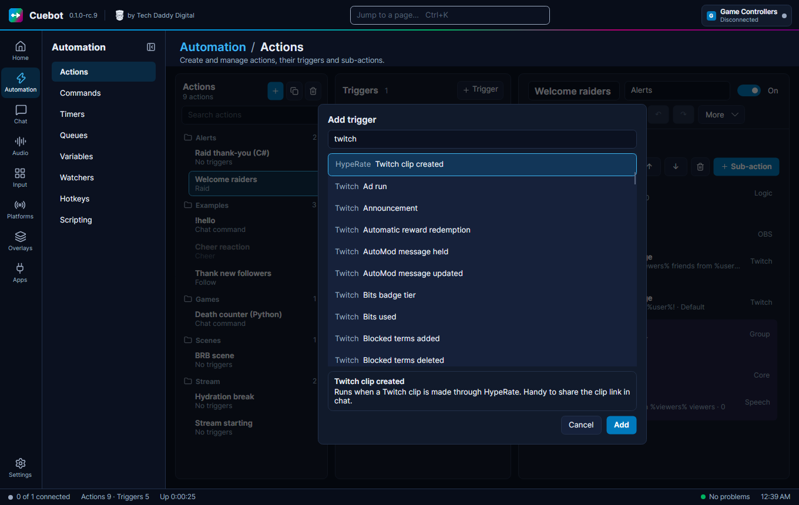

<!-- Generated by ActionHelpTests from src/Cuebot.Core/Help. Do not edit by hand. -->
# Animaze triggers

## Avatar changed

Runs when Animaze switches to another avatar, whoever switched it (you, Cuebot or another app).

| Setting | What to put in |
| --- | --- |
| **Avatars** | Only react to these avatars. Separate several with commas. Leave empty for any. |

**Variables you get**

| Variable | What it holds |
| --- | --- |
| `%animaze.host%` | The computer Animaze runs on |
| `%animaze.port%` | The port number it uses |
| `%avatar%` | The avatar now showing |
| `%previousAvatar%` | The avatar before (empty if Cuebot did not know it) |

<small>Type id: `animaze.avatarChanged`</small>

## Connected

Runs when Cuebot connects to Animaze.

**Variables you get**

| Variable | What it holds |
| --- | --- |
| `%animaze.host%` | The computer Animaze runs on |
| `%animaze.port%` | The port number it uses |

<small>Type id: `animaze.connected`</small>

## Disconnected

Runs when the connection to Animaze drops, for example because you closed it.

**Variables you get**

| Variable | What it holds |
| --- | --- |
| `%animaze.host%` | The computer Animaze runs on |
| `%animaze.port%` | The port number it uses |
| `%reason%` | Why it dropped |

<small>Type id: `animaze.disconnected`</small>
