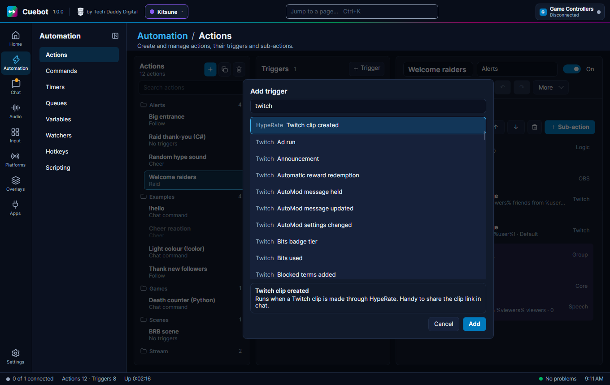

<!-- Generated by ActionHelpTests from src/Cuebot.Core/Help. Do not edit by hand. -->
# Commands triggers

## Command cooldown

Runs when a viewer tries a command that is still cooling down, so it did not run. Good for a friendly reply like "wait 30 more seconds". The broadcaster is never blocked.

| Setting | What to put in |
| --- | --- |
| **Command** | The command's name from the Commands page. Empty means every command. |

**Variables you get**

| Variable | What it holds |
| --- | --- |
| `%user%` | The viewer who tried the command |
| `%commandName%` | The command's name |
| `%remaining%` | How many seconds are left before it works again |
| `%cooldownType%` | Whether the wait is for everyone (Global) or just this viewer (User) |
| `%platform%` | The site the viewer is on, like twitch |

<small>Type id: `command.cooldown`</small>

## Command denied

Runs when a viewer tries a command they are not allowed to use, so it did not run. Good for a reply like "this one is for followers". It runs at most once every 5 seconds per viewer and command.

| Setting | What to put in |
| --- | --- |
| **Command** | The command's name from the Commands page. Empty means every command. |

**Variables you get**

| Variable | What it holds |
| --- | --- |
| `%user%` | The viewer who tried the command |
| `%commandName%` | The command's name |
| `%deniedReason%` | Why: role, denyList, notFollower, tier or statusUnknown (the platform could not be asked) |
| `%requiredRole%` | The command's minimum role |
| `%platform%` | The site the viewer is on, like twitch |

<small>Type id: `command.denied`</small>

## Command triggered

Runs when a viewer uses one of your chat commands, like !hello. You make commands on the Commands page. This trigger lets any action react to a command.

| Setting | What to put in |
| --- | --- |
| **Command** | The command's name from the Commands page. Empty means every command. |

**Variables you get**

| Variable | What it holds |
| --- | --- |
| `%user%` | The viewer who used the command |
| `%message%` | The whole chat message |
| `%rawInput%` | Only the text after the command, like "kris 50" in "!give kris 50" |
| `%input0%` | The first word after the command (input1 is the second, and so on) |
| `%inputCount%` | How many words came after the command |
| `%commandName%` | The command's name |
| `%counter%` | How many times this command has been used |
| `%userCounter%` | How many times this viewer has used it |
| `%platform%` | The site the viewer is on, like twitch |

<small>Type id: `command.triggered`</small>
