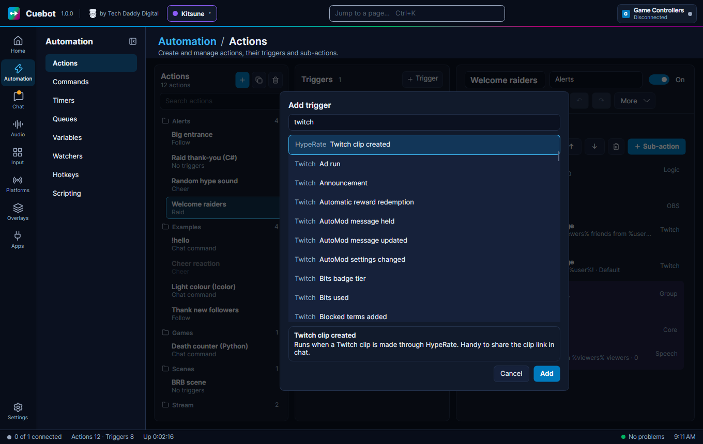

<!-- Generated by ActionHelpTests from src/Cuebot.Core/Help. Do not edit by hand. -->
# Games triggers

## Game started (Steam)

Runs when you start a game on Steam. Streaming tools from Steam, like VTube Studio or VBridger, never count: they are on the Game categories page's list of apps that are never a game. Turn on "Watch Steam for games" on that page first.

| Setting | What to put in |
| --- | --- |
| **Game** | Only this game, written as Steam names it, like Helldivers 2. Leave it empty to react to every game. |

**Variables you get**

| Variable | What it holds |
| --- | --- |
| `%game%` | The game's name as Steam shows it |
| `%steamAppId%` | The game's number in the Steam store (0 when you tried it with Ask now) |
| `%source%` | Where Cuebot saw the game: steam, or test when you used Ask now |

<small>Type id: `steam.gameStarted`</small>

## Game stopped (Steam)

Runs when the game you were playing on Steam closes, or another game takes its place. A game that is gone for only a few seconds, like a quick restart, does not count.

| Setting | What to put in |
| --- | --- |
| **Game** | Only this game, written as Steam names it. Leave it empty to react to every game. |

**Variables you get**

| Variable | What it holds |
| --- | --- |
| `%game%` | The game's name as Steam shows it |
| `%steamAppId%` | The game's number in the Steam store |
| `%source%` | Where Cuebot saw the game: steam |

<small>Type id: `steam.gameStopped`</small>

## Request answered

Runs when someone answers one of Cuebot's requests, like switching the stream category to the game you play. You, a mod on the mod portal or the companion app can answer.

**Variables you get**

| Variable | What it holds |
| --- | --- |
| `%title%` | The question, like "Switch the stream category to Helldivers 2?" |
| `%detail%` | What it would change, like "Twitch: Helldivers 2 · Kick: Helldivers 2" |
| `%kind%` | What kind of request it was: category |
| `%answer%` | Accept, AcceptAndRemember (the "Always" answer) or Decline |
| `%by%` | Who answered, like "You (desktop)" or a mod's name |
| `%result%` | done, declined, failed or notPending |
| `%message%` | What Cuebot says happened, like "Category switched on Twitch (Helldivers 2)." |
| `%requestId%` | The request's id |

<small>Type id: `requests.decided`</small>
